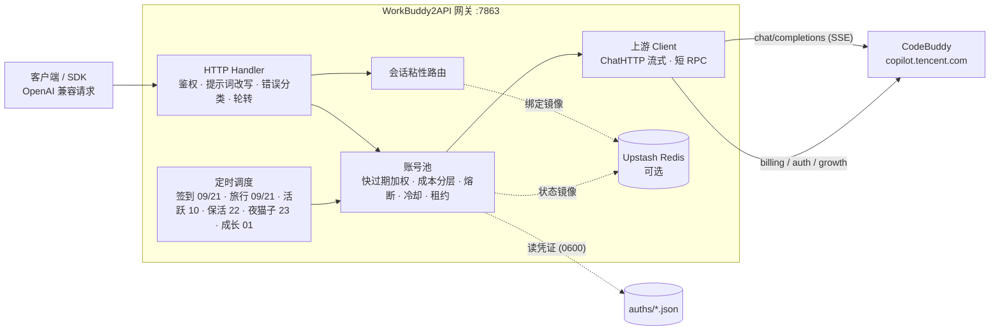

<p align="center">
  
</p>

<h1 align="center">WorkBuddy2API Panel</h1>

<p align="center">
  <b>把腾讯 CodeBuddy 账号变成 OpenAI 兼容 API 的多账号网关 · 附 Web 管理面板</b><br>
  Web 面板 · OAuth 浏览器登录 · 账号池轮转 · 熔断与冷却 · 会话粘性 · 定时签到 / 活跃 / 旅行 / 保活 / 夜猫子 / 成长队列 · <b>成长任务一键完成（23/25）</b> · 流式 / 非流式 / Responses API
</p>

<p align="center">
  
  
  
  
  
</p>

---

> [!NOTE]
> **本仓库是 [`linguo2625469/workbuddy2api-panel`](https://github.com/linguo2625469/workbuddy2api-panel) 的个人维护 fork**（后者是 [`Sliverkiss/workbuddy2api`](https://github.com/Sliverkiss/workbuddy2api) 的增强分支）。
>
> fork 的主要动机：**修好 DSH（DeepSeek Harness）接入时被上游 `11-128` 通道校验拦截的提示词问题**。DSH 的 system 身份句会被 WorkBuddy 当成「非官方渠道调用」，整单返回 HTTP 400/403；本 fork 在网关侧完成脱敏、system→user 搬移重试与错误分类，DSH 侧无需修改提示词。详见 [本 fork 做了什么](#本-fork-做了什么)。
>
> 上游已停止维护；本 fork 以自用为主、按需维护：不承诺持续更新，也不保证上游协议变化后仍可用。除 DSH 提示词兼容外，还追加了 Responses API、控制面批量闸门、模型目录 / 牌价刷新、5 个专家任务与错误分类修复（见 [本 fork 做了什么](#本-fork-做了什么)）。

> [!IMPORTANT]
> **上游项目已停止维护（2026-10-21）**：后续不再更新代码、不跟进上游变化、不再处理新的 issue / PR。
>
> 原因有三：
> 1. **上游已开始禁用反代**——WorkBuddy 对非官方客户端的识别与拦截正在收紧（通道校验、账号限制等），反代通道的稳定性与存活周期已不可控，继续做适配意义有限；
> 2. **个人精力有限**——本项目本就是个人自用工具，无力长期跟进协议变化与风控对抗；
> 3. **非法转卖泛滥**——发现大量批量注册小号、对外售卖额度、二次加壳 / 卡密分发的滥用行为，与本项目初衷完全相悖。
>
> 仓库保持现状可用（已合入的修复不会回退），但请自行评估风险：**上游随时可能彻底收紧导致不可用**；因使用非官方客户端导致的账号风控 / 封禁，由使用者自行承担。
>
> **维护方式披露**：本仓库近期的 issue / PR 处置、代码审查、测试与修复实现**大量由 AI 辅助完成**（自动化编码 agent），合并与发布决策由维护者作出。请知悉后再使用或参与贡献。
>
> 本 fork 在上游停止维护后按需维护：除 DSH 提示词兼容与少量自用修复外，还追加了 Responses API、批量任务闸门、模型目录 / 牌价刷新、5 个专家任务与错误分类修复（见 [本 fork 做了什么](#本-fork-做了什么)）；不承诺持续更新，也不保证上游协议变化后仍可用。

> **血缘**：[Sliverkiss/workbuddy2api](https://github.com/Sliverkiss/workbuddy2api) → [`linguo2625469/workbuddy2api-panel`](https://github.com/linguo2625469/workbuddy2api-panel)（增强分支，含 Web 面板）→ **本 fork**。
> 上游 Sliverkiss 仓库已删除；`linguo2625469` 分支在删库前已同步至上游 `b5077d5`（第三轮，2026-09-15），并在 `73a7560`（2026-10-21）发布停止维护声明。**本 fork 以 `73a7560` 为基线**，在保留基线已有能力的前提下追加 DSH 提示词兼容、Responses API 等增量（见下）。
> 基线分支重构的可视化运维层、账号池调度、错误分类与提示词体系均保留；本 fork 的增量见 [本 fork 做了什么](#本-fork-做了什么)，基线差异见 [与上游的差异](#-与上游的差异)。

> ⚠️ **本项目仅限自用账号（签到 / 保活 / 个人工具接入），不支持同时也是禁止批量小号分发额度、二次打包或收费售卖。** 详见 [使用声明（必读）](#使用声明必读)。

## 使用声明（必读）

本项目（含上游 [Sliverkiss/workbuddy2api](https://github.com/Sliverkiss/workbuddy2api)，下同）的开发初衷只有一个：**方便个人管理自己的 CodeBuddy 账号**——自动签到、保活、给自己的本地工具提供一个 OpenAI 兼容入口。它是免费、开源、按「原样」提供的个人自用工具。

近期我们发现有人将本项目用于以下行为：

- **批量注册小号 / 收购账号，对外提供付费 API、共享池、代充等业务**；
- **二次加壳、捆绑卡密（授权码）售卖**，或以「公益服」「低价中转」等名义变相收费分发。

我们对上述行为**表达最强烈的反对**，并声明如下：

1. **一切商用 / 售卖行为与本项目及作者无关。** 本项目不授权、不支持、不参与任何面向公众的 API 售卖、账号池出租、卡密收费分发；行为人由此产生的一切后果（包括但不限于账号封禁、条款违约与法律风险）由其自行承担，与作者和贡献者无任何关系。
2. **批量注册与转售接口配额违反目标平台服务条款。** CodeBuddy / 腾讯系服务条款禁止批量注册账号及商业转售接口。上游仓库已删除、停止公开维护——我们无法断定具体原因，但此类滥用行为正在毁掉所有正常使用者的环境，请勿再消耗社区的善意。
3. **请勿购买任何「收费版」「卡密版」「公益中转版」。** 本项目永远免费开源。任何加壳、加密、捆绑收费的「版本」都是他人篡改的产物，与本项目无关；且此类分发无法审计，存在被植入后门、回传并窃取你 CodeBuddy 凭证的风险（`auths/` 中保存的是明文 accessToken / refreshToken）。**你付钱买到的不是本项目，而是把自己账号交给陌生人的机会。**
4. **关于开源协议的诚实说明。** 本项目基于 MIT 协议开源，协议允许自由使用与修改源码——这是开源的本意，我们不会收回；但 MIT 赋予的是代码层面的自由，**不赋予**以本项目名义宣传、售卖、捆绑分发，或要求作者提供支持与背书的权利。作者不为任何第三方分发版本提供支持、更新承诺或安全保证。
5. **作者保留止损的权利。** 若滥用行为持续，作者可能随时停止维护、关闭或删除仓库，且不另行通知。上游的今天可能就是本项目的明天，望自重。

如果你的用途是管理自己的账号，欢迎正常使用、反馈问题与提交 PR。

## 项目简介

WorkBuddy2API 是一个自托管的 **OpenAI 兼容反向代理网关**，将腾讯 CodeBuddy（`copilot.tencent.com`）账号包装为统一的 `/v1/chat/completions` 服务。

- 官方不提供 OpenAI 形态的开放 API，本项目通过 **OAuth 设备授权**（面板「添加账号」或 `login.sh`）获取账号凭证，在网关侧做 token 自动刷新、账号池调度与流量治理；
- 面向 **个人多账号** 场景：多账号共享、单号故障自动换号、冷却 / 熔断防止雪崩、会话粘性保证多轮上下文不跳号；
- 对客户端只暴露 OpenAI 兼容接口，现有 SDK / 前端 / 工具 **零改造接入**。

> ⚠️ 合规须知：本项目是**非官方**网关，使用 CodeBuddy 账号作为上游，**仅限本人授权账号、本机 / 私有环境测试**。详细边界见[安全与合规](#安全与合规)。

## 本 fork 做了什么

> 一句话：**让 DSH（DeepSeek Harness）的 system 提示词不再被上游 `11-128` 通道校验整单拒绝**，同时保证 user / tool 消息不被改写。

### 问题现象

DSH 会在 system prompt 里带一句固定身份句：

```text
You are an AI agent powered by DeepSeek Harness...
```

WorkBuddy 的通道校验按**逐字精确匹配**读取 system（以及历史里的 assistant 消息），命中后返回：

```text
HTTP 400 / 403
{"code":11128,"msg":"request illegal", ...}
```

也可能是不带 code 的文案：`Illegal API invocation from an unapproved channel` / `failed channel verification` / `first message is not system prompt`。

这不是账号问题，也不是内容审核（内容审核的文案是 `blocked by security policy`）——换号、重试、改 DSH 配置都没用。旧网关把它当普通 4xx 轮转，换号重试仍然 400。

### 网关侧怎么修的

| 层 | 行为 | 配置 |
|---|---|---|
| 1. 提示词模式 | 默认 `passthrough`：DSH 的 system 原样透传，保留原生指令与工具约定；需要网关人格时再显式切 `custom` / `append` | `prompt.mode` |
| 2. 已知指纹脱敏 | 对 **system / developer / assistant** 消息整句改写：DSH 身份句 → 中性身份句；Claude Code / Codex 模板句、审查插件身份句同理。**user / tool 消息逐字原样** | `features.sanitize_blacklist_fingerprints`（默认 `true`） |
| 3. system→user 搬移 | 仍撞「身份句被拒」的 11-128 时：首条 system 换成中性提示词、原文搬进首条 user（`<instructions>` 包裹）、后续 system 就地转 user；**同账号、同请求内**重发一次。成功后记住该段 system（哈希，24h / 上限 512），后续直接搬 | `features.system_as_user_fallback`（默认 `true`） |
| 4. 终止 | 搬完仍被拒（指纹在 assistant 历史里）或结构性拒绝（首条不是 system / 缺会话 id）→ 立即 `400 channel_refused` + `gateway_hint`，不再换号空转 | — |

### 口径与边界

- **只洗三类角色**：`system` / `developer` / `assistant`；`user` 与 `tool` 逐字原样。在 DSH 里讨论 `11128`、贴错误码、翻译原文、让模型读改本仓库文档都不会被改写。
- **整句替换，不做裸词替换**：只改 `You are an AI agent powered by DeepSeek Harness...` 这一整句（以及审查插件身份句），不碰单独出现的 `DeepSeek Harness` 品牌词。
- **通道拒绝 ≠ 内容审核**：`unapproved channel` / `illegal api invocation` / `request illegal` 归 `ErrChannelRefused`，走搬移重试；`blocked by security policy` 才归 `ErrContentBlocked`，走 Degraded 提示词降级。
- **不罚号**：11-128 不冷却、不熔断、不扣权重；搬移重试不占换号名额，`MaxRotate=1` 也能重试一次。
- **默认配置即可用**：`config.example.json` 已包含两个开关的 `true`；DSH 侧无需修改 system prompt。

### 验证（DSH 兼容）

```bash
# 脱敏 / system 搬移 / 11-128 分类 / handler 接线
go test ./internal/upstream ./internal/prompt ./internal/server ./cmd/server
```

起服务后让 DSH 正常对话即可。命中 11-128 时日志会出现：

```text
INFO: [server] channel refused acct=... model=... -> systemAsUser retry (sys=xxxxxxxx)
```

若随后仍返回 `channel_refused`，看响应里的 `gateway_hint`：通常是 assistant 历史（上一轮回复）里带了指纹，清掉或重开会话即可。

### 相对基线的其他增量

除 DSH 提示词兼容外，本 fork 相对基线 `73a7560` 还追加了：

| 增量 | 说明 | 详见 |
|---|---|---|
| **OpenAI Responses API** | 原生 `POST /v1/responses`（Codex CLI 直连），复用全部选号 / 冷却 / 提示词管线 | [Responses API](#responses-apicodex-直连) |
| **模型目录与牌价** | 按 2026-11-05 官方客户端快照刷新档位 / 上下文 / 输出上限；上游缺 `credits` 时用静态牌价兜底并标 `credits_reference` | [模型与档位数据维护](#模型与档位数据维护) |
| **控制面批量闸门** | `pool.batch_concurrency` 让余额刷新 / 任务扫描 / 补领清扫等按账号扇出的任务共享并发闸门与单飞 | [批量任务并发与单飞](#批量任务并发与单飞poolbatch_concurrency) |
| **5 个专家任务** | `expert_use_maidehao` / `douyinyin` / `shangjia_xuanchuan` / `bowangwang` / `WorkBuddy_Valorant` 一键完成 | [成长任务一键完成](#-成长任务一键完成2325) |
| **错误分类修复** | `6000` 模型级限流、`14003` 模型忙（含 body `retry_after` 解析） | [错误分类与账号处置](#错误分类与账号处置) |
| **模型 ID 写法** | `models.id_style`（`cn:` / `cn/`）+ `models.realm_name_prefix`，兼容 Cherry Studio / RikkaHub | [模型 ID 与客户端兼容](#模型-id-与客户端兼容cherry-studio--rikkahub) |
| **面板前端重构** | 跟随系统主题、按钮四态、毛玻璃与无障碍，并修掉 10 个前端 bug | [视觉与交互](#视觉与交互) |

### 本 fork 的提交（相对基线 `73a7560`）

共 19 个提交（`git log --oneline 73a7560..HEAD`），关键提交如下：

| 提交 | 内容 |
|---|---|
| `f661291` | 11-128 分流、派生会话键脱敏与若干运维修复 |
| `3bcb868` | DSH 指纹脱敏 + system→user 搬移重试 + 学习表 / 配置 / 面板开关 |
| `5e75d0a` | 脱敏覆盖审查插件身份句：三方 `dsh-auto-review` 四句 + 官方 `auto-review` 的 `REVIEW_POLICY` 首句 |
| `637c86e` | 对齐 magpie 粒度：只洗 system/assistant、整句替换、通道/内容错误分流、`<instructions>` 搬移 |
| `0765ef2` | 面板前端重构：跟随系统主题（无 JS 也生效）、按钮四态与加载反馈、毛玻璃 + 动效、WCAG AA 色板、13 个无标签 checkbox 转 label；并修掉 10 个前端 bug（失效接口、静态资源缓存、CSP 拦内联处理器、配置保存提示、用量账号标识、错误文本渲染等） |
| `00fedaa` | 模型 ID 支持斜杠域前缀与列表风格切换（Cherry Studio 兼容） |
| `c33772d` | 新增 OpenAI Responses API（Codex 直连） |
| `2987428` | `14003` 按模型级归置 + 认 body `retry_after`，修掉上游抖动的放大器 |
| `003cd29` | `429 code=6000` 按模型级限流处置，摘掉整号冻结 |
| `0da493a` | 按 2026-11-05 客户端快照刷新模型档位与上下文 / 输出上限 |
| `61138b6` | 补模型牌价静态兜底并透出 `credits_reference` 标记 |
| `b439c96` | 脱敏覆盖官方 `auto-review` 与三方 `dsh-auto-review` 身份句 |
| `3fea7e3` | 企业会话判据修正 + 5 个专家任务自动完成 + 账号名徽标溢出 |
| `d282249` | 控制面批量任务共享闸门与单飞，收敛多账号并发 |
| `5a9d293` / `90f2825` / `6824aa3` | 文档：fork 现状、Release / GHCR 说明、v1.15 前端重构记录 |
| `e75ea11` / `6af4a46` | 版本号：`1.14.0-panel` / `1.16.0-panel` |

> 当前版本 `1.24.3-panel`（脱敏补齐上游四条通道校验规则：身份句、per-model 身份句、system 全文产品名、`@` 路径说明的 AND 句对；后者是每轮必带、社区 2026-10-27 起复现的第三条指纹）。

## 核心能力

| 能力 | 说明 |
|---|---|
| 🔑 **OAuth 一键登录** | `login.sh` 设备授权流程，自动落盘凭证并重启容器加载新账号 |
| 🔄 **多账号池** | 快过期积分加权 + 成本分层 + 加权随机选号，Top-5 候选 + 防惊群 |
| 🛡️ **熔断与冷却** | 429 分型处置：普通限流软冷却 600s 起指数退避（封顶 `soft_rate_max`）；`6004` / `6000` 模型级冷却到上游重置；`14003` / `6021` 不罚号；`429 + 14018` 硬冷却。404 固定 60s 短冷却、402 硬冷却至次日 04:00、连续失败熔断、在途租约限流 |
| 🧲 **会话粘性** | 同一会话（`conversation_id`）尽量绑定同一账号，TTL 滚动续期，失败自动解绑，可镜像 Redis 防重启丢失 |
| 🔀 **跨域回退** | 裸名回退（`pool.cross_domain_fallback`）+ 同名模型回退（`pool.cross_domain_model_fallback`，显式 `cn:` / `global:` 也参与）：本域目录明确没有该模型或整池不可服务时，改用另一域的同名模型，cn↔global 双向，目录未知不猜 |
| ⏰ **定时任务** | 签到（09/21 点，末尾自动跑**连登管家**：兑换已解锁档位 + 抽完抽奖次数）+ 活跃上报（10 点，点亮连登 / 解锁领养 + streak 自检）+ 猫猫旅行（09/21 点，独立排程）+ token 保活（22 点）+ 夜猫子（23 点）+ 成长任务队列（01 点），六类独立开关；另有分钟级余额刷新与补领清扫 |
| ⚡ **流式 + 非流式** | 出站强制 `stream:true`；SSE 帧按规范白名单重建；非流式由本地聚合为单响应 |
| 🧭 **Responses API** | 原生 `POST /v1/responses`（Codex CLI 直连）：入站改写成 chat 请求、出站翻译成语义事件/Response 对象，复用全部选号与处置管线；无服务端会话存储（`store` 恒 false） |
| 🧠 **推理模型兼容** | DeepSeek 思维链注入（`thinking.type=enabled` + 默认档）、`reasoning_content` 多轮回填、effort 档位自动降级 |
| 🔍 **联网搜索** | `POST /v1/search/messages` 把上游 `/agenttool/v1/search` 包成 Anthropic Messages 兼容形态（DSH 等客户端的搜索 provider 零改动接入）；复用账号池选号 / 在途租约 / token 刷新 / 错误冷却，出站请求头对齐官方客户端 |
| 💬 **系统提示词体系** | 默认 `passthrough` 透传客户端 system（保留 DSH / Claude Code 原生指令）；可选 `custom` 替换、`append` 追加；撞 11-128 通道校验时把 system 搬进 user 角色单次重试，`passthrough` / `append` 遇内容策略拦截自动降级 |
| 🧩 **DSH 提示词兼容** | DSH 的 system 身份句被上游 `11-128` 拦截时：system / assistant 整句脱敏 + system→user 搬移重试一次；user / tool 逐字原样，不影响讨论错误码与仓库文档 |
| 🗑️ **指纹脱敏** | 出站请求体黑名单指纹**整句**清洗（Claude Code / Codex / DSH 身份句 / 审查插件提示词）；**只作用于 system / developer / assistant 消息**，user 与 tool 消息逐字原样 |
| 📊 **可观测** | 每请求一行表格日志（TTFB / token 速率 / 账号标签 / rid / 结果 / 积分）；`/healthz` 带 `service` 身份标识可接负载均衡 / 宿主探活 |
| 💾 **状态持久化** | 池状态本地原子落盘 + Upstash Redis 异步镜像（可选），重启择新恢复 |
| 🖥️ **Web 管理面板** | 内嵌单页面板（**默认跟随系统明暗**，可三态循环锁定；毛玻璃侧栏/顶栏/弹层 + 入场动效；八个视图）：账号运维 / 用量与积分分析（含**剩余积分走势**折线）/ **通道健康看板**（上游拦截与出站改写：双度量趋势、覆盖期、每千请求）/ 模型档位条件查询 / 在线改配置（热生效）/ 运行日志（含**调用来源 IP·UA** 与时间区间）/ 积分任务，见 [Web 管理面板](#-web-管理面板) |
| 💰 **「已省」折算** | 用量页按厂商**官网牌价**（人民币 / 百万 tokens）把 token 折成钱：左边大字「已省 ￥ + 历史累计」，右边按模型列出折算金额与占比（每行带「入/出/缓存」单价摘要），覆盖率细条与未定价 token 在金额下方；按命中 / 未命中 / 输出三段计价，DeepSeek 走**峰谷价**（工作日 9–12、14–18 高峰，其余半价），日桶按高峰小时加权。价格来自内置种子 + `data/prices.json` 手改覆盖（改完刷新即生效）。**纯展示**：不参与计费、选号、积分保底 |

## 🎯 成长任务一键完成（23/25）

官方「成长计划」的 25 个成长任务中，**23 个可在面板上一键纯 API 完成**——无需安装官方客户端、无需人工交互，点一下「一键完成」即自动推进进度、等待异步计分落定并**自动领奖**。剩余任务展示操作指引。

### 任务覆盖与奖励

| 任务 | 奖励 | 一键完成方式 |
|---|---|---|
| `first_buddy` | +300c +8e | 解锁上报 → 同意协议 → 领养第一只 Buddy |
| `create_canvas` | +300c +5e | 设计画布创建事件组（Ardot 遥测） |
| `chat_5` | +100c | 对话活跃上报 ×5（自动补足差额） |
| `Model_chat_GLM5.2` | +100c +5e | glm-5.2 真实对话一次（发一条短消息） |
| `RichMeow_Chat` | +100c +5e +UR Buddy | 桌面端对话事件链（6 事件，含成功回执） |
| `Buddy_App` | +100c +5e | Buddy 应用「发现→进入→授权」事件链 |
| `Buddy_App_QQ` | +50c +5e | 企鹅教师助手进入事件链（与上一条共用） |
| `automation_1` | +100c +5e | 定时任务创建成功事件 |
| `Library_read` | +100c +5e | 资料库阅读点击（web 域上报） |
| `template_5` | +100c +5e | 模板使用事件组 ×5 |
| `playbook_prompt` | +100c +5e | 灵感案例「做同款」发送事件 |
| `expert_5` | +100c +5e | 真实专家召唤+使用链 ×5（专家市场拉真实专家 → 真实对话 → 使用事件） |
| `Expert_team_use_3` | +100c +5e | 专家团召唤+使用链 ×3 |
| `Hp_Appearance` | +100c +5e | 主题设置 + 皮肤生效事件 |
| `Expert_lighthouse` | +100c +5e | 轻量云专家召唤+使用链（真实对话 requestId，**可免费领一个月轻量服务器**） |
| `skill_1` | +100c +5e | 真实对话 + 技能加载事件（skill_info） |
| `skill_share` | +50c +5e | 「分享一个技能给好友」：桌面指纹上报 `skill_share_channel_action` 事件链（2026-11-15 实测点亮；任务说明要求电脑端 ≥5.9.0，事件按 5.9.3 指纹报） |
| `expert_use_maidehao` | +50c +5e | 「中国电商运营专家」：任务 `jump_url` 取 expertId → 真实召唤+对话 → expert_actual_use |
| `expert_use_douyinyin` | +50c +5e | 「抖音策略师」：同上 |
| `expert_use_shangjia_xuanchuan` | +50c +5e | 「商家宣传页与海报设计师」：同上 |
| `expert_use_bowangwang` | +50c +5e | 「直播电商教练」：同上 |
| `WorkBuddy_Valorant` | +100c +5e | 「无畏契约拼豆专家」：按名查专家市场 → 真实召唤+对话 → 上报 |

> 第 23 个是 `black_cat`（夜猫子）：判据为 23:00–08:00 窗口内的 glm-5.2 对话，面板可一键、23 点排程也会自动补足；它不占上表行，奖励以面板任务元数据为准。
>
> **上游任务会轮换下架**：2026-11-15 实测当前只下发 5 条 —— `first_buddy` / `RichMeow_Chat` / `Library_read` / `wb_wechat_oa_subscribe_task` / `skill_share`（新增），其余 20 条已不在列表里；小程序口径也只剩 3 条（`Sequential_Tasks_*` / `school_season` 已下线）。本表保留历史覆盖清单，任务不存在时动作会自动跳过。

**全新账号一键全做完 ≈ +2300 credits +108 能量（按表内 22 项奖励合计；`black_cat` 另计）**，其中仅数个任务涉及真实对话（`Model_chat_GLM5.2` 一条、`expert_5`/`Expert_team_use_3`/`skill_1`/5 个专家体验任务各数条 fast-model 短对话），其余全部为行为事件上报，零对话消耗。

### 不可自动的 2 个

| 任务 | 原因 |
|---|---|
| `Expert_Philanthropy` | 需真实捐款（服务端领奖时校验捐赠回执，已实测无法绕过） |
| `wb_wechat_oa_subscribe_task` | 需真实关注「腾讯 WorkBuddy」公众号满 24h，无可校验的 API（纯上报无法证明真实关注） |

### 实现原理（简述）

任务计分走 `/v2/report` 行为上报，但**不同任务认不同客户端指纹**：CLI 指纹（`www.codebuddy.cn`）、桌面指纹（`copilot.tencent.com` + `WorkBuddy/5.5.6` UA + `workbuddy-desktop` 事件族）、web 指纹（`www.workbuddy.cn` + `x-client-platform: web`）。网关为每类任务构造对应指纹的判据事件链（`internal/upstream/desktop.go`）；专家类任务额外要求真实专家 id 与真实对话回执（`internal/panel/autotask.go` 的 expert 动作 + `internal/upstream/desktop.go` 的专家市场调用）。上报 200 ≠ 计分——面板在执行后轮询任务进度，达标即自动调用 Web 域领奖接口。

> ⚠️ 行为事件按天幂等：重复点「一键完成」不会重复扣资源，已达标的任务自动跳过。

### 🧭 任务中心（面板新视图）

「任务中心」视图把散落的任务能力收拢成一处：

- **全账号任务扫描**：一键拉取每个账号未完成的成长任务（默认口径 25 个 + 小程序口径待办，含「校园日」与「小程序首对话」；上游 2026-11 只下发 5 个，其余已下架）；可自动的 23 个按动作执行，另 2 个展示指引
- **执行队列**：把待办按账号排队执行——账号内串行（与单任务/一键完成共用互斥锁），账号间可选并发（1-3）；执行进度实时更新到每个条目
- **开学季券码**：活动已于 2026-09-24 结束，仅保留历史券码查询（顶部「查询券码」）；5 任务状态卡已下线
- **日志分频道**：运行日志按「任务 / 对话 / 系统」三个频道筛选——对话流量再大，任务结果也不会被冲掉；日志条目带频道徽标与时间

<details>
<summary><b>🎒 开学季活动（5/5 全自动）</b>——活动期至 2026-09-24，已结束；逆向成果存档，点击展开</summary>

官方「AI 好 Buddy，开学有好礼」小程序活动的 5 个任务**全部纯 API 自动完成**（挂签到排程末尾，幂等）：

| 任务 | 奖励（每日） | 判据（已逆向） |
|---|---|---|
| 分享活动 | +100c +1抽奖 | `share-complete` 直调即点亮 |
| 桌面端体验（单次） | +100c +1抽奖 | viewed 激活 + 真实 chat + 桌面六事件链 |
| 和 AI 对话 3 次 | +50c +1抽奖 | viewed 后 3 条 `chat_request_send` 埋点（无需真实会话） |
| 召唤开学季专家 | +50c +1抽奖 | viewed 后 mp 事件链（召唤×3 + 对话） |
| 学生认证 | +100c | 需微信学生真实认证，不做 |

抽奖次数自动全部抽完。期间逆向成果（cf-connect 加密通道、mp 云对话全链路）记录在本地逆向笔记 `data/desktop-task-protocol.md` §8（`data/` 已被 gitignore，未随仓库分发）。

同一活动在成长任务中心还有两条**小程序口径**任务（`X-Client-Platform: miniprogram` 专属下发，默认列表不可见，各 +100c+5e）：

| 任务 | 判据（已逆向） |
|---|---|
| `school_season` 校园日 | mini `chat_request_send` + `activityId=school_open_day_2026`（无 activityId 不点亮；accept/claim 均要求 mp 头） |
| `Sequential_Tasks_1` 小程序首对话 | mini `chat_request_send`（无 activityId，服务端按 source=mini_program 指纹关联） |

任务中心扫描自动合并 mp 口径待办；accept 带**登记回读验证**（上游存在 200+OK 但未落账的形态，未生效自动重试一次）。

</details>

### 连登兑换与抽奖（自动）

成长中心连登档位（连续登录 7/14/28 天）兑换后发放积分 / 能量 / 补签卡 / **抽奖次数**，抽奖次数只能从兑换获得。网关把它挂在每日签到排程末尾自动跑闭环（见[定时任务](#定时任务)）：档位解锁当天自动兑换、有抽奖次数自动抽完，全程无需人工盯。

## 🆚 与上游的差异

本 fork 以 `linguo2625469/workbuddy2api-panel` 的 `73a7560` 为基线。相对基线，本 fork 的增量见 [本 fork 做了什么](#本-fork-做了什么)；下面保留基线分支相对 [Sliverkiss 上游 master](https://github.com/Sliverkiss/workbuddy2api) 的差异清单（均已在真实多账号环境验证）：

### 基线分支新增

| 能力 | 说明 |
|---|---|
| **Web 管理面板** | `internal/panel`，前端 go:embed 单文件进二进制，零外部依赖。账号池可视化（健康色条 / 积分量条 / 冷却倒计时）、积分到期分布、单号运维、批量任务、日志查看、明暗主题 |
| **请求指标与脱敏日志** | 面板展示完成成功率 / HTTP 成功率 / 平均耗时 / 最近请求，响应带 `X-Request-Id`；JSONL 只归档请求元数据，不写提示词、响应正文或凭证 |
| **浏览器内 OAuth 添加账号** | 面板「添加账号」按钮完成设备授权 → 凭证落盘 → **热加载进池（免重启）**，替代命令行 `login.sh` 流程 |
| **在线配置编辑（热生效）** | 面板直接改 `config.json`：API 密钥 / `soft_rate` / 指纹脱敏与 system→user 兜底开关 / 池参数 / 任务排程**立即生效**；装配期字段（listen 等）保存后提示需重启。写入采用深合并 + 原子替换，保留未知键 |
| **积分任务体系** | 任务列表 / 接受 / 领取接口 + 面板弹窗；「一键完成」覆盖 **17 个任务**（对话 / 领养 / 桌面行为链 / 模板 / 灵感案例 / 画布 / 专家召唤 / 技能尝鲜 / 技能分享 / 主题 / 资料库 / 夜猫子等；本 fork 已扩到 23 个），推进进度、等待异步计分落定后**自动领奖**，纯 API 零客户端依赖 |
| **限时补偿可观测（issue #189）** | 官方补偿（例：「模型服务异常额外补偿 500 积分」）在账号侧可见，网关改为**先查 `compensation-status` 再决定是否领**：面板「官方补偿」卡片列出待领账号 + 领取截止倒计时（≤48h 标红）+ 逐号/全量领取按钮；**查询失败的账号在卡片上显形为红色行，不会与「没有补偿」混为一谈**；每日签到排程同步走「查→领」，**状态查询失败与领取失败一律显式告警**（旧实现把「没有 / 已领 / 领取失败」三态压成同一形态，带截止日的补偿会静默过期） |
| **首启自动生成配置** | 目录下无 `config.json` 时自动生成推荐配置（含 `crypto/rand` 随机 `api_key`），双击即开 |
| **粘性会话内容回退** | 客户端不发 `conversation_id` 时，用 `system + 首条 user` 哈希派生会话键（`d-` 前缀），通用 OpenAI 客户端也能享受粘性 |
| **余额后台刷新** | `schedule.balance_refresh_minutes`（默认 5）周期查余额并更新池，冷却账号余额恢复自动解冻 |
| **模型能力透出** | `/v1/models` 附带 `supported_efforts` / `default_effort` / 积分倍率 / 输入输出上限等上游真实字段 |
| **安全加固** | 常量时间密钥比较（`internal/httpauth`）、CSP 与安全响应头、UID 白名单防路径穿越、前端属性转义修复 |
| **领养前置修复** | 上游 `travelAdopt` 缺 report 前置导致领养恒失败于 `first_buddy task not completed yet`；基线分支修正后实测 +300 到账（3/3 账号） |
| **原生工具调用标记还原** | 上游（DeepSeek 系）的工具调用原生语法是带全角竖线的标记文本，**仅在请求声明了 `tools` 时**才被上游解析成结构化 `tool_calls`。实测 `tools` 声明在中转环节（Responses → chat/completions 等）丢失是常态，此时模型仍想调工具，标记就以纯文本落进 `content`——Codex 这类只执行结构化 `function_call` 的客户端会把它当普通正文写进会话历史，回合直接结束、工具一次都没跑。网关在出站响应里识别并还原成 `tool_calls`（流式与非流式都覆盖） |

### 同步上游

**第一轮（基线分支 `53ee3a1` → `9a87758`，34 个提交）**：四类任务独立排程、pool 文件拆分、12153 连续计数才禁用、429 `code=6004` 模型级限流收窄、11101 不罚号、请求体 413、DeepSeek 思维链、reasoning_content 回填、Codex 指纹脱敏、系统提示词体系、出站 UA 可配等。

**第二轮（`9a87758` → `ea8b1e5`，2026-09-14，只吸收底层）**：

| 上游改动 | 吸收内容 |
|---|---|
| 净化增强 | `tool_calls.arguments` 盲区修复（content=null 的工具调用轮此前完全漏净化）、裸 `11128` 反探测改写、桌面版身份句（逗号形态）漏网修复、反馈句整句改写 |
| 出站头族 | **对齐真机抓包**：UA 分 chat / RPC / billing **三族**（默认 CN `5.11.3`+`2.176.0`、global `5.9.4`+`2.165.0`，按 realm 各取各的）；chat 带 `x-stainless-*` / `X-Agent-*` / `X-Private-Data` / `b3` / `traceparent` / `baggage` 等真机头族；`X-IDE-*` 用量归属四头 + `X-Agent-Purpose`；`X-Device-Token` 设备风控头（auth 每号 / config / 文件三源，**不自造**）。**不发** `X-Machine-ID`/`X-Session-ID`（官方客户端从不发，设备标识在 `/v2/report` 的 body 里）。`upstream.identity_mode=legacy` 可一键回退改造前形态；`go run ./cmd/hdrprobe capture\|legacy` 可实打实对比两种模式的出站头 |
| 并发修复 | 客户端 IP 改按请求参数传递（消除共享字段竞态）；billing 单段 UA 形态 |
| 签到幂等 | `IsAlreadyCheckin` 识别"今天已签到"（code=10001/14001），调度日志不再把重复签到当失败 |
| 粘性按模型判活 | 会话绑定的账号被 6004/6000 模型级限额后，换模型请求自动解绑重分配（治"限额后换不动号"）；`/healthz` 探活计入模型豁免形态（治"全号被单模型限流探活误报 503"） |
| report 增强 | `ReportChatActivity` 支持独立 `requestID`（同会话多轮上报各条可区分） |

**第三轮（`ea8b1e5` → `b5077d5`，2026-09-15，基础设施优先）**：

| 上游改动 | 吸收内容 |
|---|---|
| 会话头族与请求指纹 | 出站注入 `X-Conversation-ID` / `X-Request-ID` / `Message-ID` / `X-Trace-ID` / `X-B3-*`；`prompt_cache_key` 按账号 + 会话硬隔离，复用上游前缀缓存 |
| 6004 模型级冷却 | 每账号每模型独立计时，`/status` 台账透出多模型行 |
| 请求生命周期 | 客户端断开即取消上游请求；refresh 两段式（网络 IO 移出锁）；`http.Server` 补 `ReadTimeout` / `IdleTimeout` |
| 提示词默认值 | `prompt.mode` 缺省由 `custom` 改为 `passthrough`（透传客户端 system，更保守） |
| 其他 | 11140 硬禁用、14017 软冷却、非对话模型过滤、SSE `tool_calls` name 收敛、选号防惊群、快过期积分权重调整 |

未吸收（明确不做）：脚本体系（task_runner/school 脚本—我们已有更完整的纯 API 实现）、governance/CI workflow、成本账本选号（依赖 usage.credit 观测，收益待验证）。

> 上游 Sliverkiss 仓库随后删除，`b5077d5` 是已知的最后一次上游同步点；`73a7560`（2026-10-21）是 `linguo2625469` 分支的停止维护声明提交。本 fork 即从 `73a7560` 拉出，此后不再跟进上游。

## 架构总览



上游请求在出站前经历统一的改写管线（`internal/upstream/payload.go`）：强制 `stream:true`、`developer` 角色归一、tool_choice 归一、`image_url` 字符串兼容为 OpenAI 对象形态、DeepSeek 思维链注入、`reasoning_effort` 档位降级、`reasoning_content` 回填、指纹脱敏。

## 快速开始

### 环境要求

- **Docker + Docker Compose**（服务端部署方式，镜像内已含低权限用户与常用脚本）——或
- **Windows / macOS / Linux 直接跑单文件二进制**（无需 Docker，见下方「Windows 单文件运行」）
- 一个或多个已注册的 CodeBuddy 账号，用于 OAuth 登录
- 宿主机 Go ≥ 1.22（仅从源码构建时需要）

### 方式〇：GHCR 镜像（免克隆免构建）

> ⚠️ **本 fork 与上游的镜像不是同一个**：`ghcr.io/linguo2625469/...` 是**上游镜像**，不含本 fork 的 DSH 提示词兼容、Responses API 等增量；本 fork 的镜像由 `.github/workflows/docker-ghcr.yml` 构建并发布到 `ghcr.io/renleihaokun/workbuddy2api-panel`。

本 fork 的 CI 会构建多架构镜像（`amd64` / `arm64`），`git clone` 之外的部署路径（版本号换成你要的 Release 版本；`latest` 只在 `main` 分支构建时更新，发版后请用版本 tag）：

```bash
# 1. 准备配置与数据目录
mkdir -p auths data && cp config.example.json config.json
#    ⚠️ 务必把 config.json 里的 api_key 改成随机长串（openssl rand -hex 24）：
#    示例值是空串 = 不鉴权，端口映射出去等于把账号池敞开给任何人。
#    （程序只在你"没有 config.json"时才会自动生成随机 key，cp 出来的文件不算）

# 2. 拉取并运行
docker run -d --name workbuddy2api \
  -p 7863:7863 -e TZ=Asia/Shanghai \
  -v ./auths:/app/auths -v ./data:/app/data -v ./config.json:/app/config.json \
  ghcr.io/renleihaokun/workbuddy2api-panel:1.17.6

# 3. 健康检查（无可用账号时返回 503）
curl -s http://localhost:7863/healthz
```

> **包可见性**：GitHub 仓库页 → Packages → `workbuddy2api-panel` →
> Package settings → Change visibility → Public。若 `docker pull` 仍要求登录，先检查这里。
>
> 镜像 tag 规则（fork workflow）：`main` 分支推送 `latest` / `main` / `sha-xxxxxx`；打 `v*` tag 发布
> `1.17.6` / `1.17` / `sha-xxxxxx` 语义化版本；PR 仅构建验证、不推送。

### 方式一：Docker Compose（推荐服务器部署）

```bash
# 1. 克隆
git clone https://github.com/linguo2625469/workbuddy2api-panel.git
cd workbuddy2api-panel

# 2. 准备配置（compose 挂载此文件，缺失会导致容器启动失败）
cp config.example.json config.json
#    ⚠️ 务必将 api_key 改成随机长串（openssl rand -hex 24）：示例值空串 = 不鉴权。
#    程序只在 config.json 不存在时才自动生成随机 key。

# 3. 启动（首次会构建镜像，约 1-2 分钟）
docker compose up -d --build

# 4. 健康检查（无可用账号时返回 503）
curl -s http://localhost:7863/healthz
# {"healthy":0,"total":0,"service":"workbuddy2api"}
```

启动后打开 **`http://localhost:7863/panel/`**，用面板「添加账号」完成登录（见下节）。

常用运维命令：

```bash
docker compose logs -f          # 跟踪日志
docker compose restart          # 重启
docker compose down             # 停止并移除容器（数据在 ./auths 与 ./data，不受影响）
```

### 方式二：Windows 单文件运行（无需 Docker）

```powershell
# 1) 下载 Release 中的 wb2api.exe，或从源码构建
go build -trimpath -ldflags="-s -w" -o wb2api.exe ./cmd/server

# 2) 直接运行：首次启动自动生成 config.json（含随机 api_key，日志打印一次）
.\wb2api.exe -config config.json

# 3) 浏览器打开面板添加账号
#    http://127.0.0.1:7863/panel/
```

exe 为**单文件自包含**（前端资源已 embed 进二进制），拷到任意 Windows 机器即可运行，只需保证 `auths/`（凭证）与 `data/`（状态）目录可写。

### 方式三：源码运行（开发调试）

```bash
go build ./...
go vet ./...
go test ./...                      # 完整测试套件
go run ./cmd/server -config config.json
```

构建全部二进制：

```bash
CGO_ENABLED=0 go build -trimpath -ldflags="-s -w" -o wb2api ./cmd/server
CGO_ENABLED=0 go build -trimpath -ldflags="-s -w" -o signin_bin ./cmd/signin
CGO_ENABLED=0 go build -trimpath -ldflags="-s -w" -o login ./cmd/login
CGO_ENABLED=0 go build -trimpath -ldflags="-s -w" -o credit ./cmd/credit
```

### 添加账号（登录）

**方式 A：Web 面板（推荐，各平台通用，免命令行）**

打开 `http://127.0.0.1:7863/panel/`，点右上角「**添加账号**」：面板展示授权链接 → 浏览器完成登录 → 自动检测并落盘凭证 → **热加载进池（无需重启）**，顺带完成首次签到。

**方式 B：命令行脚本（仅 Linux / macOS，依赖 bash + python3）**

```bash
./login.sh
# 按提示在浏览器打开授权链接 → 回到终端确认 → 凭证落盘 auths/workbuddy-<uid>.json
```

`login.sh` 内置授权 URL 获取 + 浏览器登录 + token 轮询 + 首次签到 + 凭证落盘 + 容器重启，全程无 PKCE（state 由服务端签发）。账号池在容器启动时用 `auths/` 目录自动对齐，新增凭证文件即自动发现。

> Windows 用户请用方式 A（或 WSL）；`login.sh` 需要 python3。

### 验证

```bash
# 模型列表
curl -s http://localhost:7863/v1/models -H "Authorization: Bearer your-api-key"

# 账号状态（汇总 + 每账号详情，disabled 账号透出 disabled_reason）
curl -s http://localhost:7863/status -H "Authorization: Bearer your-api-key"

# 流式聊天
curl -sN http://localhost:7863/v1/chat/completions \
  -H "Authorization: Bearer your-api-key" \
  -H "Content-Type: application/json" \
  -d '{"model":"deepseek-v4-flash","messages":[{"role":"user","content":"hi"}],"stream":true}'

# 非流式聊天（本地聚合）
curl -s http://localhost:7863/v1/chat/completions \
  -H "Authorization: Bearer your-api-key" \
  -H "Content-Type: application/json" \
  -d '{"model":"deepseek-v4-flash","messages":[{"role":"user","content":"hi"}],"stream":false}'

# 联网搜索（Anthropic Messages 兼容形态，走上游 /agenttool/v1/search）
curl -s http://localhost:7863/v1/search/messages \
  -H "Authorization: Bearer your-api-key" \
  -H "Content-Type: application/json" \
  -d '{"model":"deepseek-v4-flash","tools":[{"type":"web_search_20250305","name":"web_search"}],
       "messages":[{"role":"user","content":"Perform a web search for the query: OpenAI 最新模型"}]}'
```

## 配置说明

**`config.example.json` 是配置项最完整的参考**：每个字段、默认值与结构都能在其中找到。**示例值不含任何真实密钥**，`api_key` 也刻意留空（= 不鉴权）——复制后请先填一个随机长串，别用 `test_key` 这类公开占位符。下表为字段含义速查。

### 字段速查

| 字段 | 默认 | 说明 |
|---|---|---|
| `listen` | `:7863` | HTTP 监听地址 |
| `api_key` | 空 | 网关鉴权密钥；**空 = 不鉴权直接放行**（公网必须设置） |
| `auth_dir` | `./auths` | 账号凭证目录 |
| `state_file` | `./data/state.json` | 账号池状态持久化文件 |
| `dns_servers` | 空 | **出站解析**用的 DNS 服务器（数组，按顺序试，都用不上才报错）；空 = 系统解析器。/etc/resolv.conf 不存在或不可用的环境（Android、精简容器）必须显式配，否则 Go 解析器会退回 `127.0.0.1:53`，查任何域名都变成"连本机 53 端口"（`dial tcp: lookup ... on [::1]:53: connection refused`）。只换 `Transport.DialContext`，不动超时与连接池；改动需重启 |
| `server.read_timeout` | `300s` | 入站请求读取（含 body 上传）总时长上限；大上下文/文件块经反代转发超时会 400 `read body: i/o timeout`；`0` = 不限制；改动需重启（#100） |
| `panel.package_detail_limit` | `5` | 积分构成页单账号默认展示的最早到期包数；其余未用完包与已用完包聚合折叠 |
| `logging.request_archive_enabled` | `true` | 请求元数据 JSONL 归档开关；不记录提示词、响应正文或 Authorization |
| `logging.request_retention_days` | `7` | 请求归档保留天数；超期文件在启动和周期清理时删除 |
| `logging.request_archive_max_mb` | `100` | 请求归档总容量上限（MiB）；超限优先删除最旧文件 |
| `logging.request_client_info` | `true` | 请求归档 / stdout 流水 / 面板运行日志记录调用来源（客户端 IP、User-Agent）；关闭后来源字段为空（老归档显示 `—`）。热生效 |
| `cooldown.soft_rate` | `600s` | 软限流（429 / 限流文案）冷却基数；同一账号连续触发按 2 倍指数退避 |
| `cooldown.soft_rate_max` | `2h` | 软冷却指数退避封顶 |
| `schedule.checkin_hours` | `[9, 21]` | 每日本地时区整点签到 + 余额查询解冻。空数组 / `null` = 未配置回落默认（不是禁用） |
| `schedule.travel_hours` | `[9, 21]` | 每日本地时区整点推进猫猫旅行状态机（领养 / 派出 / 领奖） |
| `schedule.activity_hours` | `[10]` | 每日本地时区整点对话活跃上报（点亮连登 + 解锁 `first_buddy`） |
| `schedule.keepalive_hours` | `[22]` | 每日本地时区整点刷新 token 保活 |
| `schedule.blackcat_hours` | `[23]` | 每日本地时区整点夜猫子补足（23:00–08:00 计数窗口） |
| `schedule.growth_hours` | `[1]` | 每日本地时区整点触发成长任务队列（扫描 + 执行全部待办）；空数组 / `null` = 未配置回落默认（不是禁用）。建议零点后，避开 Sequential 链解锁竞态 |
| `schedule.checkin_enabled` | `true` | 签到总开关；`false` 真正关闭 |
| `schedule.travel_enabled` | `true` | 猫猫旅行总开关（独立于签到） |
| `schedule.activity_enabled` | `true` | 活跃上报总开关 |
| `schedule.keepalive_enabled` | `true` | token 保活总开关 |
| `schedule.blackcat_enabled` | `true` | 夜猫子总开关 |
| `schedule.growth_enabled` | `true` | 成长任务队列自动排程总开关；`false` = 关闭每日自动扫描 / 执行（面板「执行全部待办」仍可手动触发） |
| `schedule.include_disabled_in_tasks` | `false` | 让**保号类**四任务（签到 / 活跃上报 / token 保活 / 余额刷新）对**已禁用**账号也执行——「禁用」只关选号，不停保号。`false`（默认）保持「禁用的跳过」 |
| `schedule.balance_refresh_enabled` | `true` | 余额后台刷新开关；开启时按 `balance_refresh_minutes`（默认 5）周期查全部账号余额 |
| `schedule.balance_refresh_minutes` | `5` | 余额后台刷新周期（分钟）；并发上限受 `pool.batch_concurrency` 约束 |
| `schedule.task_sweep_enabled` | `true` | 任务补领清扫开关：分钟级、幂等地 accept 未接受任务、claim 已达标未领奖励（不跑任何行为链路）。默认开启 |
| `schedule.task_sweep_minutes` | `15` | 补领清扫周期（分钟）；与成长队列（行为链路、成本高）不同，清扫只做 accept/claim 两条幂等 RPC |
| `schedule.jitter_minutes` | `45` | 按账号的分钟级时刻抖动窗口。排程只精确到小时，而网关出口只有一个 IP——不抖动时全部账号会在同一整点做完全相同的动作（签到/上报/保活/夜猫子），上游不需要任何指纹就能把它们归到一起。开启后每个账号按 uid 稳定散列到该小时内的不同分钟（跨重启不漂、按自然日轮换、按任务区分）。显式 `0` = 关闭。**只影响定时排程**：面板手动「立即签到/上报/保活」仍立刻对全部账号执行。**热生效** |
| `global.enabled` | `true` | global 域路由总开关。`false` = 纯 CN 逃生门：即便 auth 写了 `realm=global` 也不路由 global base（`auth.Realm()` 的第一道闸）。改动需重启 |
| `global.chat_base` / `global.billing_base` | 空 | 国际版上游 base 覆盖；空 = 内置默认 `https://www.workbuddy.ai`。改动需重启 |
| `cn.chat_base` | 空 | 国内版 chat / 模型目录上游 base 覆盖；空 = 内置默认 `https://copilot.tencent.com`。`copilot.tencent.com` 对部分海外出口（Clash 全局 + TUN 等）会 TLS 复位，可改官方桌面端同构的 `https://www.workbuddy.cn`。改动需重启 |
| `upstream.timeout_seconds` | `120` | 短 RPC（刷新 / 签到 / 余额 / 模型列表）总时长上限 |
| `upstream.header_timeout_seconds` | 回落 `timeout_seconds` | 聊天首字节前（响应头）上限 |
| `upstream.idle_timeout_seconds` | `300` | 聊天流中空闲上限（活跃续命，静默断流） |
| `upstream.identity_mode` | `capture` | 出站身份实现模式。`capture`（缺省）= 对齐真机抓包：不发自造头、UA 分三族、补 `x-stainless-*` / `X-Agent-*` / `baggage` 等真机头族、会话 ID 用 UUIDv7。`legacy` = **逐字节还原改造前**形态（含 `X-Machine-ID`/`X-Session-ID`、Origin/Referer/Accept-Language 全覆盖、旧三段式 UA 5.5.4/2.137.1），作为逃生门。**热生效**。可用 `go run ./cmd/hdrprobe capture` / `legacy` 实际对比两种模式的出站头 |
| `upstream.user_agent` | 空 | 出站 User-Agent 覆盖（空 = 按 realm 的三族默认：CN `WorkBuddy/5.11.3 WorkBuddy/5.11.3 CLI/2.176.0`、global `WorkBuddy/5.9.4 workbuddy-ai/5.9.4 CLI/2.165.0`；billing 用 `axios/1.16.1`；可用 `client_version` / `cli_version` 调版本段）。官网「使用端」列按出站 UA 服务端归因。**热生效** |
| `upstream.client_version` | 空 | UA 的品牌段与 `X-IDE-Version`（单一来源）；空 = 按 realm：CN `5.11.3` / global `5.9.4`。**热生效** |
| `upstream.cli_version` | 空 | UA 的 `CLI/<ver>` 段；空 = 按 realm：CN `2.176.0` / global `2.165.0`。**热生效** |
| `upstream.client_name` | 空 | 用量归属头取值：配 `WorkBuddy` 时注入 `X-IDE-Name` / `X-IDE-Type` / `X-IDE-Version` 三头（`X-Product` 恒 `SaaS`，是真机的 SKU 段）；配 `SaaS` = 只发 `X-Product` 不设 `X-IDE-*`。**热生效** |
| `upstream.device_token` | 空 | `X-Device-Token` 设备风控头全局兜底；每号 auth 文件的 `device_token` 优先。改动需重启 |
| `upstream.device_token_file` | 空 | 设备 token 文件路径兜底（宿主落盘的桌面端 token，5 分钟读取缓存）。改动需重启 |
| `upstream.passthrough_ip` | `false` | 是否把客户端 IP 透传给上游；默认关闭（反代安全边界）。改动需重启 |
| `features.sanitize_blacklist_fingerprints` | `true` | 出站请求体**整句**指纹脱敏：Claude Code / Codex 模板句、裸 `11128`、DSH 身份句、三方 `dsh-auto-review` 与官方 `auto-review`（含中文副本 `auto-review-zh`）审查插件的身份句。**只作用于 system / developer / assistant 消息**，user 与 tool 消息逐字原样（上游通道校验只读 system / developer 与 assistant，2026-10-21 真机 A/B） |
| `features.system_as_user_fallback` | `true` | **system→user 搬移重试**：只在「身份句被拒」（`request illegal` / `unapproved channel` / `illegal api invocation`）时把 system 原文搬进首条 user（`<instructions>` 包裹）、system 留中性提示词、同请求内重发一次；成功后记住该段 system（哈希，24h / 上限 512）。结构性拒绝（首条不是 system、缺会话 id）不重试；搬完仍拒 → `400 channel_refused` 终止轮转。`false` = 关闭搬移 |
| `models.hidden` | `[]` | 模型黑名单：不对外暴露的模型。裸名=两域都藏；`"cn:xxx"`/`"global:xxx"`/`"cn/xxx"`/`"global/xxx"`=只藏该域（斜杠与冒号等价，大小写敏感）。`GET /v1/models` 列表过滤 + `POST /v1/chat/completions` 点名拒绝（400 `model_unavailable`）。面板保存后热生效 |
| `models.id_style` | `colon` | 模型列表/面板输出的 ID 分隔符：`colon`=`cn:model`（默认，既有协议，零回归）；`slash`=`cn/model`（Cherry Studio 2.x 等按 `/` 取末段匹配内置模型目录的客户端必须用这个，否则模型会被降级成无能力/上下文的「自定义模型」）。**只影响展示**：请求侧永远同时接受 `cn:`、`global:`、`cn/`、`global/` 与裸名。面板保存后热生效，无需重启 |
| `models.realm_name_prefix` | `false` | `true` 时列表/面板的模型 `name` 前置 `CN · ` / `Global · `，便于两域同 id（如 `deepseek-v4.1-flash`）在保留服务端 name 的客户端里区分；空 name 不编造。默认关闭 = 现有输出不变；热生效 |
| `prompt.mode` | `passthrough` | 系统提示词模式：`passthrough` = 透传客户端原始 system（默认，保留 DSH / CLI 原生指令；降级重试仍切中性提示词）；`custom` = 网关用自有提示词替换客户端 system；`append` = 开头连续 system/developer 块后插网关提示词（既有消息逐字不动） |
| `prompt.file` | 空 | `custom` / `append` 模式的提示词文件路径；空 = 内置默认（约 2KB）；路径非空但不可读 → 启动报错 |
| `upstash.url` / `upstash.token` | 空 | 空 = 纯内存模式（Noop 降级，功能照常） |
| `pool.max_in_flight` | `3` | 单账号最大在途请求数（`0` = 不限） |
| `pool.max_in_flight_global` | `2` | global 域单账号在途上限（国际版 WAF 风控更紧，压低并发） |
| `pool.batch_concurrency` | `3` | **控制面批量任务并发**：余额刷新 / 任务补领清扫 / 任务中心扫描 / 积分构成 / 补偿状态 / 券码 / 昵称同步等「按账号扇出」的任务，同一时刻最多有几个账号在打上游（`<=0` 回落 3，`>8` 钳到 8）。这些任务共享同一个进程级闸门，多个任务同时跑也不会叠加成 N×3；与数据面 `max_in_flight*` 正交（后者只管 chat/search 单号在途）。面板保存后热生效（下一轮批量任务起效） |
| `pool.degrade_threshold` | `5` | 连败降权阈值：未知错误（ErrClient/传输层）连败 N 次临时出池 |
| `pool.degrade_cooldown` / `pool.degrade_cooldown_max` | `10m` / `2h` | 连败降权时长与上限钳制 |
| `pool.cost_explore_interval` | `30m` | costTier 条件探索窗口：免费层垄断且存在未知号时，每窗口把一个真实请求搭车改道给未知号（零新增上游请求；成功即毕业，失败走既有错误策略）。`0` = 关停 |
| `pool.credit_floor` | `100` | **积分保底**：账号余额低于该值时，对**实测收费**模型（tier 2，账本 6h 内有效观测）不再参与选号——防止收费模型把余额打穿、连免费模型都 402 冷却到次日签到（最坏约 11.5 小时不可用）。tier 0（实测免费）/ tier 1（无观测）**不受限**：保底保的是「留余额给免费模型用」，且 tier 1 若拦会让账本过期 / 重启清零的触底号死锁在「学不回来」。含会话粘性路径（粘性号触底则解绑换号）。全池触底且全 tier 2 时选号返回空（网关回 503），**不放行**。签到回血越过 floor 即刻自动恢复。`0` = 关闭 |
| `pool.cross_domain_fallback` | `false` | **裸模型名跨域回退**（issue #135）：开启后，请求 `model` 不带 `cn:` / `global:` 前缀时不再等价于 `cn:<模型>`——首选域（cn）选不到可用号（账号级冷却/熔断/在途占满，或该域账号对这个模型 11102 后被模型级负缓存避开）会自动改用另一域再选一次，客户端只写一个模型名即可跟随账号池切换。显式 `cn:` / `global:` 前缀**不受本开关影响**（写哪个域就用哪个域；要连显式前缀一起回退请用下面的 `cross_domain_model_fallback`）。跨域会消耗另一个域的额度，故默认关闭 |
| `pool.cross_domain_model_fallback` | `false` | **同名模型跨域回退**：对**显式 `cn:` / `global:` 前缀同样生效**，但要求「另一域目录里确有同名模型」——目录未探测到/已过期（1h TTL）时视为未知，**不猜、不回退**。触发条件二选一：①本域目录明确没有该模型（第一次上游调用之前就改道，不浪费 11102 轮转）；②本域对该模型整池不可服务（账号级冷却/熔断/在途占满/模型级负缓存/积分保底）而另一域有可服务号。cn↔global 双向，每请求最多切一次。两开关同开时裸名沿用旧开关的宽松语义（不校验目录），显式前缀仍要求目录同名。面板保存后热生效 |
| `pool.breaker_threshold` | `3` | 连续失败触发熔断阈值 |
| `pool.breaker_cooldown` | `30m` | 熔断基础退避时长 |
| `pool.breaker_cooldown_max` | `6h` | 熔断指数退避封顶 |
| `pool.idle_weight_per_hour` | `0.5` | 闲置补偿：每小时未使用 +0.5 权重 |
| `pool.idle_weight_max` | `5.0` | 闲置补偿权重封顶 |
| `pool.strategy.domestic` | `weighted_random` | 国内版账号池调度：`weighted_random` / `round_robin` / `sequential_exhaust`，支持热更新 |
| `pool.strategy.international` | `weighted_random` | 国际版账号池独立调度策略，同上；不改变既有地区路由 |
| `pool.account_order.domestic` / `pool.account_order.international` | `[]` | 对应地区的 UID 优先顺序；未列出账号按 UID 排序追加；只用于轮询和顺序耗尽 |
| `pool.prefer_expiring` | `true` | 快过期积分加权：窗口内仍有有效快过期批次的账号，选号权重 ×3（虚拟实例）；不按到期时间排序、与批次金额无关；是软偏好，弱于会话粘性与模型成本分层（#101） |
| `pool.expiring_soon` | `168h` | 快过期加权窗口：仅窗口内仍有有效批次的账号命中上述 ×3；窗口开大 → 命中账号变多、偏好被稀释；留空或 `0` 关闭 |
| `session_sticky.enabled` | `true` | 会话粘性路由开关 |
| `session_sticky.ttl` | `30m` | 会话绑定 TTL（滚动续期） |
| `session_sticky.gc_interval` | `5m` | 过期绑定 GC 周期 |

### 上游超时语义（三段各归其位）

| 字段 | 作用对象 | 默认 | 行为 |
|---|---|---|---|
| `timeout_seconds` | 短 RPC（token 刷新 / 签到 / 余额 / 模型列表） | `120` | 总时长硬上限，到期报错走换号 / 熔断 |
| `header_timeout_seconds` | 聊天 SSE **首字节前** | `120` | 由 `Transport.ResponseHeaderTimeout` 约束；超时 = 换号重发 |
| `idle_timeout_seconds` | 聊天 SSE **流中空闲** | `300` | 活跃吐数据续命不掐；静默超时才断流释放租约 |

聊天流（`stream` true / false 均同）**没有总时长上限**：聊天使用 `Timeout=0` 的专用 client，长思考 / 长输出不会被掐断。

### 环境变量覆盖

加载顺序：JSON 文件 → `WB2A_*` 环境变量（变量非空才覆盖）：

`WB2A_LISTEN` · `WB2A_API_KEY` · `WB2A_AUTH_DIR` · `WB2A_STATE_FILE` · `WB2A_DNS`(逗号分隔多个) · `WB2A_SOFT_RATE`(duration) · `WB2A_SOFT_RATE_MAX`(duration) · `WB2A_TIMEOUT_SECONDS` · `WB2A_HEADER_TIMEOUT_SECONDS` · `WB2A_IDLE_TIMEOUT_SECONDS` · `WB2A_USER_AGENT` · `WB2A_CLIENT_VERSION` · `WB2A_CLI_VERSION` · `WB2A_CLIENT_NAME` · `WB2A_DEVICE_TOKEN` · `WB2A_DEVICE_TOKEN_FILE` · `WB2A_PASSTHROUGH_IP`(bool) · `WB2A_SANITIZE_FINGERPRINTS`(bool) · `WB2A_PROMPT_MODE` · `WB2A_PROMPT_FILE` · `WB2A_PREFER_EXPIRING`(bool) · `WB2A_EXPIRING_SOON`(duration)

### 按地区配置账号池调度

国内版（`cn`）与国际版（`global`）可独立选择策略，例如：

```json
{
  "pool": {
    "strategy": {
      "domestic": "weighted_random",
      "international": "sequential_exhaust"
    },
    "account_order": {
      "international": ["uid1", "uid2", "uid3"]
    }
  }
}
```

- **加权随机**：保留原有成本分层、Top5 加权、闲置补偿和快过期积分权重。旧配置缺少策略时，两域均使用此默认值。
- **轮询**：在当前最优成本层的全部可用账号之间按顺序轮换，不截断 Top5。跳过禁用、暂停、对应模型冷却、积分保底拦截及在途占满的账号。
- **顺序耗尽**：持续使用当前账号，直到对应模型冷却、账号不可用、积分保底拦截或成本层优先级变化，再向后切换。恢复的早序账号不会抢占仍可用的当前账号，后续轮转可再次使用。请求级重试和在途占满可暂用其他账号，但不推进主账号；普通失败仍按现有熔断规则处理。

两种有序策略仍遵守会话粘性和成本探索，轮询指针 / 顺序耗尽主账号按 `(realm, model)` 独立维护，通过既有本地状态与 Redis 快照机制恢复。全部候选冷却时返回无可用账号，等待既有恢复机制，不提前试探冷却账号；加权随机继续保留原有全冷却兜底。选号和指针更新持池锁，在途租约仍由既有 Acquire/Release 保证。

Web 面板「账号池与流量治理」可分别配置策略和账号顺序，保存后热生效。闲置补偿与快过期积分加权仅影响加权随机。无地区上下文的旧 Pool 入口保留原行为；策略不会改变路由或自动跨地区借号。

本功能不假定国际版免费模型已采用五小时限额；限流及恢复时间继续依据现有上游识别逻辑处理，不硬编码五小时。

## 核心行为语义

### 系统提示词体系

客户端（Claude Code / Codex / DSH 等）会在 system prompt 注入固定模板句。上游有两条**互不相同**的拒绝链路：

- **内容策略拦截**（HTTP 400 + `blocked by security policy`）：按内容审核文案判定，`ErrContentBlocked`；由提示词降级路径处理。
- **通道校验失败**（HTTP 400/403 + code `11128` / `11-128`，文案 `request illegal` / `Illegal API invocation from an unapproved channel` / `failed channel verification`）：上游认为请求不是官方客户端发出的，`ErrChannelRefused`；由指纹脱敏 + system→user 搬移路径处理。

网关提供三层防护，互不替代：

1. **提示词模式**（决定 system 的来源形态）：`prompt.mode`，默认 `passthrough`
2. **指纹脱敏**（消灭已知 system / assistant 指纹）：`features.sanitize_blacklist_fingerprints`
3. **system→user 搬移**（兜底未知 system 指纹）：`features.system_as_user_fallback`

| 模式 | 语义 |
|---|---|
| `passthrough`（默认） | 透传客户端原始 system，不做改写；DSH / Claude Code 的原生指令、工具约定完整保留。已知指纹由脱敏清洗，未知指纹由搬移兜底 |
| `custom` | 出站前用网关自有提示词**替换**客户端 system / developer 消息（删除全部 system / developer，头部插入单条 system）；user / assistant / tool 消息逐字不动 |
| `append` | 开头连续 system / developer 块之后**插入**一条网关自有 system，既有消息（含客户端项目规范/工具约定）逐字不动——两者并用；降级期退化为 replace（带指纹原文重试只会确定性再撞 400） |

内置默认提示词约 2KB（`internal/prompt/defaultprompt.md`，嵌入二进制），仅在 `custom` / `append` 模式下使用。`prompt.file` 指向自定义提示词文件（自定义人格 / 人设）即整体替换内置默认；**留空 = 内置默认**，路径非空但不可读 → **启动报错**（fail fast，不会静默回落到内置默认）。

指纹脱敏的口径与 magpie 的 WorkBuddy 插件一致：**整句替换**（不做裸词替换），且**只作用于 system / developer / assistant 消息**，**user / tool 消息逐字原样**——上游通道校验只读 system（含 developer）与 assistant（2026-10-21 真机 A/B）。因此讨论 DSH、贴错误码、翻译原文、让模型读改仓库文档都不受影响；覆盖范围含 CLI 模板句、DSH 身份句、三方 `dsh-auto-review` 与官方 `auto-review`（含中文副本 `auto-review-zh`）的身份句。

### 通道校验被拦：system→user 搬移重试

上游对 **system / assistant** 来源做逐字指纹校验，命中即 `400 11-128`（`request illegal` / `Illegal API invocation from an unapproved channel` / `failed channel verification`）。指纹脱敏能消灭**已知**指纹；未知指纹由「角色搬移」兜底：

| 阶段 | 行为 |
|---|---|
| 首次 | 原样出站，system 仍是 system |
| 撞「身份句」11-128 | 把 system 原文搬进首条 user（`<instructions>…</instructions>` 包裹）、system 换成中性提示词、**后续 system 就地转成 user**；**同账号、同请求内**重发一次；不罚号、不退避、不占换号名额 |
| 已学习 | 搬移成功后记住该段 system 原文的哈希（进程内存、24h 过期、上限 512 条）；同一段 system 的下一次请求直接以搬移形态出站，不再先撞一次 400 |
| 兜底 | 搬完仍被拒（指纹在 assistant 历史里搬不走）→ 立即 `400 channel_refused` + `gateway_hint`，只试一次、不再循环；结构性拒绝（首条不是 system、缺会话 id）**不重试** |

由 `features.system_as_user_fallback` 控制（默认开启、面板热生效）。关闭后不做搬移，但通道拒绝仍会立即终止轮转——换号不改变请求形状。搬移只改**出站 body 的角色形态**，会话头、粘性键与用量口径均在搬移前确定，不受影响。

### 内容拦截误报与降级重试

`passthrough` / `append` 模式请求被上游内容策略拦截（HTTP 400 + `blocked by security policy`）时，判定为 system 指纹误报：**同请求内**换 Degraded 中性提示词重试一次；第二次仍被拦（用户内容本身触发审核）→ `400 content_blocked` 透传上游原文，不轮转、不罚号。`custom` 模式已整段替换 system，不走此降级。

- 触发降级后持续到**次日 00:00 CST**（Asia/Shanghai）重置；降级期内 `passthrough` / `append` 请求直达中性提示词，不再先撞 400
- 降级状态是**进程内存态**，重启清零
- 内容问题非账号问题：`ErrContentBlocked` 不罚账号（无冷却 / 熔断 / 计错），由网关降级重试消化
- 与上一节的 system→user 搬移**互相独立**：内容拦截走本节的 Degraded 降级，通道校验失败（`ErrChannelRefused`）走角色搬移

### 原生工具调用标记还原

上游（DeepSeek 系）的工具调用原生语法不是 OpenAI 的 JSON `tool_calls`，而是一段带**全角竖线**（U+FF5C）分隔符的标记文本：

```text
<PIPE>DSML<PIPE> calls>
<PIPE>DSML<PIPE> invoke name="exec_command">
<PIPE>DSML<PIPE> parameter name="cmd" string="true">ls -la<PIPE>DSML<PIPE> parameter>
</PIPE>DSML<PIPE> invoke>
</PIPE>DSML<PIPE> calls>
```

（上面用 `<PIPE>` 占位，真实分隔符是两个全角竖线。）

上游**只在请求声明了 `tools` 时**才把这段标记解析成结构化 `tool_calls`。一旦某次请求没带上 `tools`——实测这在链路上是常态（协议转换丢字段、一次性 `exec` 探测、auto-review 复核回合等）——模型仍然想调工具，于是标记以纯文本落进 `content`。下游没有任何一层认识它：Codex 只执行 Responses API 的结构化 `function_call` 条目，于是把它当普通助手正文写进会话历史，回合直接 `task_complete`、工具一次都没跑。

网关在出站响应里做最后一道还原（`internal/upstream/dsml.go`），判定分两级：

| 工具名单状态 | 判定 |
|---|---|
| 非空 | **严格**：块内每个工具名都必须在名单里 |
| 为空（`tools` 丢失，实测常态） | **弱**：块必须完美闭合，且工具名形如合法标识符（`^[A-Za-z0-9_][A-Za-z0-9_.:-]{0,63}$`） |

名单有两个来源，二者会分别缺失，所以都要：**本请求声明的工具**（`tools[].function.name` / `tools[].name` / `functions[].name`）与**会话历史里出现过的工具名**（`messages[].tool_calls[].function.name`）。

还原还受三条硬性前提约束：本回合上游没有给出任何结构化 `tool_calls`（不覆盖真实调用）、块内除 invoke/parameter 与空白外不夹带正文、非流式额外要求 `finish_reason` 为 `stop`。**任何一条不满足即原文逐字节透出**——未闭合、参数畸形、超长（>256KB）一律回吐，修复层绝不吞字节。

命中与否各记一行日志，便于排障时区分「没识别到」与「识别到但判定不通过」：

```text
INFO: [server] stream ...: repaired N native tool call(s) from assistant text (tool names known=K)
WARN: [server] stream ...: saw M native tool call block(s) but repaired none (tool names known=K)
```

### 错误分类与账号处置

上游错误由 `Classify` 统一分类（按结构化业务码优先、再文案、最后状态码兜底；具体顺序见 `internal/upstream/client.go` 的 `Classify`），账号处置如下：

| 分类 | 触发条件 | 账号处置 | 恢复 |
|---|---|---|---|
| 模型无权限 | `11102`「该后端无此模型」/ `11158` 模型权限错误 | (账号, 模型) 负缓存避让：换模型 / 换号；不罚整号 | 负缓存窗口到期 |
| 余额不足 | HTTP 402 / `429 + code 14018` / body 含余额关键词 | 硬冷却到**次日 04:00**（本地时区） | 签到（09/21 点）余额恢复自动解冻 |
| 频控 | HTTP 429 / 限流文案（不限状态码） | 普通限流：软冷却 `soft_rate`（600s 起，连续触发指数退避，封顶 `soft_rate_max`）。**`code 6004` / `6000`（模型级）带「将在 … 重置」时**只冷却该模型到上游重置墙钟并豁免切模型（见[常见问题](#429-code6004模型级限流的冷却语义)）。**`14003` 模型忙 / `6021` 渠道满载**不罚号、不轮转（见下节 FAQ） | 到期自动恢复 / 成功清零退避 |
| 账号级故障 | `11140` + `request illegal`（账号被上游限制）/ `14017`（trial 未激活） | `11140` 硬禁用（官方申诉，重登无效）；`14017` 软冷却（补完 register 后可能自愈） | 申诉 / 软冷却到期 |
| Session 失效 | body 含 `Offline user session not found` / `12153` | **连续 3 次**才永久禁用（一次 12153 多为临时抖动：网络 / 闪断 / refresh 竞态）；刷新成功 / 任意成功 / 手工复活清计数 | 人工重新登录（`login.sh`）或 `ReviveDisabled` 复活 |
| 上游 404 | HTTP 404 | 软冷却固定 60s（不随 `soft_rate`、不单独退避） | 到期自动恢复 |
| 上游基础设施 | HTTP 500 + `10000` + `extError 502001`（Upstream authentication failed） | **不罚账号、不喂熔断**，仍换号；末端 `502 upstream_error` | 即时 |
| 渠道满载 | `6021` / `queue.full.title` | **不罚账号、不轮转**，直接 `503 upstream_busy`（换任何账号都撞同一堵墙） | 即时 |
| 模型忙 | HTTP 429 + code `14003`（`Model busy`） | **不罚账号、不轮转**，直接 `429 model_busy` + `Retry-After`（优先上游 body `retry_policy.retry_after`，缺省 30s） | 即时 |
| WAF 拦截 | HTTP 403 且无业务信封（HTML 拦截页 / 空体） | 账号软冷却 60s 起 + 抖动，不 `Disable` | 到期自动恢复 |
| 服务端错误 | HTTP ≥500（上述基础设施类除外） | 喂连续失败计数，达阈值熔断 | 熔断到期 / 成功清零 |
| 请求体解析失败 | HTTP 400 + `Unmarshal chat params failed` / code `11101` | **不罚账号、不轮转**，直接 `400 bad_params` 透传原文（换号必然同样失败） | 即时 |
| 提示词过长 | `11115`（prompt is too long） | **不罚账号、不轮转**，直接 `400 prompt_too_long` | 即时 |
| 图片无效 | 图片格式 / 数据无效 | **不罚账号、不轮转**，直接 `400 image_invalid` | 即时 |
| 内容拦截 | HTTP 400 + `blocked by security policy` | **不罚账号**，`passthrough` / `append` 模式走降级重试 | 即时 |
| 通道校验失败 | HTTP 400/403 + code `11128` / `11-128`，或文案 `unapproved channel` / `illegal api invocation` | **不罚账号**；身份句被拒时自动 system→user 搬移重试一次；搬完仍拒或结构性拒绝 → `400 channel_refused` 立即终止轮转（换号无用） | 即时（按 `gateway_hint` 排查 assistant 历史） |
| 客户端错误 | 其余 4xx / 业务 `code≠0` | 不处罚，换号重试 | 即时 |
| 请求体过大 | 超过网关 64 MiB 安全网（`/v1/chat/completions`、`/v1/responses`） | 本地直接 `413 request_too_large`，不选号、不打上游 | 即时（客户端缩小请求） |

请求体解析失败（`11101`）、提示词过长（`11115`）与图片无效一样**不罚账号、不轮转**：问题在请求内容而非账号健康，换号必然同样失败。网关不做请求体内二次截断，`11101` 均为客户端发来的畸形 JSON；唯一例外是 64 MiB 的读入安全网（防无上限 `ReadAll` 打爆内存），超限由网关直接 413，不会走到上游。

**熔断器**：冷却入口与 5xx（`14003` / `6021` / `502001` 等明确不罚号的分类除外）共用唯一连续失败计数器 `fails`；累计达 `breaker_threshold`（默认 3）触发熔断，退避 `breaker_cooldown × 2^retryCount`，封顶 `6h`；成功清零。

**软冷却指数退避**（与熔断器并存的第二条升级线）：软限流的**冷却时长**本身也按连续次数退避——同一账号连续触发软冷却时 `soft_rate × 2^(连续次数-1)`，封顶 `soft_rate_max`。计数 `soft_streak` 独立于熔断器的 `fails`，只在**成功**或**签到解冻**时清零，随 `state.json` 持久化。

### 选号策略

1. 过滤：禁用 / 冷却 / 熔断 / 在途占满账号不参与
2. 按模型实测成本分层，只保留当前最优层
3. 默认开启快过期积分加权（软偏好，不改排序）：

   - 在模型成本最优层内，`expiring_soon` 窗口内仍有有效快过期批次的账号，选号权重 ×3（`expiringVirtualSlots` 虚拟实例展开，会话粘性路径同口径）。
   - 不按到期时间排序、与批次金额无关：14 天后到期与 3 天后到期、1 分与几千分，只要在窗口内待遇相同。
   - 该偏好弱于会话粘性（绑定号健康则直接使用）与模型成本分层（按实测成本硬过滤）；已过期、零余额、无有效到期时间的账号不进入加权集。
4. 同一候选池内加权随机（快过期命中账号在上面的基础上 ×3）：

   `weight = credits 比例 ×10 + idleWeight`

   - `credits 比例` = 该号积分 / 候选集最大积分
   - `idleWeight` = `min(闲置小时 × idle_weight_per_hour, idle_weight_max)`，从未使用给满分
5. 防惊群：跳过 100ms 内刚被选中的账号；全冷却时从非禁用、非余额耗尽的软冷却 / 熔断账号中选最早到期者顶班

### 会话粘性

同一会话尽量复用同一账号，多轮对话不跳号：

- 会话键提取顺序：`metadata.conversation_id` → `metadata.conversationId` → `metadata.user_id` → 顶层 `conversation_id` → 顶层 `conversationId`（snake_case 优先于 camelCase）
- TTL 滚动续期（默认 30m），GC 周期 5m；绑定可镜像到 Redis（7 天 TTL）防重启丢失
- 请求失败自动解绑；成功后绑定跟随最终成功账号

### 同名模型跨域回退

上游对同一个模型名的可见性会按域分叉：`deepseek-v4.1-flash-sg` 只在国际版目录里，某些 `gpt-*` 只在国内版。客户端写死一个 `cn:xxx` 后，一旦该域对这个模型整池不可用，请求就只能失败。`pool.cross_domain_model_fallback`（默认关）让网关在**另一域确有同名模型**时自动改道：

| 触发条件 | 说明 |
|---|---|
| T1 本域目录明确没有该模型 | 目录快照（1h TTL）里本域 absent、另一域 present → **第一次上游调用之前**就换域，不浪费 `MaxRotate` 次 11102 轮转 |
| T2 本域对该模型整池不可服务 | `ServableForModelRealm(本域) == 0` 且另一域 > 0：账号级冷却 / 熔断 / 在途占满 / 模型级负缓存（11102、6004）/ 积分保底都计入 |

约束与边界：

- **目录未探测到/已过期 = 不猜、不回退**（宁可本次失败，也不拿旧目录决定路由）。目录由启动预热（`warmModelRates`）与 `/v1/models`、面板模型页刷新；CN 走 `/v3/config` + 企业端点，global 走三路 UA + 企业端点家族。
- cn↔global **双向**，每个请求最多切一次（防两域来回打乒乓）。
- 目录未知但上游先撞 11102 时，本次可能以 `model_unavailable` 结束（受 `MaxRotate` 封顶）；该域账号的模型级负缓存会让**下一次**请求走 T2 改道。
- 显式 `cn:` / `global:` 前缀**参与**（这是与 `pool.cross_domain_fallback` 的核心区别）；两开关同开时，裸名沿用旧开关的宽松语义（不校验目录）。
- 可观测：切换时打一行 `INFO: [server] model realm fallback model=… cn -> global (catalog=… servable=…/…)`；请求归档记 `realm`（实际服务域）与 `fallback`（是否回退），面板「通道健康」看板的「跨域回退」计数与分域对比都取自这两个字段。

### 反代通道事件计数

面板「通道健康」看板的数据源。**数与请求终态无关**——11-128 被 system→user 救回后终态是 200，按终态统计会得出「上游从没拦过我们」的错误结论（1.21.0 的第一版就是这么错的）。

事件的标签、顺序、分组、单位、解释统一登记在 `internal/channelstat/kind.go` 的注册表里（18 个 kind），面板与测试都从注册表取，不再各维护一份清单：

| 事件 | 触发点 | 分组 | 单位 | 语义 |
|---|---|---|---|---|
| `channel_refused` | 每次 attempt 分类为 11-128（含流内 error 帧） | refusal | 请求 | 上游认为请求不是官方客户端 |
| `sys_as_user` | system→user 搬移重试实际发出 | offchart | 请求 | 我们的救回动作（与拦截成对出现，不重复进图） |
| `content_blocked` | 上游内容策略拦截 | refusal | 请求 | 内容审核（含 system 指纹误报） |
| `degrade_trigger` | 触发 Degraded 提示词降级 | offchart | 请求 | 按「降级窗口」计一次，不按撞墙请求数计 |
| `soft_rate` / `hard_credit` / `model_busy` / `upstream_busy` / `waf_block` / `model_blocked` | 各 attempt 的上游分类 | throttle | 请求 | 配额、容量与风控 |
| `stream_error` / `stream_read_error` / `empty_stream` / `timeout` | 流中断与超时 | stream | 请求 | 劣化的另一种表现 |
| `role_normalized` / `sanitize` | `prepareBody` 的出站改写（按消息条数） | offchart | 工作 | 为了让请求过通道，改了多少东西 |
| `cache_miss` | 大前缀整段未命中告警 | other | 请求 | 成本劣化 |
| `catalog_fail` | global 目录探测失败 | other | 请求 | 通道可用性 |

- 存储：`data/channel-stats.json`，小时桶保留 90 天后折叠为日桶，5 分钟防抖落盘；重启后继续累计（`since` / 上次降级触发 / 累计学习次数一并持久化）。
- 分组：`refusal` / `throttle` / `stream` / `other` 四个进图组由后端按「总数 − 进图组 − offchart」倒推 `other`（未登记的新事件不会丢，落进 other）；`offchart`（搬移 / 归一 / 清洗 / 降级）只进 KPI 与事件表，不画柱。
- 口径：`sys_as_user` 与 `channel_refused` 几乎一一对应，看板上**只把 channel_refused 画进拦截柱**；`sanitize` / `role_normalized` 是按消息条数计的工作量，和按请求计的拦截事件差两个数量级，走「出站改写」度量（独立 y 轴），不参与每千请求换算。
- 时区：桶键是**服务端本地时间**（不带偏移）。面板接口回 `tz`（如 `+08:00`），前端据此把小时桶换算成浏览器本地时间显示，并在覆盖条标注「服务端分桶 UTC±HH:MM」；日桶按服务端日历日标注。**部署侧应显式设 `TZ`**（见 [定时任务](#定时任务) 一节的告警），否则日桶会切在当地时间 08:00 而不是 00:00。若已有存量数据是从别的时区写下的，用 `scripts/migrate_tz.py` 平移桶键（**先停服**）。
- 回填：把历史数据写成 `data/channel-stats.seed.json`，服务启动时合并一次并改名 `.imported`（先落盘再改名，避免「改名成功 + 落盘失败」丢数据）；合并时 `since` 取最早、`degrade_last_at` 取最晚、`learned_total` 累加、`last_at` 每 kind 取最晚，不会让种子回滚主账本元信息。

### 定时任务

六类 hourly 任务各自独立排程、各有开关，互不影响；另有余额刷新与任务补领清扫两个分钟级任务。容器时区由 `TZ` 控制（compose 默认 `Asia/Shanghai`）。

> ⚠️ **裸机部署务必显式设置 `TZ`**。任务时刻（`checkin_hours` 等）按**进程本地时区**解释；宿主系统时区是 `Etc/UTC` 且服务没设 `TZ` 时，`[9, 21]` 实际会在北京时间 17:00 / 次日 05:00 执行，整体晚 8 小时，看板的小时/日桶也会切在北京时间 08:00 而不是 00:00。systemd 部署加一个 drop-in 即可：
>
> ```ini
> # /etc/systemd/system/workbuddy-panel.service.d/50-timezone.conf
> [Service]
> Environment=TZ=Asia/Shanghai
> ```
>
> `sudo systemctl daemon-reload && sudo systemctl restart workbuddy-panel`。
> 若此前一直跑在 UTC，`data/usage.json` 与 `data/channel-stats.json` 的小时桶键是 UTC 表示，
> 需要**先停服再迁移**（否则运行中的进程会把内存快照写回）：
> `python3 scripts/migrate_tz.py <data-dir>` 演练、加 `--apply` 应用。脚本只平移 `h:` 桶键，
> 合计与元信息不变；遇到日桶会拒绝执行（日桶横跨两个时区日，需另行折叠）。

| 任务 | 开关（默认 true） | 时刻（默认） | 行为 |
|---|---|---|---|
| 签到 | `schedule.checkin_enabled` | `checkin_hours` `[9, 21]` 整点 | 签到 + 余额查询；余额恢复则解冻冷却账号。**末尾追加连登管家**（见下） |
| 活跃上报 | `schedule.activity_enabled` | `activity_hours` `[10]` 整点 | 对话活跃上报（`chat_request_send` 事件，必须含 `userId`）；点亮连登 + 解锁 `first_buddy`；每号每天 1 次 |
| 猫猫旅行 | `schedule.travel_enabled` | `travel_hours` `[9, 21]` 整点 | 独立排程：无猫领养 / `idle` 派出 / `arrived` 领奖 |
| 保活 | `schedule.keepalive_enabled` | `keepalive_hours` `[22]` 整点 | 全账号刷新 token；session 失效**连续 3 次**才自动禁用 |
| 夜猫子 | `schedule.blackcat_enabled` | `blackcat_hours` `[23]` 整点 | **先查任务进度再决定**：`black_cat` 未达标才在 23:00–08:00 计数窗口内补足 glm-5.2 短对话（每天 1 次累计 3 天，漏跑次日窗口自动补） |
| 成长任务队列 | `schedule.growth_enabled` | `growth_hours` `[1]` 整点 | 自动扫描全部账号未完成待办并执行（与面板「执行全部待办」同管线）；Sequential 任务链零点解锁后自动推进，建议零点后跑 |

> 分钟级任务：余额后台刷新（`schedule.balance_refresh_enabled`，默认 5 分钟）与任务补领清扫（`schedule.task_sweep_enabled`，默认 15 分钟），不受上面六类 hourly 开关影响。

#### 批量任务并发与单飞（`pool.batch_concurrency`）

按账号扇出的控制面任务（余额刷新、任务补领清扫、任务中心扫描、成长队列扫描、积分构成、
补偿状态、券码、昵称同步）共享同一个进程级闸门：同一时刻最多 `pool.batch_concurrency`
个账号在打上游（缺省 3，范围 1-8，面板保存后热生效、下一轮任务起效）。改造前这些任务
每个账号一个 goroutine、彼此独立，账号一多就是 N～2N 个请求同时打出，还会和 chat 流量叠加。

同一任务还带单飞（同一时刻只跑一轮）：余额刷新用**合并**语义（手动刷新恰逢后台在跑时，
等这一轮结束即返回，数据就是刚查回来的），签到 / 旅行 / 活跃上报 / 保活 / 补领清扫用
**跳过**语义（后来者直接返回「上一轮仍在执行」，面板按钮会如实提示）。数据面
（`/v1/chat/completions` 等）不经此闸门，仍由 `pool.max_in_flight*` 按账号控制在途。
多实例部署时闸门不跨进程协调。

#### 禁用账号与保号任务（`schedule.include_disabled_in_tasks`）

缺省 `false`：禁用账号被上述**签到 / 活跃上报 / 保活 / 余额刷新**四任务跳过，与选号过滤一致。

面板「禁用」的语义是「**不再参与选号**」，但这四类任务此前会一并跳过禁用号——被禁用的账号因此拿不到签到积分、不续 token、余额也不再刷新；而 `ReenableIfCredits` 明确不复活 disabled 账号，等于签到这条唯一的自动回血路径也断了，只能人工点「解冻」。

如果采用「**一次只放开一个账号、用禁用做流量开关**」的轮换方式（同 IP 多号怕触发风控），闲置待命的号恰恰是最需要签到的——把它设为 `true`，禁用号仍会签到 / 保活 / 刷新余额，**但依旧不参与选号**（`pool` 选号侧的 disabled 过滤不受本开关影响）。

> 该开关**只覆盖调度器的这四类任务**。猫猫旅行、夜猫子、连登管家（挂在签到末尾的 `RunStreakBonusNow`）与成长任务队列**仍按原样跳过禁用账号**——若也需要，请另行提出。

#### 暂停选号（账号级 `paused`，无需配置）

比上面的全局开关更常用的账号级入口：面板账号行的「**暂停选号**」按钮。暂停的账号：

- **退出选号**（含全冷却兜底），状态显示「已暂停选号」，点「恢复选号」即刻回池——不清冷却域、无需解冻或重登；
- **无条件照常保号**：签到 / 活跃上报 / 保活 / 余额刷新四任务照跑（不依赖 `include_disabled_in_tasks`）；
- **其余任务体系照常**：猫猫旅行（纯 RPC：状态/派出/领奖）、连登管家、成长任务队列与任务中心扫描/执行都照常参与——这些走的是上报/领奖接口，不发模型对话（个别任务动作自带一次真实短对话，如 `Model_chat_GLM5.2`，影响可控）；失败照常记错误行，不特殊处理；
- **唯一跳过的是夜猫子**：`RunNightChats` 逐条发真实 glm-5.2 对话，是任务体系中唯一「整任务都是模型对话」的，与「让位防风控」正面冲突。

这正是「一次只放开一个号、其余让位」轮换用法想要的粒度：让位的号不再承接**选号流量**，也避开夜间的对话补足；其余养号动作照常。与「禁用」的区别：禁用是终态（session/授权判死，需人工解冻，保号默认也停），暂停是运维临时态（账号健康，随时恢复）。状态持久化（state.json `paused` 字段），跨重启不丢；`disable`/`revive` 会一并清掉 `paused`。

#### 企业版账号（自动识别，无需配置）

`auth` 文件带非空 `enterpriseId` 的账号被识别为**企业版**（面板账号名旁显示「企业版」标签）。企业版**没有个人成长体系**——上游对这些端点一律拒绝（实测 2026-10-07，同一时刻与个人号 A/B 对照）：

| 端点 | 企业版响应 |
|---|---|
| `POST /v2/billing/meter/daily-checkin`（签到） | `400 code 10001`「企业账号不支持该操作」 |
| `POST /billing/meter/claim-gift` / `claim-compensation`（夜猫子领奖） | `400 code 10001` 同上 |
| `POST /billing/meter/compensation-status`（补偿状态查询） | 网关**在门控处一并跳过**（与 claim-compensation 同属无补偿体系的调用） |
| `GET /activity/growth/*`（连登 / 旅行 / 热力图 / 抽奖）与 `GET /v2/activity/growth/tasks`（成长任务） | `403`「growth system is only available for personal users」 |

因此网关对企业号**不发起**这五类调用（签到 / 活跃上报 / 猫猫旅行 / 夜猫子 / 连登管家），面板也不渲染「签到」「任务」按钮（只留「额度」）。判定（`auth.Auth.IsEnterprise()`）与既有 `IsGlobal()`（D4 门控）在**同一批引用处并列书写**，`upstream` 侧零改动。

> **判据修正（2026-11-06）**：行为类任务（活跃上报 / 连登 / 旅行 / 夜猫子 / 成长任务执行）另用 `auth.Auth.IsEnterpriseSession()` 判定——`auth` 文件 `enterpriseId` 非空，**或** AccessToken 的 JWT 里 `enterprise_id` 非空。历史实现曾把 JWT `token_source=enterprise_switch` 直接当企业上下文，但 2026-11 起 CN 侧 CLI 登录（`platform=CLI`）会给**个人号**也打该标记（`enterprise_id` 为空），实测这类号的 `/v2/report` 正常计分（连登 0→1、`first_buddy` 直接 `completed`），故该标记已不再作为判据，否则会把个人号整批误跳过。

**企业版照常的能力**：选号派发、保活（token 刷新仍必需——不刷新同样会过期失效）、额度查询。

企业额度不在个人「资源包」体系内（`get-user-resource*` 对 `enterpriseId` 账号恒返回空 `Accounts`，面板因此长期显示 0），故额度改走 `POST /v2/billing/meter/get-enterprise-user-usage`：上游 `credit` 是**本周期已用**（与个人口径「剩余」语义相反），`limitNum` 是**分配给该账号的额度**，网关据此换算 `剩余 = limitNum - credit`；`limitNum = -1` 为不限量（面板显示「不限」，且不参与周期分桶）。企业配额按周期重置（`cycleResetTime`），未用完即作废，故周期末会参与 `prefer_expiring` 优先消耗。

> 成员账号**无权查询企业池总额度**（实测：池端点在成员 token 下返回 `403 not_authorized`，`/console/accounts` 显示 `isAdmin=false`）。面板展示的只是**该账号被分配的额度**；企业池余额只有企业管理员在管理后台可见。

#### 连登管家（签到排程末尾自动执行）

成长中心的连登档位（连续登录 7/14/28 天）兑换后发放积分 / 能量 / 补签卡 / **抽奖次数**，抽奖次数只能从兑换获得。管家在每日签到后自动跑一遍闭环（幂等，未解锁静默跳过）：

1. 查连登档位状态 → 已解锁（非 locked / 非 claimed）的档位自动**兑换**
2. 查抽奖次数 → **有次数自动全部抽完**，奖品记日志（`streak-bonus <uid>: 🎲 …`）

无需配置，跟随签到排程；到天数那天自动完成「兑换 → 抽奖」，无需人工盯。

**关闭定时任务**：用 `schedule.*_enabled: false` 显式关闭（六个 hourly 任务都设 `false` 则小时排程循环空转阻塞，等待退出信号；分钟级余额刷新 / 补领清扫仍由各自开关与间隔独立运行）。注意两点语义：

- **空数组与 `null` 表示「未配置 → 回落默认」**，不是「禁用」；真正关闭请用 `*_enabled: false`
- **禁用不会擦除小时配置**：`*_hours` 原样保留，改回 `true` 即恢复原时点；小时值必须是 0-23，非法值启动即报错
- 关签到会把「余额恢复即解冻」一起关掉，被硬冷却的账号只能等次日 04:00 自然到期

#### 活跃上报（独立排程）

对池内每个可用账号在 `activity_hours`（默认 `[10]` 整点）发送一条对话活跃上报（事件 `chat_request_send`，body 为数组，事件必须含 `userId`）：

- 一条上报同时点亮 growth 连登 + 解锁 `first_buddy` 任务（领养前置）
- 每号每天 1 次即可（单时点）：日活跃奖励按天去重，重复上报无额外收益
- `conversationId` 由网关生成（`wb2api-<ms>`），无需真实会话
- 限速：账号间间隔 800ms（与旅行同口径）
- **streak 自检**：上报成功后回读连登天数（只读 oracle），日志每号一行可 grep：`activity <uid>: streak days=N`。`days=0` 记 **warn**（`report OK but streak.days=0 (silent drop?)`，对应上游「200 但静默丢弃」）；回读失败记 warn 但不影响主流程（上报按天幂等，不重试，只观测）
- 手动诊断 / 补跑用 `python3 scripts/probe_active.py`（只读探测；写操作默认 dry-run，需 `--yes`）

#### 猫猫旅行（独立排程）

对池内每个可用账号在 `travel_hours`（默认 `[9, 21]` 整点）单趟推进一次，每趟只做一个动作，不轮询不等待。默认两趟闭环：9 点领昨日到站奖励并派出，21 点领当日到站奖励（`daily_limit_reached` 自动挡住二次派出）。

| 探测结果 | 动作 |
|---|---|
| 无猫（`buddy` 为 `null`） | 先同意协议（幂等），再尝试领养；过门槛则 +300 积分并获得猫 |
| `state=idle` 且今日未派出 | 派出 `location_id=4`（古镇客栈；4 个地点收益 / 时长区间相同，无最优解） |
| `state=arrived` | 领取到站奖励（带 `record_id`） |
| `state=traveling` / 今日已达上限 / 未知状态 | 跳过 |

- 领养门槛未达标时上游返回 HTTP 400，每账号每自然日只尝试一次（跨日重试，记录仅存内存）；门槛可用活跃上报解除
- 限速：账号间间隔 800ms
- 每自然日 1 次派出：按 CST（Asia/Shanghai）自然日重置，与容器 `TZ` 无关
- 失败隔离：单账号失败只跳过该账号当趟；401 不强刷（token 刷新交保活时点）

## 搜索端点与余额刷新

### 联网搜索 `POST /v1/search/messages`

把上游 `/agenttool/v1/search` 包成 **Anthropic Messages 兼容**的搜索端点。这样任何按
`${baseURL}/messages` 发起搜索的客户端（如 DSH 的 `web-search-deepseek`）只需把搜索
baseURL 指向 `<网关>/v1/search`，即可零代码接入本网关的搜索能力。

与 chat 共享同一套账号池语义：选号轮转、在途租约、token 临近过期自动刷新、失败按错误
类型冷却或熔断。

**为什么不用 `/v1/messages`**：那是 Anthropic 模型对话的标准路径，留给未来的 chat 转发；
搜索挂在 `/v1/search/messages`，语义清晰且互不干扰。

请求（Anthropic Messages 形态）：

```json
{
  "model": "deepseek-v4-flash",
  "max_tokens": 4096,
  "tools": [{ "type": "web_search_20250305", "name": "web_search", "max_uses": 5 }],
  "messages": [
    { "role": "user", "content": [{ "type": "text", "text": "Perform a web search for the query: OpenAI 最新模型" }] }
  ]
}
```

- `tools` 必须声明 web_search（`type` 以 `web_search` 开头或 `name` 为 `web_search`），
  否则返回 400——本端点只服务搜索，不处理模型对话
- 搜索词取自 user 消息文本，固定前缀 `Perform a web search for the query:` 会被剥离
- 结果条数固定为官方默认值 5（服务端实际上限约 10）

响应为 Anthropic Messages 形态，搜索结果在 `web_search_tool_result` block 里：

```json
{
  "id": "msg_wb2api_...",
  "type": "message",
  "role": "assistant",
  "model": "deepseek-v4-flash",
  "content": [
    {
      "type": "web_search_tool_result",
      "tool_use_id": "srvtoolu_...",
      "content": [
        { "type": "web_search_result", "url": "https://...", "title": "..." }
      ]
    },
    {
      "type": "text",
      "text": "",
      "citations": [
        { "type": "web_search_result_location", "url": "https://...", "cited_text": "摘要" }
      ]
    }
  ],
  "stop_reason": "end_turn",
  "usage": { "input_tokens": 0, "output_tokens": 0 }
}
```

> **摘要只走 citations**：Anthropic 的 `web_search_result` 本身不带摘要，摘要由 `text`
> block 的 `citations[].cited_text` 承载（与官方行为一致）。
>
> **上游未实现的参数不要暴露给用户**：实测 `allowed_domains`、`freshness`、
> `blocked_domains`（折成 `(-site:)` 拼进 query）在服务端均**静默失效**——传了不报错也
> 不生效。本端点因此不接受这三个字段，避免调用方产生「已过滤」的错误预期。

**余额后台刷新**（`schedule.balance_refresh_enabled`，缺省开启）：每 `balance_refresh_minutes`（缺省 5）分钟并发查询全部账号余额并更新池内积分（并发上限 `pool.batch_concurrency`，缺省 3；与补领清扫等批量任务共享同一进程级闸门）——两次签到时点之间 credits 保持新鲜，余额恢复的冷却账号也会自动解冻（语义同签到，但不做签到不刷 token）。面板「立即刷新」按钮也是全量刷余额；5 秒自动轮询只读内存，不打上游。

## 🖥️ Web 管理面板

内嵌式管理面板（`internal/panel`，前端 go:embed 单文件打进二进制，无外部构建依赖），服务启动后访问：

```
http://127.0.0.1:7863/panel/
```

鉴权与 API 同口径：`api_key` 非空时面板要求输入一次密钥（浏览器 localStorage 记住）；为空则直接可用。
界面**默认跟随系统明暗**（`prefers-color-scheme`，系统切主题时实时生效），顶栏主题按钮按「跟随系统 → 浅色 → 深色 → 跟随系统」三态循环并记住选择。左侧导航八个视图（按「观测 / 运行 / 系统」分组）：

| 视图 | 功能 |
|---|---|
| **账号池** | 统计条（账号总数 / 可用 / 冷却中 / 已禁用 / 已暂停选号 / 积分剩余·总额 / 粘性会话）+ **积分到期提醒卡**（按最近到期批次估算、FEFO 口径；点「检查」拉逐包明细）+ 账号表：健康色条与状态标签（可用 / 限流冷却 / 积分冷却 / 熔断 / 连败降权 / 已禁用）、积分量条、成功·失败计数、在途、最近一次用量（次数 / token / 延迟 / 速率）、最近成功时间；单号操作 签到 / 余额 / 任务 / 暂停选号 / 恢复选号 / 解冻 / 禁用 / 移除；批量「全部签到」「旅行巡检」「活跃上报」「全部保活」；下方**模型锁池**表列出被上游按模型限流的模型（整池不可用 / 没号可用 / 部分限流）、可选与总数、锁定账号数、最早解锁与全池解锁倒计时、限流原因，无锁定时显示「所有模型均可选」 |
| **用量** | 指标卡（请求数 / 总 token / prompt / completion / 失败尝试 / 平均延迟，含占比与吐字速率）+ **Token 时序图**（渐变堆叠柱、均值参考线、峰值标注、悬停看单桶明细）+ **用量明细**（按账号 / 按模型 / 按域切换，可按合计 Token / 请求数 / 失败数 / 平均延迟排序，含 prompt·completion 占比条与「官方价」列）+ **积分扣除历史**（按账号 / 按模型，折算「积分 / 1M Token」）+ **已省**（一张账单：左边大字金额 + 覆盖率细条，右边按模型列出 请求 / token / 折算金额 / 占比条，金额降序、未定价排末尾；牌价快照与模型数压成 header 一行小字，点「展开全部」看全量） |
| **积分构成** | **剩余积分走势**（全池合计 + cn/global 分域折线，余额后台刷新/签到结束时采样；企业版不限量账号不计入合计）+ **积分到期分布**（按批次到期日聚合，颜色区分账号）+ **账号对比**（按来源归并的面额 / 余额 / 包数卡片与混合构成条）+ 逐包明细（按到期日排序，默认展开最近到期的 `panel.package_detail_limit` 个，其余与已用完的包折叠） |
| **通道健康** | 上游拦截与出站改写：**6 张 KPI**（请求 / 失败率 / 11-128 拦截 / 搬移重试 / 出站改写 / 限流·容量，每张带单位与口径）+ **状态条**（通道正常/降级中徽标 + 提示词模式 + 上次降级 + 已学习指纹「本进程/历史」 + 跨域回退）+ **覆盖条**（窗口 + 事件/用量/归档各自的数据起点 + 服务端分桶时区）+ **双度量趋势图**（拦截事件堆叠柱：通道拒绝 / 限流·容量 / 流中断·超时 / 其他；出站改写双折线：归一 / 清洗；可切绝对量/每千请求，覆盖带标出「数据起点」）+ **失败率折线**（窗口定域、断档分段、均值/峰值）+ **事件分类表**（注册表标签 / 次数 / 每千请求 / 最近一次 / 说明，可按表头排序）+ **分域对比**（只比较 cn/global，标注带域标记覆盖率，不把历史全算「未标注」）。支持关 / 30 秒 / 60 秒 / 5 分钟自动刷新。事件计数来自网关决策点（**含被救回的请求**），失败率来自用量账本（90 天），分域来自请求归档 |
| **任务中心** | 成长任务队列：一键扫描全部账号未完成待办（默认口径 + 小程序口径）→ 按账号排队执行（账号内串行，账号间可选并发 1-3），进度实时更新；另含开学季券码查询（活动已结束，仅历史券）。详见 [任务中心](#-任务中心面板新视图) |
| **模型与档位** | 实时查询上游：每模型的积分倍率（含限时免费 / 夜间折扣等**生效价**与划线牌价）、默认思考档、支持的档位（含「off（可关）」）、上下文长度与最大输出；存在探测数据时最大输出列显示**实测上限与钳制告警**（见「探测模型真实输出上限」）。支持**按条件查询**：关键词（ID / 名称 / 描述 / 厂商 / 标签，空格分词 AND）、域（CN / Global）、能力（工具 / 视觉 / 思考 / 默认）、思考档位、价格（折扣 / 限时免费 / 打折），以及按倍率 / 上下文 / 最大输出 / ID 排序 |
| **配置** | 在线编辑 config.json：服务（监听地址 / API 密钥 / 单账号明细条数）、定时任务（签到 / 保活 / 旅行 / 活跃 / 成长 / 补领清扫 时点与开关 + 余额刷新间隔；夜猫子时点与开关仅 `config.json`）、账号池与流量治理、上游与高级（超时 / 出站 UA / 提示词模式 / 指纹脱敏 / system→user 兜底 / 粘性路由）、日志（调用来源记录开关） |
| **运行日志** | **请求记录表**（时间 / 结果 / 模型 / 账号 / **来源 IP** / **User-Agent** / 耗时 / Token / 积分 / 请求 ID），支持按 IP·UA·模型·账号·请求 ID 与结果筛选、读取条数、时间范围；下方 **运行日志** 按「任务 / 对话 / 系统」分频道，可开关自动滚动；新增 **积分历史**（每次真实查到余额与上次比对，变动即留痕） |

顶部另有「刷新余额」（向上游全量查询真实余额并回写；5 秒自动轮询只读内存，不打上游）与「添加账号」（浏览器内完成 OAuth 设备授权：显示授权链接 + 自动轮询，登录后凭证落盘并**热加载进池，免重启**，也支持导入 cockpit tools 导出的 JSON）。

### 视觉与交互

面板是高频操作界面，视觉目标是「**精密仪器**」而不是营销页：**深色像机房玻璃**（层次靠径向光晕与抬升），**浅色像账本纸**（层次靠描边、留白与极淡阴影，关掉彩色光晕）。实现集中在 `index.html` 的内联 `<style>`（桌面）与 `mobile.css`（手机），全部经 go:embed 打包，**无构建步骤**。

**主题跟随系统（默认）**

| 状态 | `data-theme` | 外观来源 |
|---|---|---|
| 跟随系统（默认） | 无该属性 | CSS `@media (prefers-color-scheme: light)` |
| 手动浅色 | `light` | `[data-theme="light"]` 显式色板 |
| 手动深色 | `dark` | `:root` 基础深色色板 |

- 「跟随系统」时**不写属性**：系统换主题浏览器自己就跟着变，`app.js` 只额外监听 `matchMedia` 重绘图标。
- 浅色令牌由媒体查询提供，**JS 尚未执行的第一帧就已经是正确配色**，不会先闪一下深色。
- 浅色色板在 CSS 里写了两份（媒体查询 + 显式锁定），`TestIndexHTMLLightPaletteConsistent` 保证两份逐字一致。
- 原生控件（滚动条 / 日期选择器 / 下拉）跟着 `color-scheme` 走；手机端额外用 `color-scheme: only light|dark` 退出安卓的「自动暗化」。

**设计令牌 v3**（全部定义在 `:root`，由 `TestIndexHTMLDesignTokensComplete` 守住完整性）：

| 类别 | 令牌 | 说明 |
|---|---|---|
| 表面 | `--bg → --surface → --surface-2 → --raise` | 页面 → 卡片 → 内嵌 → 浮起，四级分层 |
| 描边 | `--line / --line-soft` | 语义边界 / 同级分隔 |
| 语义 | `--ok / --warn / --bad`（各带 `-soft`） | 只用于状态，不做装饰 |
| 字号 | `--fs-kicker 10.5` · `--fs-label 11.5` · `--fs-meta 12` · `--fs-ctl 12.5` · `--fs-table 13` · `--fs-emph 13.5` · `--fs-body 14` · `--fs-title 15` · `--fs-dialog 16` · `--fs-page 18` · `--fs-num 26` · `--fs-hero 32` | 组件规则里不再出现裸 px 字号（`TestCSSNoLiteralFontSizes`） |
| 控件高度 | `--h-xs 26` · `--h-ctl 30` · `--h-btn 32` | 表格行内 / 卡片头与筛选栏 / 顶栏与弹层 |
| 间距 | `--sp-1…7` = 4 / 6 / 8 / 12 / 16 / 20 / 28；`--pad-x 18` · `--pad-cell-x 12` · `--gap-box 18` | 4px 基准；所有卡片头/卡片体/首列共用 18px 网格 |
| 圆角 | `--r-xs 4` · `--r-sm 6` · `--r-md 9` · `--r-lg 12` · `--r-xl 16` · `--r-pill 999` | 五档 + 胶囊，不再一个组件一种圆角 |
| 阴影 | `--sh-1` 发丝 · `--sh-2` 卡片 · `--sh-3` 弹层 · `--sh-accent` 主按钮光晕 | 深色偏黑、浅色偏蓝灰 |
| 动效 | `--dur-1/2/3` = 140 / 200 / 280ms，统一 `--ease` | 所有交互态复用同一套 |
| 数字 | `--font-num`（无衬线 + `tabular-nums`） | 大数字有产品感，列宽仍然对齐 |

**对比度是带测试卡的指标**（`TestCSSContrastTargets`，WCAG AA）：

| 指标 | 深色 | 浅色 | 阈值 |
|---|---|---|---|
| 次要文字 / 卡片 | 6.05 | 5.80 | ≥ 4.5 |
| 卡片 / 页面底色 | 1.135 | 1.142 | ≥ 1.12 |
| 分隔线 / 卡片 | 1.40 | 1.41 | ≥ 1.35 |
| 主按钮白字 / 实心色 | 5.11 | 6.66 | ≥ 4.5 |

**毛玻璃层（glassmorphism）**

只给**覆盖在内容之上**的层用，数据卡片保持不透明——密集表格叠在模糊背景上会明显掉可读性：

| 层 | 令牌 | 模糊 |
|---|---|---|
| 侧栏 `.nav` / 顶栏 `.topbar` | `--glass`（半透明表面） | `blur(18px) saturate(150~160%)` |
| 弹层 `.dlg` / toast `.tst` | `--glass-strong`（≈97% 不透明，正文不被背后的表格线穿透） | `blur(24px)` / `blur(14px)` |
| 遮罩 `.veil` | 深色主题半透明黑；浅色主题改成更轻的深灰 | `blur(10px)` |

玻璃必须有「东西可折射」，否则只是一块灰膜——`body` 上铺两团极低透明度的径向光晕（`--glow-1/--glow-2`，浅色下只剩 4~7%），并设 `background-attachment: fixed` 让光晕不随滚动漂移；窄屏退回 `scroll`（手机上固定背景每次滚动都要重绘整页）。

**组件规格**

- **壳层**：侧栏 232px + 分组标签（观测 / 运行 / 系统）；品牌标记 32px 渐变块 + 版本胶囊；侧栏底部状态卡（`--surface-2` 内嵌块）。
- **顶栏**：58px、标题 18px/650、运行时长做成 `--mono` 胶囊；`.topbar-inner` 与 `.view` 共用 1520px 纵轴（宽屏下标题与卡片同一条左边线）；**上下文动作**——`go()` 把当前视图写到 `body[data-view]`，CSS 让「添加账号」只在账号池出现。
- **指标卡**：`.stat` 与 `.kpi` 共用一套规格（标签 → 数值 → 副文案 → 构成条），统计条 7 张卡在 ≤1599px 改排 4+3、积分额度卡跨两格；KPI 走显式断点（6 列 → ≤1439px 三列 → ≤700px 两列），不再用 `auto-fit`（见 v1.25 一节）。
- **表格**：表头实色 + 11.5px；健康色条改为单元格内绝对定位的 3px 导轨（不占列宽），首列与卡片标题同用 18px 缩进；`th.num/td.num` 右对齐 + `tabular-nums`；账号表 / 模型表 / 任务表改为 `table-layout: fixed` + 逐列宽度预算；模型目录、账号池、用量明细、积分扣除历史、请求记录一律 `.tbl-wrap.tall` 限高 + 吸顶表头（实色，滚动不透行）。
- **开关**：配置页 14 个原生 `input[type=checkbox]` 改成纯 CSS 开关（40×22 胶囊 + 18px 滑块），**DOM 与 `name` 不变**，`collectConfig()` 零改动；`TestCSSSwitchIsCustom` 防原生方块回归。
- **空态**：`.empty` 一套（40px 圆形图标 + 标题 + 说明 + 可选 CTA），表格内用 `.empty.inline`；账号池空态直接给「添加账号」按钮（`data-a="add"`，走同一套事件委托）。
- **弹层**：`.dlg.sm/.md/.lg` 三种宽度（不再写内联 width）、16px 圆角、近不透明玻璃、分段式 tabs 与 `.vtabs` 同规格；密钥门是有 `api_key` 时的「第一屏」，带品牌区与 40px 输入框。

**动效**

- 视图切换：淡入 + 上浮 8px（靠 `hidden` 的 display 变化触发，无需 JS 配合）
- KPI 卡：六张依次浮起，每张 +35ms
- Token 时序图：淡入上浮
- 导航项：加载时从左侧滑入（一次性）
- 主题按钮：悬停转 18°、按下回缩
- 主按钮：悬停上浮 1px + 阴影加深，按下回沉
- 卡片：悬停上浮 1px + 边框转强调色

全部动效在 `prefers-reduced-motion: reduce` 下压到 0.01ms（`TestCSSReducedMotionOverridesThemeAnim` 守着主题过渡那条最具体的规则）。

**交互反馈**

- 按钮四态：hover（描边 + 提亮）、active（下沉 1px + 内阴影，模拟物理按键）、focus-visible（2px 焦点环）、disabled（降透明度、取消位移）。
- 异步按钮统一走 `setBusy()`：禁用 + `aria-busy` + 文案替换，CSS 用 `button[aria-busy="true"]::after` 画内联转圈——把「点了没反应」变成「正在跑」。
- 主题切换、弹层、toast 都有进出场过渡；`prefers-reduced-motion: reduce` 下全部压到 0.01ms。
- toast 容器带 `role="status" aria-live="polite"`，操作结果读屏软件也能播报；当前导航项带 `aria-current="page"`。

**空态与加载**：数据未到时不再是一块空白——KPI 网格用微光骨架（`.kpis:empty::after`），空表用 `.tbl-wrap:has(tbody:empty)::after` 微光条；列表用统一的 `.empty`（图标 + 标题 + 说明），表格内用 `.empty.inline` 单行空态。

**v1.19.1 视觉打磨（v3）**

- 组件收敛：两套指标卡合成一套；`.empty`/`.tc-empty`、`.vtabs`/`.dlg .tabs` 各自合并；主按钮渐变与图表色板收进令牌（`--btn-pri-*` / `--chart-1…12`，浅色单独一套）。
- 网格对齐：顶栏标题、卡片标题、表格首列统一 18px 纵轴；`.view` 侧边距 24px；桌面端 `scrollbar-gutter: stable` 防切页横跳。
- 密度：账号表用量 chip 2×2（行高 115→62–65px）；模型表能力标签并入第二行（行高 ~64px）；筛选/卡片头控件统一 30px。
- 细节：吸顶表头改实色、保存条去毛玻璃、危险按钮 hover 才红、图表移除与刻度重叠的「峰值/均值」内联文字（顶部说明保留）、长说明改短句 + `title`。

**v1.20.0 原生控件与交互层**

面板里凡是「浏览器/系统自己画」的控件都收了回来。原生元素仍保留在 DOM 里做值与语义的兜底，只换外观与弹层——这样 `collectConfig()`、`change` 事件、读屏语义都不受影响。

| 控件 | 数量 | 做法 |
|---|---|---|
| `<select>` | 17（模型筛选 6 / 排序 3 / 结果与条数 2 / 并发 1 / 时间范围 2 / 配置 4） | 新增 `controls.css` + `controls.js`：`appearance:none` + 自绘箭头；展开层是自绘 listbox（桌面玻璃浮层、`(pointer:coarse)` 底部 sheet），↑↓/Home/End/Enter/Esc/首字母跳转，外点关闭；原生 select 仍是唯一值源 |
| `confirm()` | 4 | `WBControls.confirm()` 自绘确认框：危险操作实心红按钮、默认焦点在「取消」、Esc/遮罩取消 |
| 行内危险操作 | 账号表每行 | 禁用/移除收进 `⋯` 菜单（fixed 挂 body，不被 `.tbl-wrap` 裁切），行宽少 80px |
| `title` tooltip | 43 处 | 启动时搬进 `data-tip` 并移除 `title`；380ms 延迟、focusin 也触发、滚动即隐藏；`<tr title>` 直接丢弃 |
| 文件 / 数字 / 搜索框 / 单选 | 1 / 14 / 2 / 2 | 去掉 UA 的「选择文件」灰按钮、数字上下箭头、搜索清除 X；realm 单选改胶囊分段控件；自动填充黄底覆盖 |
| 日期时间 | 2（用量/日志自定义范围） | 自绘月历弹层：周一开头、今天/现在快捷键、时分输入、Esc/外点关闭；原生 `datetime-local` 保留值同步，`change` 事件照旧 |
| 弹层 | 5 个 `.veil` + 密钥门 | `role="dialog"` / `aria-modal` / `aria-labelledby`；焦点陷阱、Esc、点遮罩、`html.lock` 滚动锁；密钥门 `data-lock` 不可关闭；关闭后焦点归还触发元素 |
| toast | — | 错误 8s / 成功 3.2s、hover 暂停、可手动关闭、同文案合并 `×N`、最多 3 条、`role=alert/status` |
| 手机抽屉 | — | 关闭态 `visibility:hidden + inert + aria-hidden`（Tab 不再落到屏幕外导航）；打开时焦点进第一个导航项、`.main` inert；Esc 关闭后焦点回汉堡 |

配套细节：`viewport-fit=cover` + `env(safe-area-inset-*)`、`100dvh`、仅 iOS 把输入控件抬到 16px（防聚焦自动放大）、账号名手机端两行、手机操作按钮 40px 触摸目标。

**v1.20.0 布局修复**

- 账号表列宽预算：状态列封顶 200px、账号列 170px、用量列 140px、限流芯片省略号；「禁用/移除」进 `⋯` 菜单。实测 1440/1366/1280/1200 四档 `.tbl-wrap` 的 `scrollWidth` 与 `clientWidth` 相等，不再横向溢出。
- 手机账号卡重排：名称/ID 与状态同行，积分独占一行（数字+进度条），成功/失败与在途一行，用量与最近成功各一行，操作按钮 5 列自适应。
- 配置页加载门禁：`cfgReady` 未就绪时整表禁用、保存按钮禁用、失败显示原因并可「重试读取」；响应缺少 `config` 字段也按失败处理，杜绝空表单覆盖线上配置。
- 数字与时间统一：账号表 token/延迟/速率改用与用量页同一套 `fmtTok/fmtMs/fmtRate`（`5.12M tok` / `980ms` / `48.6 tok/s`），积分千分位；请求记录、积分历史、运行日志的时间改 `MM-DD HH:mm:ss`，跨天可区分。
- 窄桌面档（1025–1199）：账号表收起「最近成功 / 在途」两列、危险操作进 `⋯`，仍放不下时在表格上方显示「左右滑动查看全部列 →」提示（`markScrollables()` 按实际 `scrollWidth` 判定，不写死断点）。

**v1.20 已知取舍**

- 1025–1199 没有切成手机卡片模式：这一档侧栏仍是桌面形态，切卡片会让 iPad/小笔记本的布局跳变；保留容器内横滚 + 提示更稳。
- 字号阶梯保留 12 / 12.5 / 13 / 13.5 的细档：密集表格里「控件 12.5 / 表格 13 / 强调 13.5」有实际区分作用，不为了档位数量强行合并。
- 配置表单用 `aria-label`（取 `.lb` 一行）而不是给 30+ 字段批量加 `for/id`：读屏效果等价，结构改动风险小得多。

**v1.25.0 桌面列宽预算与溢出治理（视觉 v5）**

这一版只解决一件事：**桌面端「数字/单位跑出方块」**。现场实测（生产面板 v1.24.3，1024 / 1280 / 1366 / 1440 / 1600 / 1920 六个宽度）暴露的是同一个根因——账号表用 `auto` 布局算列宽：

| 列 | 实测宽（1920） | 内容需要 | 结果 |
|---|---|---|---|
| 账号 | 170（钉死） | 邮箱名 230+ | 名字被截成 `renleihao…n2@…` |
| 状态 | 200（钉死） | 62 | 空 138px |
| 积分 | 229 | ~90 | 空 139px |
| 成功 / 失败 | 207 | ~95 | 空 112px |
| 最近成功 | 199 | ~70 | 空 129px |
| 用量 | 140（钉死） | 139 | **每行溢出 2.8–13.1px** |

「用量」列的四枚 chip 是 2×2 `max-content` 网格，最坏一行（`20108次` + `776.93M tok`）需要 139px，而 140px 列扣掉 24px 单元格内边距只剩 116px：chip 盒宽 58.5px、内部文字实测 74.1px，`305.7 tok/s` 直接被画到隔壁「操作」列上（1440 下文字右端 1083.6 > 单元格右边界 1074）。

**改法**

- 账号表换 `table-layout: fixed` + 逐列预算：状态 132 / 积分 124 / 成功·失败 96 / 在途 48 / 用量 176 / 最近成功 96 / 操作 176（余量全部给账号列）。生产实测四档：1920 账号 612、1440 290、1366 312（藏最近成功）、1280 226、1024 194（再藏在途 + 用量），均无横向滚动、无单元格越界。
- 用量 chip 三件套：列宽 176 + `min-width:0` + `overflow:hidden` + 文字 `nowrap/ellipsis`。列宽刚够时零溢出，将来数值更长时退化成 chip 内省略号（完整值仍在单元格 tooltip 里），**再也不会画到邻居列**。
- 行内动作从 5 个收到 4 个：「任务」并入 `⋯` 菜单（企业版不出现该项，菜单项带 `role="menuitem"`），操作列 219 → 176px，让出来的宽度给账号名。
- 账号名不再被三处合谋截断：JS 的中间截断阈值按列宽档位放宽（≥1200px 邮箱 34 字符内不截），CSS 侧 `.who` 解除 170px `max-width`。
- 模型表反过来分配：模型列 170 → 514px、积分倍率 205 → 96px、支持档位 455 → 240px，行高 117 → 64px（59 个模型总高 6.9k → 3.8k）。
- 配置页短输入收口：`#cfgForm input[type=number]` 180px（原来「单账号明细条数」是 1112px 装一个 1 位数）、时点列表 `.fld-hours` 240px（原来 544px）；监听地址 / UA / 路径等长文本保持整行。
- 长表吸顶：`.box{overflow:hidden}` 会让 `position:sticky` 相对卡片失效，所以长表统一挂 `.tbl-wrap.tall`（自带滚动条）——账号池用 `.acct-tall` 预算 `max(260px, 100vh − 300px)`，用量明细 / 积分扣除历史 / 请求记录各用默认或自身高度。
- KPI 卡改显式断点：`#usStats` 六张卡 6 → 3 → 2 列（原来 `auto-fit` 在 1280 下排成 5+1，第二行只有「平均延迟」一张孤儿卡）；副文案改成成对 `nowrap` 的 `.s-pair`，`prompt 99.7%` 与 `completion 0.3%` 不会再被拆到两行。
- 图表语义色：`流中断·超时` 从 `--chart-2`（青绿，跟 `--ok`「正常」撞语义）改成暖橙 `--chart-10`，绿色只留给「正常 / 成功」；completion 占比 <1% 时在图表说明里点明「同轴几乎不可见」，避免误判成图表故障。
- 文案与标识符：奖励 `+300 分 +8 能 Buddy` → `+300 积分 · +8 能量 · Buddy`；日均需耗补单位（`≥14 积分/天`）；弹窗 uid 走 `shortUid()`（`0ff3a47b…6d7e`，不再裸切片）；请求记录的模型 ID 改单行省略 + tooltip，不再在连字符处折成两行。
- 交互细节：弹窗初焦点不再落在批量动作上（优先文本输入 → 页脚「关闭」），次要按钮焦点环降一档，禁用态主按钮改中性实色（原来 `opacity:.45` 看着像按钮被裁）。

**新增契约测试**（`internal/panel/frontend_test.go`）：`TestCSSAccountTableColumnBudget`、`TestCSSUsageChipClipsInsideBox`、`TestCSSConfigNumberInputNarrow`、`TestCSSLongTableSticky`、`TestCSSKpiGridNoOrphan`、`TestAppJSAccountMenuOwnsTasks`、`TestAppJSShortUid`。这些测试守的是「数字不能跑出方块」这条底线，不是像素级外观。

**已知取舍**：账号池改成卡片内滚动（表头常驻），滚轮会在表格内滚动而不是整页；如果你更习惯整页滚，去掉 `.acct-tall` 即可，代价是滚两屏后看不到列名。

**v1.22.0 反代劣化看板重做**

v1.21.0 的第一版看板数的是「请求最终失败没有」，在真实部署上几乎全是 0——因为 11-128 被 system→user 救回后终态是 200。7 天实测：终态失败 60 次（0.3%），而日志里 `channel refused` 48 次、`role normalized` 2,522 次。这一版把度量对象换成**上游拦截强度**：

- 新增 `internal/channelstat` 事件计数器（小时桶、90 天后折叠日桶、5 分钟防抖落盘到 `data/channel-stats.json`），在网关决策点自增，**与请求终态无关**：`channel_refused` / `sys_as_user` / `sanitize` / `role_normalized` / `content_blocked` / `degrade_trigger` / `soft_rate` / `hard_credit` / `model_busy` / `upstream_busy` / `waf_block` / `model_blocked` / `stream_error` / `stream_read_error` / `empty_stream` / `timeout` / `cache_miss` / `catalog_fail`。
- 看板主图改为**拦截事件堆叠柱**（按次数，不做 100% 归一化——归一化会让「一天 3 次」和「一天 300 次」长得一样）；副图是**失败率折线**，y 轴固定 0–2% 小量程，99.7% 成功率下那 0.3% 也看得见。失败率数据来自用量账本（90 天小时桶），历史立刻可用。
- 状态区区分**本进程**与**跨重启累计**：降级「本进程未触发 / 上次 11-19 18:33」、指纹「本进程 0 条 / 累计 114 次」——`degradeGate` / `systemModeGate` 是重启清零的内存状态，单看它们会把「刚重启」读成「从没发生过」。
- 分域表只统计带域标记的事件，不足 100 条显示「数据积累中」，不再把 1.21.0 之前的 19.8k 历史全算进「未标注」。
- 事件数据从本版本起累计（可选：用 `data/channel-stats.seed.json` 回填历史，启动时合并一次并改名 `.imported`）。

**通道健康看板 v3（本次重构，未单独发版）**

- 事件分类收口到 `internal/channelstat/kind.go` 注册表（18 个 kind，含中文标签 / 分组 / 单位 / Hint），面板 API 直接下发 `groups[]` 元数据与 `kinds[].group/unit/hint`；删除死条目 `model_rate_limit`，新增 `cache_miss` / `timeout` / `catalog_fail` 的显式登记。
- 趋势图拆成两个度量：拦截事件（堆叠柱，可切绝对量 / 每千请求；分母 <10 请求的桶不画，避免 1 个事件放大成 500‰）与出站改写（归一 / 清洗双折线，独立 y 轴）。x 轴用窗口边界定域，窗口起点到 `events.since` 之间画覆盖带 + 「数据起点」标记（贴右边缘时标签自动翻到左侧）。
- 失败率图：同样窗口定域，无请求的桶不画点、断档分段；y 上限按峰值自适应（不再固定 0–2%），标注均值 / 峰值 / 有请求桶数。
- 状态条区分「通道正常 / 降级中」；`state` 未接线时为 `null`（不再编造「从未触发」）；零值时间字段由 `DegradeState.MarshalJSON` 省略，修复「01-01 07:36:42」。
- 分域表只比较 cn/global，`realm_labeled / realm_total` 给出覆盖率，未标注不占一行。
- 事件表加「说明」列（注册表 Hint）、可排序；每千请求只对 `unit=request` 的事件换算，按消息计的工作量显示「—」。
- 请求路径：`internal/server/channel.go` 的 `channelAdapt` 状态机收口「提示词改写 / system→user 搬移 / 内容拦截降级」，修复：降级重试漏记 `degraded`、循环耗尽把内容拦截报成 503、客户端断连被记成传输失败并罚号、非流式 200+error 帧不计事件、`degrade_trigger` 按请求重复计、学习计数并发重复。
- usage 序列按看板粒度折叠（不再「事件按日、失败率按小时」）、窗口左边界按桶对齐（三源同口径）、72h 预设留 1 分钟容差（不再永远落日桶）。

**v1.21.0 两个新看板**

- **反代劣化**（新导航视图）：6 张 KPI + 提示词降级状态条 + **100% 堆叠结果构成图** + 错误分类表 + 分域对比表。柱子按桶内请求数归一化——看的是「构成怎么变」，绝对量交给 KPI 与表格；跨天断档用真实时间轴定位，不会被画成一段连续曲线。
- **剩余积分走势**（积分构成页顶部）：合计 / CN / Global 三条折线 + 合计面积填充 + 采样点 tooltip；y 轴从 0 起（积分为负没有意义），x 轴同样用真实时间轴。采样点 > 60 时自动隐藏圆点，避免糊成一条粗线。
- 两个新图都复用现有 `.uschart` 外壳与刻度样式，新增的只有 `polyline.ctl-*` / `path.ctarea` / `rect.dbar` / `.dchip` 这几条规则；配色走既有令牌（`--accent` / `--ok` / `--warn` / `--bad` / `--chart-*`），没有引入新色板。
- 窄屏同样走 440 宽 viewBox（刻度 4 个），与用量图的手机版同口径；错误分类表与分域表由 `mobile.js` 的 `labelTables()` 自动转成卡片。

### 手机端（≤760px）

无需配置：窗口宽度 ≤760px 时自动生效，>760px 完全不参与，桌面端逐像素不变。

- **侧栏 → 抽屉**：顶栏出现汉堡按钮，点遮罩 / 选中导航项 / `Esc` / 窗口拉宽都会自动关闭（拉宽不复位会留一层 fixed 遮罩把页面盖住点不动）
- **宽表 → 卡片**：表头隐藏，每列字段名由 `mobile.js` 从 `<th>` 的纯文本抄进同列 `td[data-l]`，CSS 用 `content: attr(data-l)` 渲染——写死在 CSS 里会随表头改名漂移；桌面端的「数值列右对齐」在卡片模式下会重置回左对齐（每格是「字段名 + 值」的行内组合）
- **Token 时序图窄屏重画**：上游那张图固定 viewBox `1200×200` 靠 `width:100%` 缩放，360px 宽下缩放比只剩 ~0.28（内部 10px 刻度实际 ~2.8px，看着是一排小点）；窄屏改画 `440×230` 并抽稀刻度，tooltip 同样跟随柱子
- 顶栏 / 筛选栏 / 弹层 / 统计条 / KPI 卡按同一密度口径收紧：统计条与 KPI 都走两列卡片流（7 张统计卡的最后一张通栏收口，不留半行空洞），卡片头部固定成「标题 → 说明 → 操作按钮」三行，不再被 5 个按钮挤成三截；`color-scheme: only light|dark` 退出手机浏览器的「自动暗化」（否则主题按钮显示浅色、页面实际还是黑的）；「跟随系统」模式按 `prefers-color-scheme` 把 `color-scheme` 同样钉成单值
- **触摸反馈**：手机没有 hover，`@media (hover: none)` 下按下改用底色变化（桌面那套 `translateY` 在触摸端会被忽略，反而显得没反应），同时关掉 UA 默认的灰色高亮块
- 实现全在 `mobile.css` / `mobile.js` 两个独立文件里（`index.html` 只多一行 `<link>`、一行 `<script>`），改手机端不会与上游对 `index.html` / `app.js` 的改动冲突

### 时间范围查询

「用量」「运行日志 → 请求记录」「通道健康」「剩余积分走势」共用同一个时间范围控件，预设 **今天 / 近 24 小时 / 近 3 天 / 近 7 天 / 近 30 天 / 全部历史 / 自定义**（自定义展开起止时间输入，精确到分钟；起止颠倒就地标红）：

- 「今天」与「自定义」的区间由**浏览器按本地时区**算好后发给服务端——服务端时区未必与浏览器一致（容器常挂 `TZ=Asia/Shanghai`），让服务端算"今天"会在跨时区时切错日子；
- 滚动预设走服务端的 `hours` 口径（当前整点往回 N-1 小时），与既有统计口径逐位一致（前端自己减 N 小时会在边界多算/少算一个桶）；
- 用量侧由 `usage.Window` 统一三种窗口口径，并在响应里回显实际生效区间（`window_from` / `window_to`），总览右上角因此会显示形如 `9-30 00:00 → 9-30 15:02 · 14 个分桶 · 数据自 …` 的口径说明；
- 请求记录的时间过滤在**归档侧**完成（`reqlog.Filter.From/To`，而不是筛已拉取的条目），所以区间落在更早时段时也能取到记录。

### 调用来源（客户端 IP / User-Agent）

请求记录表会显示每次调用的来源：IP 取 `X-Forwarded-For` 首段 → `X-Real-IP` → 回落 TCP 对端（直连部署下这是唯一线索）；User-Agent 截断 200 字节入库，stdout 流水行同时追加压缩后的客户端标签（`src=203.0.113.7 ua="Chrome/120.0.0.0"`，浏览器 UA 不会整段铺开）。

来源信息比 token 计数敏感（IP 属个人信息），因此由 `logging.request_client_info` 控制，**缺省开启、热生效、面板「配置 → 日志」可关**；关闭后归档与面板都不再出现来源字段（老归档里没有该字段的条目显示 `—`）。

**配置热生效**：保存配置后，`api_key`、`cooldown.soft_rate`、`features.sanitize_blacklist_fingerprints`、
`features.system_as_user_fallback`、`models.hidden`、`models.id_style`、`models.realm_name_prefix`、`logging.request_client_info`、`pool.*`（熔断/在途/批量并发/权重/跨域回退）、
`schedule.*`（时点/开关/余额刷新间隔/补领清扫）**立即生效，无需重启**；
涉及进程装配期依赖的字段（`listen`、`auth_dir`、`state_file`、`dns_servers`、`server.read_timeout`、`upstream.*`、`global.*`、`cn.chat_base`、`upstash.*`、`session_sticky.ttl`）
保存后会提示"需重启进程生效"。配置写入采用「深合并且原子替换」：只更新面板表单覆盖的键，
用户手写的未知键与其余字段原样保留。

### 模型 ID 与客户端兼容（Cherry Studio / RikkaHub）

网关模型名带 realm 前缀，用于区分国内版（cn）与国际版（global）；**前缀有两种等价写法**：

| 写法 | 说明 |
|---|---|
| `cn:glm-5.2` / `global:gpt-5.6-sol` | 冒号写法，默认；`/v1/models` 默认输出这个 |
| `cn/glm-5.2` / `global/gpt-5.6-sol` | 斜杠写法，`models.id_style=slash` 时输出 |
| `glm-5.2` | 裸名 = `cn:glm-5.2`（历史兼容） |

请求里的 `model` 用上述任一写法，网关都按同一 realm 路由。跨域回退有两档、互相独立：`pool.cross_domain_fallback` 只对**裸名**生效（不校验目录）；`pool.cross_domain_model_fallback` 连**显式前缀**也生效，但要求另一域目录里确有同名模型。两者都默认关闭，详见[同名模型跨域回退](#同名模型跨域回退)。

**为什么需要斜杠**：Cherry Studio 2.x 用内置 provider registry 判断「模型是什么」（能力、上下文窗口、推理档位、是否出现在 Pi/DSH 智能体选择器里）。它的归一化只按 `/` 取 ID 最后一段——`cn:glm-5.2` 匹配不到 registry 里的 `glm-5.2`，只能降级成「无元数据的自定义模型」；`cn/glm-5.2` 取末段后能精确命中。RikkaHub 等不查 registry 的客户端两种写法都能直接用。

**切换步骤**：① 面板「配置 → 模型 ID 与客户端兼容」把分隔符改成 `slash` 保存（即时生效）；② 在 Cherry Studio 的模型服务商里重新「获取 / 同步模型」；③ 旧冒号写法的模型行可删除（不删也能继续请求，网关两种都收）。

**回滚**：把 `id_style` 改回 `colon` 即可；已保存斜杠写法的客户端无需修改（解析兼容）。注意少数把 `/` 当 provider 命名空间的转发工具可能对斜杠 ID 有歧义，默认 `colon` 不受影响。

### 面板接口（`/panel/api/*`）

与页面同一 Bearer 鉴权，可直接脚本化调用：

| 分组 | 端点 |
|---|---|
| 只读 | `GET overview` · `GET usage`（`hours` 或 `from`/`to`；响应含 `saved_yuan` / `priced_tokens` / `unpriced_tokens` 与 `pricing{enabled,source,updated,coverage_pct,lifetime_saved_yuan,...}`）· `GET packages` · `GET models` · `GET model_probes` · `GET logs` · `GET request_metrics` · `GET request_logs`（`limit` / `outcome` / `account` / `model` / `client_ip` / `user_agent` / `from` / `to`）· `GET credit_history`（`limit` / `uid`）· `GET credit_trend`（`from` / `to`；走势采样点 + 实时 `current`）· `GET channel_health`（`from` / `to`；`requests` 失败率序列 + `events` 事件序列（每点带 `groups`）+ `groups` 堆叠组元数据 + `kinds` 事件表（`label/group/unit/hint/per_1k/last_at`）+ `state`（未接线为 `null`）+ `sources` 各源 `from/to/since` + `tz` + `realms` 分域 + `realm_labeled/realm_total`）· `GET config` · `GET tasks/queue` · `GET school/vouchers` |
| 账号运维 | `POST accounts/{uid}/checkin` · `balance` · `revive` · `disable` · `pause` · `resume` · `remove`；`POST checkin_all` · `travel_all` · `activity_all` · `keepalive_all` · `balance_all` |
| 补偿 | `GET compensation`（逐号查补偿状态，**只读**）；`POST accounts/{uid}/compensation`（单号领）；`POST compensation_all`（全量领，返回 `summary{claimed,skipped,errored,credit}`——**先看 `errored` 再看 `claimed`**，否则会把「全部查询失败」说成「没有待领补偿」） |
| 任务 | `GET accounts/{uid}/tasks`；`POST accounts/{uid}/tasks/accept` · `accept_all` · `claim` · `auto` · `auto_all`；`POST tasks/scan_all` · `tasks/run_queue` |
| 添加账号 | `POST login/start` · `GET login/poll` · `GET login/regions` · `POST import/cockpit` |
| 写入 | `POST config`（校验 → 落盘 → 热应用，返回需重启字段清单）· `POST usage/save`（立即把内存用量落盘） |

账号运维操作均落到池既有入口（`Revive`/`Disable`/`Remove` 等），与 `/status` 观测口径一致。

**静态资源缓存协商**：面板的 `index.html` / `app.js` / `mobile.css` / `mobile.js` 都带内容哈希算出的 `ETag` 与 `Cache-Control: no-cache`——它们经 go:embed 随二进制变化，若不带缓存头，浏览器会做启发式缓存，**升级后仍在跑旧的 app.js**（表现为"后端已改、页面按钮还是老行为 / 接口 404"，只能靠清缓存恢复）。内容没变时回 304，开销可忽略。

**安全响应头**：面板页面与全部 `/panel/api/*` 响应统一带 `Content-Security-Policy`（`default-src 'none'`，脚本仅同源，`frame-ancestors 'none'` 禁嵌套）、`X-Content-Type-Options: nosniff`、`X-Frame-Options: DENY`、`Referrer-Policy: no-referrer` 等；前端脚本独立为同源 `app.js`，不含内联脚本与内联事件处理器（`index.html` 里禁止出现 `on*=`，由 `TestIndexHTMLNoInlineEventHandler` 守着——被 CSP 静默拦掉的内联处理器表现为「点了没反应」，密钥弹窗上那个还会让回车触发整页重载）。

**鉴权实现**：`internal/httpauth` 统一 server 与 panel 的 Bearer 校验，使用 SHA-256 摘要 + `subtle.ConstantTimeCompare` 常量时间比较（避免逐字节比较泄露密钥信息）；上游返回的 `uid` 经白名单校验（`[A-Za-z0-9_-]`，长度 ≤64）后才用于拼凭证文件名，防止路径穿越。

> ⚠️ 公网部署提示：服务自身只提供明文 HTTP，**请务必置于 HTTPS 反向代理之后**（Nginx/Caddy 等）并配置访问限流；仅本机或私有网络使用时可直接运行。

## 🔌 API 端点

| 端点 | 鉴权 | 说明 |
|---|---|---|
| `POST /v1/chat/completions` | Bearer（`api_key` 非空时） | OpenAI 兼容补全；流式/非流式；无网关侧请求体上限（超限由上游返回） |
| `POST /v1/responses` | Bearer（`api_key` 非空时） | OpenAI Responses API（Codex CLI 直连）；流式语义事件/非流式 Response 对象；无服务端会话存储（见下节） |
| `GET /v1/models` | Bearer（`api_key` 非空时） | 模型列表（纯动态拉取，缓存 1h；失败返回空列表 + 5min 负缓存）；ID 写法随 `models.id_style`（默认 `cn:`，`slash` 时 `cn/`），可用 `?style=colon\|slash` 仅覆盖本次响应（调试/验证用）；每模型带 `context_length`/`max_output_tokens`（四级查找链：上游目录 → 内置知识表 → model.json 缓存 → models.dev）、`reasoning_supported_efforts`/`reasoning_default_effort` 思考档位及描述/标签/倍率等全字段（上游有返回时） |
| `GET /status` | Bearer（`api_key` 非空时） | 账号状态汇总 + 每账号详情（积分/冷却/熔断/在途/粘性）+ `model_locks`（按「域 + 模型」聚合的限流视图：可选 / 总数、锁定账号数、`state`、最早解锁与全池解锁时间、限流原因；无锁定为空） |
| `GET /healthz` | 无 | 健康检查：有 healthy 且未占满账号返回 200，否则 503；响应带身份标识（见下） |

> 鉴权规则：仅当 `api_key` 非空才校验 `Authorization: Bearer <api_key>`；**`api_key` 为空时上述端点直接放行**；`/healthz` 恒无鉴权。

`/healthz` 响应示例（200 / 503 同结构，仅状态码与计数变化）：

```json
{"healthy": 2, "total": 3, "service": "workbuddy2api"}
```

响应同时带 `X-Service: workbuddy2api` 头。这两个身份标识用于区分**本网关**与同端口上可能残留的其他服务——对方即使返回 2xx 也不会带该字段 / 头，宿主探测据此避免"假成功"。

**宿主健康探测指引**：强校验（推荐）用 `/status` + `api_key`——只有持有正确 `api_key` 的本网关返回 200，其他服务返回 401 / 404；弱校验（不适合持 key 的负载均衡器）用 `/healthz` + `service` 字段判据（`/healthz` 恒无鉴权，`service == "workbuddy2api"` 才算命中本网关）。容器自带 `HEALTHCHECK` 用的就是弱校验（仅进程内自检，够用）。

### 流式行为细节

- 出站请求强制 `stream:true`；SSE 帧按 OpenAI 规范**白名单重建**（`reasoning_content` 保留、工具调用按 index 合并、未知字段剥离）
- 保证恰好一个 `data: [DONE]`（上游漏发时兜底补写）；空流先写一帧 `error` 再补 `[DONE]`
- 非流式请求由本地聚合完整 SSE 流为单 `chat.completion` 响应（含 `reasoning_content` / `tool_calls`）
- 正文里的原生工具调用标记在透传前还原为 `delta.tool_calls`（见「原生工具调用标记还原」）：命中时一帧会拆成「正文帧 + N 个调用帧 + 收尾帧」，上游的 `finish_reason: stop` 改写为 `tool_calls` 且排在调用帧之后；未命中时逐字节透传

### Responses API（Codex 直连）

Codex CLI 自 2026-02 起移除了 `wire_api = "chat"`，`responses` 是唯一受支持值。本网关提供原生 `POST /v1/responses`：**入站把 Responses 请求改写成 chat 请求 + 出站用翻译垫片把 chat 的 JSON/SSE 翻回 Responses**，因此选号、轮转、冷却、提示词改写、指纹脱敏、原生工具调用标记修复、用量账本全部复用 `/v1/chat/completions` 的既有管线，且 chat 端点的行为逐字节不变。

支持范围：

| 能力 | 状态 |
|---|---|
| `input`（字符串 / item 数组）、`instructions` | ✅ |
| `tools`：`function` / `custom`（freeform，如 `apply_patch`） | ✅ |
| `tool_choice` / `parallel_tool_calls` | ✅（`tool_choice` 归一化为上游可接受的形态） |
| `max_output_tokens` / `temperature` / `top_p` / `reasoning.effort` | ✅（`minimal` 映射为 `low`，其余按模型档位降级） |
| 流式语义事件（`response.created` / `output_item.added` / `content_part.added` / `output_text.delta` / `function_call_arguments.delta` / `response.completed` 等） | ✅ |
| 图片输入（`input_image`，data URL / http） | ✅ |
| `store` | 恒返回 `false`（网关不落盘） |
| `previous_response_id` / `background` / `conversation` / `prompt` | ❌ 400 `unsupported_parameter`（不静默假装支持） |
| 内置工具（`web_search` / `file_search` / `local_shell` / `mcp` 等） | 丢弃该工具声明并记日志，请求继续 |
| `input_file` / `file_id` | 丢弃并记 WARN（上游无文件输入能力） |
| `text.format`（`json_schema`） | 尽力映射到 `response_format`；上游是否支持未验证 |

> **语义差异（有意为之）**：网关没有服务端会话存储，**每一轮必须回传完整 `input`**（Codex 默认 `store:false` + 全量历史）。响应里的 `store` 恒为 `false`（请求里的 `store:true` 会被忽略，不落盘），`previous_response_id` 明确 400。另外不产出 `reasoning` item / 推理摘要事件（上游只有 `reasoning_content` 文本，无 encrypted_content 可回传）；custom 工具的 `input` 增量在收尾时一次性下发（partial JSON 无法安全解包）。上游以 `200 + error 帧` 报内容拦截/通道拒绝时只做分类透传，不执行 HTTP 400 路径的 degrade / SystemAsUser 同号重试。

Codex 配置示例（`~/.codex/config.toml`，`base_url` 指向网关 `/v1`）：

```toml
model = "deepseek-v4-pro"
model_provider = "wb2api"

[model_providers.wb2api]
name = "WorkBuddy2API"
base_url = "http://127.0.0.1:7863/v1"
env_key = "WB2API_KEY"
wire_api = "responses"
```

`env_key` 是**环境变量名**，其值填网关的 `api_key`。若网关 `prompt.mode = "custom"`，客户端的 `instructions` 会被网关自有提示词整段替换；跑 Codex 建议改用 `append` 或 `passthrough`，否则 Codex 的工具使用约定会被覆盖。

### 上游端点

上游接口均为 CodeBuddy 官方 CLI / 插件使用的**非公开 / 逆向接口**，未见公开 API 文档；路径及 Host 以代码内常量为准（见 `internal/upstream/*.go`）。主要 base：

- **`copilot.tencent.com`**（CN）：聊天补全（SSE）、token 刷新、OAuth、模型列表、growth 域（旅行 / streak）；可被 `cn.chat_base` 覆盖
- **`www.codebuddy.cn`**（CN）：每日签到、余额查询、活跃上报
- **`www.workbuddy.cn`**（CN Web）：任务领奖（Web 域 `ClaimReward`）、开学季券码、Web 域行为上报
- **`www.workbuddy.ai`**（Global）：国际版 chat / billing / growth；可被 `global.chat_base` / `global.billing_base` 覆盖

> 小程序口径任务（`X-Client-Platform: miniprogram`）走 chat base（默认 `copilot.tencent.com`），不是 `www.workbuddy.cn`。

下表为高频子集（非穷举）：

| 相对路径 | 方法 | 用途 |
|---|---|---|
| `chat/completions` | POST | 聊天补全（SSE） |
| `console/enterprises/personal/models` | GET | 动态模型列表 |
| `v3/config` | GET | 模型目录 / 档位 / 牌价（1h 缓存） |
| `plugin/auth/token/refresh` | POST | token 刷新 |
| `billing/meter/daily-checkin` | POST | 每日签到 |
| `billing/meter/get-user-resource` | POST | 余额查询 |
| `billing/meter/get-enterprise-user-usage` | POST | 企业版额度查询（`limitNum - credit`） |
| `billing/ide/trial` | POST | global 试用加油包（`cmd/trial` 一次性领取） |
| `billing/meter/claim-gift` | POST | 新手礼包 / 夜猫子等礼包领取 |
| `billing/meter/compensation-status` | POST | **补偿活动状态**（`active` / `claimed` / `credit_num` / `validity_period` / `end_time`）；`active=false` 是「当前无活动」的正常 200，不算错误 |
| `report` | POST | 对话活跃上报（`chat_request_send` 事件数组，必须含 `userId`；点亮连登 / 解锁领养） |
| `plugin/auth/state?platform=CLI` | POST | OAuth 取授权 URL |
| `plugin/auth/token?state=` | GET | OAuth 轮询取 token |
| `plugin/login/account?state=` | GET | OAuth 取账号信息 |
| `activity/growth/buddy/agreement` | POST | 猫猫旅行：同意协议（幂等） |
| `activity/growth/buddy/first` | POST | 猫猫旅行：首次领养 |
| `activity/growth/buddy/info` | GET | 猫猫旅行：查询猫档案 |
| `activity/growth/buddy/travel/status` | GET | 猫猫旅行：旅行状态 |
| `activity/growth/buddy/travel/depart` | POST | 猫猫旅行：派出 |
| `activity/growth/buddy/travel/claim` | POST | 猫猫旅行：领奖 |
| `activity/growth/streak` | GET | 连登天数 + 兑换档位状态（活跃自检 / 连登管家） |
| `activity/growth/redeem` | POST | 连登档位兑换（`{tier, client_token}`；未解锁 403） |
| `activity/growth/lottery/summary` | GET | 抽奖次数查询 |
| `activity/growth/lottery/draw` | POST | 抽奖一次（`{client_token}`，消耗 1 次） |
| `activity/growth/tasks` | GET | 任务列表（含 reward_credit/reward_energy/progress） |
| `activity/growth/tasks/accept` | POST | 接受任务（`{"task_codes":[...]}`） |
| `v2/activity/growth/tasks` | GET | 小程序口径任务列表（需 `X-Client-Platform: miniprogram`） |
| `portal/operation-platform/market/expert/list` | POST | 专家市场列表（专家类成长任务用） |
| `activity/growth/tasks/<task_code>/claim` | POST | **领取任务奖励**（任务码在路径、无 body；**Web 域 `www.workbuddy.cn`**，非 CLI 域——这是领奖能成功的关键） |

出站请求按**三族 UA** 对齐真机（chat `WorkBuddy/5.11.3 WorkBuddy/5.11.3 CLI/2.176.0`、global 品牌段为 `workbuddy-ai`；RPC 族首段即品牌 slug；billing 为 `axios/1.16.1`），可被 `upstream.user_agent` 覆盖；聊天请求带账号头（`X-User-Id` 等），**永不携带 `X-Refresh-Token`**（该头只出现在 token 刷新请求）。领奖请求额外带 `x-client-platform: web` 与 workbuddy.cn 的 Origin/Referer。

## 请求级日志

每个 `/v1/chat/completions` 请求结束时输出一行表格日志（stdout）：

```text
| #001 | 18:31:31 | deepseek-v4.1-flash       | stream | 200 | 示例号(0851ce35)       | TTFB=801ms | tok=60   | 23.5tok/s   | total=2.6s | rid=... | out=success | try=1 | credit=0.0123 | src=203.0.113.7 ua="OpenAI/Python" |
```

| 字段 | 说明 |
|---|---|
| `#001` | 进程级请求序号 |
| `18:31:31` | 结束时刻 |
| 模型列 | 模型名（含 realm 前缀；显示列宽 26，超宽截断） |
| `stream` / `sync` | 请求模式 |
| `200` | 状态码 |
| 账号列 | `昵称(uid8)`（中文昵称按 2 列/字算，列宽 22；只补不截） |
| `TTFB` | 流式首帧耗时（非流式为 `-`） |
| `tok` / `tok/s` / `total` | 输出 token 数 / 速率 / 总时长 |
| `rid` / `out` / `try` / `credit` | 请求 ID / 结果（`success` / `http_error` 等）/ 尝试次数 / 扣减积分；仅带 `requestID` 的请求出现 |
| `src` / `ua` | 来源 IP 与压缩后的客户端 UA 标签；`logging.request_client_info=true` 时出现 |

**归档字段（JSONL，面板「通道健康」看板的数据源）**：除上表的基础元数据外，每条事件还记 `realm`（实际服务域 cn/global）、`err_kind`（归一化失败分类：`channel_refused` / `content_blocked` / `model_blocked` / `soft_rate` / `model_busy` / `upstream_busy` / `waf_block` / `server` / `timeout` / `transport_error` / `no_healthy_account` / `stream_read_error` / `empty_stream` / `upstream_parse` / …）、`fallback`（本次是否跨域回退）、`degraded`（是否走了 Degraded 中性提示词）、`sys_as_user`（是否走过 system→user 搬移）。旧归档没有这些字段时，看板把它们归入「未分类」而不是丢弃。

**敏感度**：流水日志不含任何 token 明文（详见[安全与合规](#安全与合规)）；stdout 流水不落盘，请求元数据按 `logging.request_archive_*` 归档 JSONL（不含提示词、响应正文、Authorization）。

## 部署运维

### 发版（自动）

**版本号就是发布开关**：把 `cmd/server/main.go` 里的 `appVersion` 改成新版本（如 `1.21.0-panel`）→ 推到 `main`，`.github/workflows/auto-release.yml` 自动完成：

1. 从源码读出 `appVersion`，剥掉 `-panel` 得到 tag 名 `v1.21.0`；
2. tag 不存在就建并推送（**已存在则跳过**，重复推送 / 补提交都安全）；
3. 显式触发 `go-binaries`（测试 → 五平台二进制 → GitHub Release + `checksums.txt`）与 `docker-ghcr`（amd64/arm64 镜像）。

> 为什么打完 tag 还要「显式触发」：用仓库 `GITHUB_TOKEN` 推的 tag **不会**再触发 `push` 事件（GitHub 防递归），两个发布工作流不会自己跑；`auto-release` 用 `gh workflow run --ref <tag>` 把它们按 tag 引用拉起，行为与手工推 tag 完全一致。

手工等价流程（演练 / 补发 / 回滚版本）仍然可用，直接推 tag 即可，`push` 事件照常触发两个发布工作流：

```bash
git tag v1.21.0 && git push origin v1.21.0
```

发布纪律（CI 断言，不合规直接失败）：

- tag `vX.Y.Z` 必须等于源码 `appVersion`（剥掉 `-panel` 后比对；`-ci` 演练 tag 豁免一致性断言）；
- 二进制里必须能 `grep` 到 `appVersion`（防交叉编译矩阵编错树 / 漏 ldflags）；
- 打包名不带 `-panel` 后缀：`wb2api-panel-v1.21.0-<os>-<arch>.tar.gz`。

产物与去向：

| 渠道 | 内容 |
|---|---|
| GitHub Release `vX.Y.Z` | `windows-amd64.zip` / `linux-amd64.tar.gz` / `linux-arm64.tar.gz` / `darwin-{amd64,arm64}.tar.gz` + `checksums.txt` |
| GHCR `ghcr.io/renleihaokun/workbuddy2api-panel` | tag 发布 `X.Y.Z` / `X.Y` / `X` / `sha-xxxxxx`；`main` 推送另出 `latest` / `main` |

**部署到服务器（单文件二进制）**：

```bash
# 1) 本机下载并校验 arm64 包
gh release download v1.21.0 -p '*linux-arm64.tar.gz' -p checksums.txt
sha256sum -c checksums.txt --ignore-missing && tar xzf wb2api-panel-v1.21.0-linux-arm64.tar.gz

# 2) 传到服务器，跑现成的滚动更新脚本（备份 → 原子替换 → 重启 → 健康检查 → 失败自动回滚）
scp wb2api haokun:~/workbuddy2api-panel/wb2api.new
ssh haokun 'cd ~/workbuddy2api-panel && sha256sum wb2api.new'   # 记下 sha，下一步用
ssh haokun 'cd ~/workbuddy2api-panel && sudo systemd-run --unit=wb2api-deploy --collect \
  env EXPECT=<sha256> VER=1.21.0-panel ./deploy-wb2api.sh'
```

`deploy-wb2api.sh` 通过 `EXPECT`（二进制 sha256）与 `VER`（版本串）两个环境变量校验新包，缺省值保留上次发布的口径；脚本用 `systemd-run` 起，SSH 断线也会跑完，结果看 `deploy-last-status` 与 `deploy-<时间戳>.log`。

> 全自动「发版即部署」需要把服务器 SSH 私钥存进仓库 Secrets（如 `DEPLOY_SSH_KEY`）再加一个 deploy job；这一步涉及生产机凭据，**未默认开启**，需要时再单独加。

### Docker 镜像

多阶段镜像（`golang:1.23-alpine` 构建 → `alpine:3.20` 运行）一次编译全部四个二进制并随镜像分发：

- **wb2api**（主服务）、**signin_bin**、**login**、**credit** + 脚本（`login.sh` / `signin.sh` / `credit.sh` / `scripts/probe_active.py`）
- 以 `app` 用户（uid 10001）运行，`app/auths` 与 `app/data` 预建
- 镜像内默认落 `config.example.json` 作为空配置（不含密钥），生产用挂载卷覆盖 `/app/config.json`
- 内置 `HEALTHCHECK`（`wget /healthz`，30s 间隔）

账号 / 数据通过 `docker-compose.yml` 卷挂载持久化：`./auths`、`./data`、`./config.json`。

### 工具脚本

| 脚本 | 用途 |
|---|---|
| `./login.sh` | OAuth 登录 → 落盘 auth → 重启容器；首次运行自动 `go build -o login ./cmd/login` |
| `./signin.sh [auths_dir]` | 批量签到（过期先刷新）；首次运行自动 `go build -o signin_bin ./cmd/signin` |
| `./credit.sh` / `./credit.sh -json` | 积分日报（美化 / 原始 JSON）；**不会自动编译**，需先 `go build -o credit ./cmd/credit`（Docker 镜像内已预编译） |
| `python3 scripts/probe_active.py` | 活跃上报手动诊断 / 补跑（probe=只读 / report=单号上报 / unlock=单号领猫 / ALL=全池；写操作默认 dry-run，需 `--yes`）；镜像内已含 |
| `python3 scripts/probe_max_tokens.py` | 探测各模型**真实输出上限**（区分静默钳制与模型主动收尾），`--panel-out` 结果可直接进面板展示（见下节）；**不在镜像内**，需在宿主机运行 |

二进制不在 git 中：`login.sh` / `signin.sh` 首次使用会自动 `go build` 对应 `cmd/*`，`credit.sh` 需手动编译（或使用 Docker 镜像内的预编译版本）；也可直接从 [Releases](https://github.com/renleihaokun/workbuddy2api-panel/releases) 下载五平台预编译包。

### 探测模型真实输出上限

上游 `/v3/config` 里的 `max_output_tokens` 是**声称值**，普遍虚高：实测 16 个 CN 模型中 8 个被
**静默钳制**（请求 `max_tokens` 更大也不报错，输出到真实上限即截断），最狠的声称 1M 实际 32K。
「模型与档位」视图因此支持在最大输出列叠加**实测标注**：

- 🔴 `32K ⚠ 钳制 12×` —— 实测被截断于 32K，声称值的 1/12（`finish=length` 判据，可信）
- 🟢 `48K ✓ / 64K ↑` —— 实测与声称一致 / 实际比声称更大
- ⚪ `≥40K` / `?` —— 满额未触顶（下界）/ 模型主动收尾未测出

实测值**不写死在代码里**——它来自探测工具写入的数据文件，上游调整后重跑一次即自动刷新：

```bash
# 在网关所在机器上（探测会真实消耗积分；单模型预算默认 600s，并行 4）
python3 scripts/probe_max_tokens.py   --base http://127.0.0.1:7863/v1 --key sk-xxx   --panel-out data/output_probes.json

# 断点续测 / 只测指定模型 / 预览计划
... --resume
... --models cn:glm-5.2 --panel-out data/output_probes.json
... --dry-run
```

> `--prefix` / `--models` 同时接受 `cn:` 与 `cn/` 两种写法（`models.id_style=slash` 时无需改命令）；面板契约键恒为 `realm:bare`（`cn:glm-5.2`），与列表写法无关。

文件落在 state 文件同目录（默认 `data/output_probes.json`，`data/` 已被 gitignore），面板
`GET /panel/api/model_probes` 只读透传，写入后**下次查询即生效，无需重启网关**；未探测的
模型不受影响。探测判据（两种停止的区分 / 提示词量级匹配 / 并行与时间预算）的设计细节
见脚本头部注释。

### 模型与档位数据维护

`/v1/models` 与面板「模型与档位」的兜底数据来自三处，**远端永远优先**：

| 数据 | 文件 | 来源与口径 |
|---|---|---|
| 思考档位 | `internal/upstream/effort_catalog.go` | CN 取官方 WorkBuddy 客户端 product-config 快照（`%USERPROFILE%\.workbuddy\storage\*\scoped\*\wb-product-config.json`，当前基线 `captured_at=2026-11-05T14:45:53Z`）；global 取线上实测。按 realm 分表，不混用 |
| 上下文 / 输出上限 | `internal/upstream/context_catalog.go` + `internal/upstream/model.json` | 同一快照的 `maxInputTokens`/`maxOutputTokens`（产品生效上限）；context 遵循「宁可高估不低估」，maxOutput 取官方值。两文件必须逐条一致 |
| 官方 API 牌价（面板「已省」折算） | `internal/pricing/prices.go`（内置种子）+ `data/prices.json`（本地覆盖） | 厂商**中国区官网**定价页快照，人民币 / 百万 tokens（输入 / 输出 / 缓存命中），2026-11-17 核对：GLM-5.3 = 8 / 28 / 2、GLM-5.3-Flash = 0.8 / 2.8 / 0.23、GLM-5.2 = 8 / 28 / 2、DeepSeek-V4.1-Flash = 2 / 8 / 0.04、DeepSeek-V4-Pro = 9 / 27 / 0.30（DeepSeek 取**高峰价**，空闲时段 ×0.5）、Kimi K3.1 Pro = 13 / 68 / 1.3、Kimi K3 = 20 / 100 / 2（`kimi-k3-1` 按 K3 折：那是 WorkBuddy 侧加的 -1 后缀，官方价目表无此 id）、Kimi K2.8 Preview = 6.5 / 27 / 1.7（K2.8 是 K3 之后的新预览版，价目取自腾讯 TokenHub 计费页）、MiniMax-M3.1-Flash = 1 / 4 / 0.10（`space-bunny` 是其早期匿名版）、MiMo-V2.6-Pro = 3 / 6 / 0.025、Step 5 Preview = 7 / 20 / 0.70、混元 Hy3 = 1 / 4 / 0.25（`hy3` / `hy3-x`）、混元 Hy4 = 6 / 18 / 0.3（`hy4std` / `hy4free` / `hy4-preview-x`）。**只做展示**，不参与 `ModelRate` / credit-floor / 选号。只有 `fast-model` / `balanced-model` / `deep-model` 三个 WorkBuddy 自有档位别名没有官方对应型号，保持「未定价」（按任何官方型号近似都算编，要填就自己在 `data/prices.json` 覆盖） |
| 定价（牌价/促销） | `internal/upstream/rate_catalog.go`（仅展示兜底） | `credits` 与 `modelPromotions` 由 `/v3/config` **实时**解析（1h 缓存），面板展示「生效价 + 划线牌价」；促销按当前时间窗计算。**远端永远优先**；只有上游缺 `credits` 时才用 2026-11-05 官方快照牌价补位并标 `credits_reference`。静态牌价不参与 `ModelRate` / credit-floor / 选号 |

更新流程（改完三处后）：

```bash
gofmt -l internal/upstream/*.go   # 应无输出
go test ./internal/upstream       # 含快照逐项比对与表/种子一致性
```

线上目录审计（只读 `/v1/models`，不发推理请求、不消耗积分；默认 skip）：

```bash
WB2A_AUDIT_URL=http://127.0.0.1:7863 WB2A_AUDIT_KEY=sk-xxx \
  go test ./internal/upstream -run TestLiveCatalogAudit -v
```

报告分三档：`FAIL`（思考模型缺档位、远端档位与静态表冲突、context 缺失）、`WARN`（缺输出上限/缺倍率）、`INFO`（上游调价、退役模型）。新模型上线后先跑一次审计，再按报告补 `effort_catalog.go` / `context_catalog.go` / `model.json` / `rate_catalog.go`。

**官方 API 牌价（「已省」折算用）**怎么维护：复制根目录 `prices.example.json` 到 `data/prices.json`（与 `state_file` 同目录，默认 `./data/`）后手改，**面板刷新即生效**（按 mtime 热重载，不用重启、也不用动 `config.json`）；不建这个文件就用内置种子牌价。

```json
{
  "version": 1,
  "updated": "2026-11-17",
  "currency": "CNY",
  "unit": "per_1m_tokens",
  "models": {
    "glm-5.3": { "input": 8, "output": 28, "cache_hit": 2, "source": "docs.bigmodel.cn 定价页" },
    "deepseek-v4-pro": {
      "input": 9, "output": 27, "cache_hit": 0.3,
      "peak": { "factor": 0.5, "hours": [[9, 12], [14, 18]], "weekdays_only": true,
                "holidays": ["2026-11-17"] }
    },
    "global:glm-5.3": { "input": 10, "output": 32, "cache_hit": 2.6, "note": "国际版按美元价折人民币" }
  }
}
```

- 键：裸模型名对两域生效；`cn:xxx` / `global:xxx`（斜杠写法等价）只覆盖该域。
- `cache_hit` 缺省 = 没有单独缓存档位（按输入价算）；写 `0` = 缓存命中免费。
- `peak` = 峰谷价：`input/output/cache_hit` 写**高峰价**，非高峰乘 `factor`；`hours` 是北京时间高峰时段（左闭右开），`weekdays_only` 让周末全天低谷，`holidays` 列出的日期整天低谷（法定节假日只能手填，不填则该日按工作日算、金额偏高）。
- 单行写错（负数、NaN、时段越界）只剔除该行并打 WARN；整份文件坏（币种/单位不符、JSON 错）保留上一版并透出错误，面板数字不会归零。

### 账号管理

- 多账号复制 `auths/workbuddy-<uid>.json` 即可，池启动时自动对齐目录
- Session 失效账号被禁用（`disabled_reason` 透出在 `/status`）后，可用 `./login.sh` 重新登录覆盖凭证；已持久化 `disabled=true` 的账号可在源码侧调用 `Pool.ReviveDisabled(uid)` 复活（`state.json` 中清除 `disabled` 标志）
- 备份 = `auths/`（凭证）+ `data/state.json`（池状态：积分 / 冷却 / 计数）；配置 Upstash 后状态另镜像至 Redis（7 天 TTL）

## 安全与合规

### 1. 凭据管理（auths）

- **位置**：`./auths`（`auth_dir` 可配），文件名 `workbuddy-<uid>.json`
- **内容**：明文 `accessToken` / `refreshToken` + 账号元信息（`account.uid` / `enterpriseId` / `nickname`）
- **权限**：容器内以 `app` 用户（uid 10001）运行；token 刷新由 `SaveAtomic` 以 `0600` 原子写回（tmp + rename）；`login.sh` 落盘同样显式 `0600`（`os.open` 指定 mode + 写后 `chmod`，覆盖旧文件也不会继承宽权限）
- **切勿提交 git**：`.gitignore` 已排除 `auths/`、`data/`、`backups/`、`config.json`、`*.key`、`*.pem`、`*.env`、`docs/` 及除 README 外的全部 `*.md` 工作文档

### 2. 网络暴露与日志敏感度

- 默认监听 `:7863`，compose 暴露 `0.0.0.0:7863`，**无内置 TLS**；公网部署必须设置 `api_key`，建议前置反代 / 内网
- 请求日志字段：序号 / 模型 / 模式 / 状态码 / **账号标签（昵称 + uid8）** / TTFB / token 数——**不含** `accessToken` / `refreshToken` / `api_key` 明文（不读取 `Authorization` 头）
- 日志写 **stdout / stderr**（容器内进入 `docker logs`），无落盘文本日志；请求元数据另按 `logging.request_archive_*` 归档 JSONL（不含提示词、响应正文、凭证）

### 3. 发布来源与合规边界

- **预编译 release**：从 [Releases](https://github.com/renleihaokun/workbuddy2api-panel/releases) 下载五平台二进制（Linux amd64/arm64、macOS amd64/arm64、Windows amd64），每个 release 附 `checksums.txt`（SHA-256）；也可从源码自构建
- 登录 / 签到 / 积分工具：`./login.sh` / `./signin.sh` / `./credit.sh`
- **校验和**：release 资产附 `checksums.txt`；`go.sum` 仅约束 Go 模块依赖，不覆盖发布产物
- 上游 CodeBuddy 属腾讯系商业产品，本项目是其**非官方 OpenAI 兼容网关**；使用其账号做 API 网关涉及目标平台服务条款与账号风险，作者不对账号封禁、条款违约或使用结果负责

### 4. 授权使用边界

- 仅限**本人授权账号**、本机 / 私有环境测试
- 不得共享、转售、违规分发，或用于违反目标平台条款的用途；**严禁批量注册账号做 API 业务、二次加壳或捆绑卡密售卖**——详见顶部[使用声明（必读）](#使用声明必读)
- 遵守 CodeBuddy 平台服务条款与所在地法律
- 妥善保管 `auths/`（明文凭证）与网关端口

## 常见问题

### 429 code=6004（模型级限流）的冷却语义？

上游 `429` + `code 6004` 是**该模型的使用量超限**（msg 通常带「将在 YYYY-MM-DD HH:MM:SS UTC+8 重置」），**不是账号整体被限流**。`code 6000`（msg 常带「您也可以切换其他模型继续使用」）是同一族的**模型级频率限制**——2026-11-04 实案：同一账号在 `glm-5.3` 上连续 6000，同一时段切到 `deepseek-v4.1-flash` 仍正常 200。两者按同一口径处置：

- **冷却到上游重置时间**：msg 带「将在 … 重置」时，该模型冷却 `until` 精确等于该墙钟（按 UTC+8 解释），并封顶 `soft_rate_max`（默认 2h）
- **切模型立即可用**：冷却由 6004/6000 触发时会记录触发模型；同一账号改用**其他模型**请求时视为可用。同模型或未记录模型的冷却回到现状
- **退回指数退避**：6004/6000 无「将在 … 重置」文案，或其余 code 的普通软限流 → 仍是 `soft_rate`（600s 起，连续触发指数退避，封顶 `soft_rate_max`）

### 429 code=14003 / 6021（模型忙 / 渠道满）怎么处理？

这两类是**上游侧拥塞**，与账号余额、凭证、积分无关，换号重试只会放大请求量：

- **`14003`（Model busy / too many requests）**：该模型此刻排队。网关不罚号、不轮转，直接回 `429 model_busy` + `Retry-After`——优先采信上游 body 的 `retry_policy.retry_after`（实测 `30`），缺失时回落 30s；**绝不回落到本地 `soft_rate`**，否则「30 秒后重试」会被放大成 10 分钟。
- **`6021`（`queue.full.title`）**：上游推理集群队列打满，换任何账号都撞同一堵墙。网关回 `503 upstream_busy`，不罚号不轮转，客户端按 SDK 退避重试即可。
- 两者都不进熔断计数、不触发换号，也不会把整池健康号逐个冷却。

### 多图会话请求体超限怎么办？

网关**不再设请求体上限**（`server.max_body_mb` 已移除，对齐上游）：任意大小的请求体都会完整读入并转发上游，超限类问题由上游自然返回错误——其响应信息量更大（能看到上游的真实策略），网关不再以 413 提前拦截。

- 多图/长上下文会话（历史图片每轮以 base64 重发，编码再膨胀约 37%）不会再撞网关侧 413
- 若上游真的返回 413/超限错误，网关按既有错误分类链路如实透传（不打码、不罚号——超限是请求侧问题）
- 客户端中途断流导致的半截 body 在读入阶段即报 `400 invalid_request`，不会把截断 JSON 喂给上游（issue #41 语义保留在读错误路径）

### Docker 部署登录后报「写入 auths/…json.tmp 失败： permission denied」？

容器以 `app` 用户（uid 10001）运行，而宿主机挂载的 `./auths`、`./data` 目录属主不是它——写凭证 tmp 文件被拒。三种解法任选（前两种均**无需 root 容器**）：

```bash
# 方案 1（推荐，非 root）：让容器以你自己的 uid 运行——挂载目录本来就是你建的
PUID=$(id -u) PGID=$(id -g) docker compose up -d --force-recreate
# 或写进 .env 文件长期生效（.env 已被 .gitignore 忽略）：
#   echo "PUID=1000" > .env && echo "PGID=1000" >> .env

# 方案 2：把挂载目录属主交给容器默认用户（需要 sudo）
sudo chown -R 10001:10001 ./auths ./data ./config.json

# 方案 3：compose 设 user: "0:0" 以 root 运行（NAS/群晖不便 chown 时用）
```

报错信息里自带这条指引；compose 的 `user` 已参数化为 `${PUID:-10001}:${PGID:-10001}`。

### 账号被 Disable 后如何恢复？

- **用 `./login.sh` 重新登录**覆盖凭证，重启后自动回池；
- 或源码侧调用 `Pool.ReviveDisabled(uid)` 清除 `disabled` 状态（`state.json` 同步刷新）。

### 系统提示词被内容策略 / 通道校验误杀怎么办？

默认 `prompt.mode=passthrough` 透传客户端 system（保留 DSH / Claude Code 原生指令）；system / developer / assistant 消息里的已知指纹由 `features.sanitize_blacklist_fingerprints` 整句清洗，未知 system 指纹由 `features.system_as_user_fallback` 搬移兜底。`passthrough` / `append` 模式遇到 `blocked by security policy` 内容拦截时，还会换 Degraded 中性提示词同请求重试一次。

若错误是 **11-128 通道校验失败**（`request illegal` / `Illegal API invocation from an unapproved channel` / `failed channel verification` / `first message is not system prompt`）而不是内容审核文案：身份句被拒时网关会把 system 指令搬进 user 角色（`<instructions>` 包裹）重试一次（默认开启），成功后记住该段 system、后续直接搬移出站；搬完仍 400 说明指纹在 assistant 历史里，按响应里的 `gateway_hint` 清理即可。user / tool 消息从不被改写，所以在 DSH 里讨论错误码、读改本仓库文档不受影响。

### 如何让官网「使用端」列显示为 WorkBuddy？

官网「使用端」列按出站请求 UA 服务端归因。配置 `upstream.user_agent: "WorkBuddy/2.x.x"`（或环境变量 `WB2A_USER_AGENT`）即可改写全部出站请求的 UA；默认为对齐真机的三族形态（CN `WorkBuddy/5.11.3 WorkBuddy/5.11.3 CLI/2.176.0`，global `WorkBuddy/5.9.4 workbuddy-ai/5.9.4 CLI/2.165.0`，billing `axios/1.16.1`），版本段可用 `client_version` / `cli_version` 调整；`go run ./cmd/hdrprobe capture` 可打印实际出站头核对。

### 「已省」是怎么算的？和实际支出对不上怎么办？

口径是「**同样这些 token 走厂商官方 API 要付多少钱**」，不是「你实际花了多少钱」：

```
已省 = Σ (缓存命中 token × 缓存价 + 缓存未命中 token × 输入价 + 输出 token × 输出价) / 1,000,000
```

- 价格取厂商**中国区官网**牌价（人民币 / 百万 tokens），DeepSeek 按**峰谷价**：工作日 9–12、14–18 点高峰原价，其余时段与周末半价；90 天前折叠成日桶的数据按当天高峰小时数加权。
- 上游没回缓存命中信息的请求按**未命中价**算 → 偏高；DeepSeek 取高峰价 → 也偏高。想对得更准就往 `data/prices.json` 里按你的实际口径覆盖（包括把 DeepSeek 改成空闲价）。
- 模型没有官方牌价时**不计金额**，只在列表末尾标「未定价」、并计入覆盖率缺口；只有失败请求、没有任何 token 的模型不进明细表，只在页脚记「另有 N 个模型无 token 记录」；有未定价 token 时覆盖率最多显示 99.99%%（不会四舍五入成 100%%）；按模型明细就在同一块里（金额降序，默认显示前 6 个，点「展开全部」看全量），不用切到「用量明细」标签页。牌价的来源 `seed`（内置）/ `seed+file`（读到你的文件）与快照日期在区块 header 右侧。
- 时间窗与页面其它数字一致（切区间会变），卡片副行另给「累计」（全部历史，不受窗口影响）。

### 想给某个模型补牌价，但不知道官方价格？

去该模型厂商官网的「API 定价」页抄三列：输入（缓存未命中）、输出、缓存命中（没有就留空）。按上一条的格式写进 `data/prices.json` → 刷新面板即生效。**不要填估值**：填错比留空更糟，留空至少会在覆盖率里显形。需要临时按你自己谈的价格算，也可以直接覆盖（覆盖优先于内置种子）。

## 关键断言 ↔ 代码出处

> 本表只引文件与符号，不写行号——代码演进后行号必然漂移，符号名才是稳定锚点。

| 断言 | 出处 |
|---|---|
| `prompt.mode` 默认 `passthrough` | `cmd/server/config.go` `Default()` |
| `features.sanitize_blacklist_fingerprints` 默认 `true` | `cmd/server/config.go` `Default()` |
| `features.system_as_user_fallback` 默认 `true` | `cmd/server/config.go` `Default()` |
| 请求体无网关侧上限（max_body_mb 已移除） | `internal/server/handler.go` `chatCompletions` 读 body 段 |
| 出站强制 `stream:true` | `internal/upstream/payload.go` `PrepareBodyOptWithEffortsAndDefault`（`obj["stream"] = true`） |
| DeepSeek 思维链注入（`thinking.type=enabled`） | `internal/upstream/thinking.go` `injectThinking` |
| 默认 `reasoning_effort` 档位 = `high` | `internal/upstream/thinking.go` `defaultDeepSeekEffort` |
| `reasoning_content` 多轮回填（assistant 消息） | `internal/upstream/thinking.go` `backfillReasoningContent` |
| Degraded 中性提示词常量 | `internal/prompt/prompt.go` `Degraded` |
| system→user 搬移改写（`<instructions>` 包裹、首条中性 system、后续 system 就地转 user） | `internal/prompt/system.go`（`SystemAsUser` / `SystemText`） |
| system 搬移学习表（24h / 上限 512）与 11-128 单次重试接线 | `internal/server/systemmode.go`（`systemModeGate`）、`internal/server/handler.go` `chatCompletions` |
| 指纹脱敏角色范围（仅 system / developer / assistant）与 DSH 整句改写 | `internal/upstream/sanitize.go`（`sanitizeMessages` / `sanitizeFeatures` / `sanitizeRewrites`） |
| 降级触发与次日 00:00 CST 重置 | `internal/server/degrade.go`（`Trigger` / `nextMidnightCST`） |
| 6004/6000 模型级限流 code 与重置时间解析 | `internal/upstream/client.go`（`IsModelRateLimit` / `ModelRateLimitReason` / `ParseRateReset`） |
| `14003` 模型忙 / `6021` 渠道满载 / `502001` 上游基础设施不罚号 | `internal/upstream/client.go` `Classify`；`internal/server/handler.go`（`ErrModelBusy` / `ErrUpstreamBusy` / `ErrUpstreamInfra`） |
| `11101` 不罚号、不轮转 | `internal/upstream/client.go` `Classify`（`ErrBadParams`）；`internal/server/handler.go` `chatCompletions` fail-fast 分支 |
| 出站 UA 三族与覆盖（空 = 按 realm：CN `WorkBuddy/5.11.3 … CLI/2.176.0`、global `WorkBuddy/5.9.4 workbuddy-ai/… CLI/2.165.0`、billing `axios/1.16.1`） | `cmd/server/config.go`（`Upstream.UserAgent` / `ClientVersion` / `CliVersion` / `IdentityMode`）；接线 `cmd/server/main.go`；默认值与三族形态 `internal/upstream/identity.go`（`defaultClientVersionCN/Global`、`defaultCliVersionCN/Global`） |
| session-dead 连续阈值 3 才禁用 | `internal/pool/entry.go` `sessionDeadThreshold` |
| `ReviveDisabled` 人工复活 | `internal/pool/state.go` `Pool.ReviveDisabled` |
| disabled 账号透出 `disabled_reason` | `internal/pool/entry.go` `Status.DisabledReason` |
| 硬冷却至次日 04:00 | `internal/pool/cooldown.go` `Pool.CooldownUntilTomorrow4AM` |
| 软冷却退避封顶 2h | `internal/pool/entry.go` `defaultSoftRateMax` |
| `pool.cross_domain_fallback` 默认 `false`（裸名回退） | `cmd/server/config.go` `Default()` / `Pool.CrossDomainFallback`；接线 `internal/server/handler.go` `chatCompletions` |
| `pool.cross_domain_model_fallback` 默认 `false`（同名模型回退，含显式前缀） | `cmd/server/config.go` `Pool.CrossDomainModelFallback`；决策 `internal/server/handler.go`（`canSwitch` / `otherHasModel`） |
| 每域模型名快照（1h TTL，Present/Absent/Unknown 三态） | `internal/upstream/catalog.go`（`CatalogModelState` / `storeCatalogNames`）；写入点 `FetchModels` / `fetchGlobalModelsOnce` |
| 请求归档的 `realm` / `err_kind` / `fallback` / `degraded` / `sys_as_user` | `internal/reqlog/reqlog.go` `Event`；写入 `internal/server/logging.go` `requestTrace.event` |
| 归档窗口聚合（小时/日桶、错误分类、分域） | `internal/reqlog/reqlog.go` `Recorder.Aggregate` |
| 剩余积分走势采样（1 分钟去抖、30 分钟落盘节流、上限 1.2 万点、落盘 `credit-trend.json`） | `internal/creditline/creditline.go`（`Snapshot` / `Ledger.Add` / `Ledger.Flush`）；触发 `internal/scheduler/scheduler.go`（`SetCreditTrendHook`） |
| 面板「通道健康」/「积分走势」接口 | `internal/panel/degrade.go` `channelHealth`、`internal/panel/credittrend.go` `creditTrend`；路由 `internal/panel/panel.go` `routes` |
| 反代通道事件计数（11-128 / 搬移 / 改写 / 限流 / 流中断…，与请求终态无关） | `internal/channelstat`（`kind.go` 注册表 + `Inc` / `Series` / `Rollup`）；埋点 `internal/server/handler.go`（`noteEvent` / `noteKind`）、`internal/server/channel.go`（`channelAdapt`）、`internal/upstream/payload.go`（`PrepareBodyOptStats`）、`internal/upstream/global_models.go`、`internal/server/logging.go`（缓存未命中） |
| 降级「上次触发」与「累计学习次数」跨重启保留 | `internal/channelstat`（`MarkDegrade` / `AddLearned`）；接线 `internal/server/handler.go`（`rememberSystem`） |
| 提示词降级状态 / 已学习指纹条数对外只读出口 | `internal/server/degrade.go` `DegradeState`、`internal/server/systemmode.go` `systemModeGate.Len` |
| Top-5 候选短名单 | `internal/pool/pick.go` `Pool.pick` |
| `activity_hours` 默认 `[10]` | `cmd/server/config.go` `Default()` |
| `growth_hours` 默认 `[1]` 与成长队列 | `cmd/server/config.go` `Default()`；`internal/scheduler/scheduler.go` `taskGrowth` |
| 活跃自检回读 streak | `internal/scheduler/scheduler.go` `checkActivityStreak` |
| streak 端点 `activity/growth/streak` | `internal/upstream/travel.go`（`streakPath` / `GrowthStreak`） |
| Redis 粘性镜像 7 天 TTL | `internal/redisstore/redisstore.go` `keyTTL` |
| 静态兜底表含 `deepseek-v4-flash` 等 | `internal/upstream/context_catalog.go` `contextCapFallback` |
| 批量任务闸门与单飞 | `internal/batch/batch.go` `Gate`；`internal/pool/pool.go` `Pool.BatchForEach` |
| `global.enabled` / `cn.chat_base` 装配期生效 | `cmd/server/main.go`（`up.GlobalEnabled` / `applyCNChatBase`） |
| 「已省」只做展示，不参与计费/选号 | `internal/pricing/prices.go`（包注释与 `Price`）；`internal/usage/usage.go` `SnapshotWindowPricing`（只写 `SavedYuan/PricedTokens`） |
| 无牌价模型不参与折算、不伪造价格 | `internal/usage/usage.go` `aggAcc.addCost`（priced=false 只累加 `UnpricedTokens`）；`internal/pricing/prices.go` `Lookup`（未命中返回 ok=false） |
| DeepSeek 峰谷价：工作日 9–12 / 14–18 高峰、空闲 ×0.5 | `internal/pricing/prices.go`（`deepSeekPeak` / `FactorAt`） |
| 牌价文件热加载（mtime 脏检查，改完即生效） | `internal/pricing/store.go`（`Store.Current` / `refresh`） |

## 免责声明

本项目仅供学习和研究使用。使用者需遵守 CodeBuddy 服务条款，自行承担使用风险（包括账号封禁、条款违约等）。作者不对任何因使用本项目产生的直接或间接损失负责。

## License

本项目采用 [MIT License](LICENSE) 开源协议。

- 允许任意使用、复制、修改、合并、发布、分发、再授权及销售
- 再分发（源码或二进制形式）时，请保留原仓库的 MIT 版权声明与许可声明（如在 NOTICE 或 README 中注明原始出处 `https://github.com/Sliverkiss/workbuddy2api`）
- 本项目不授予任何上游（CodeBuddy / 腾讯）接口或服务的权利；使用者仍需自行遵守上游服务条款
