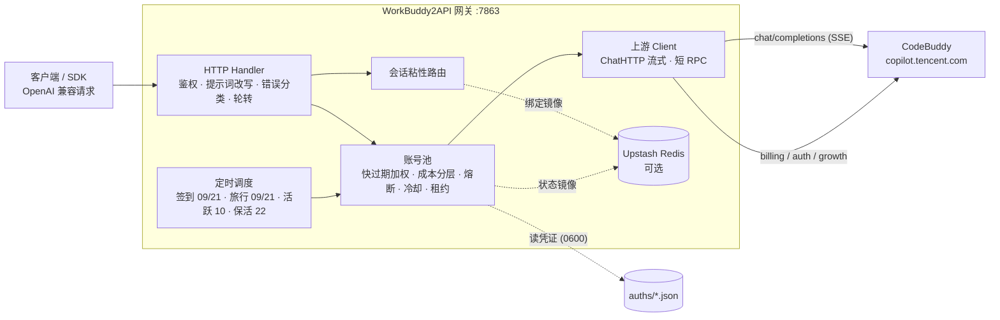

<p align="center">
  
</p>

<h1 align="center">WorkBuddy2API Panel</h1>

<p align="center">
  <b>把腾讯 CodeBuddy 账号变成 OpenAI 兼容 API 的多账号网关 · 附 Web 管理面板</b><br>
  Web 面板 · OAuth 浏览器登录 · 账号池轮转 · 熔断与冷却 · 会话粘性 · 定时签到 / 活跃 / 旅行 / 保活 · <b>成长任务一键完成（17/18）</b> · 流式 / 非流式
</p>

<p align="center">
  
  
  
  
  
</p>

---

> [!NOTE]
> **本仓库是 [`linguo2625469/workbuddy2api-panel`](https://github.com/linguo2625469/workbuddy2api-panel) 的个人维护 fork**（后者是 [`Sliverkiss/workbuddy2api`](https://github.com/Sliverkiss/workbuddy2api) 的增强分支）。
>
> fork 的主要动机：**修好 DSH（DeepSeek Harness）接入时被上游 `11-128` 通道校验拦截的提示词问题**。DSH 的 system 身份句会被 WorkBuddy 当成「非官方渠道调用」，整单返回 HTTP 400/403；本 fork 在网关侧完成脱敏、system→user 搬移重试与错误分类，DSH 侧无需修改提示词。详见 [本 fork 修了什么](#本-fork-修了什么)。
>
> 上游已停止维护，本 fork 也只做最小维护（以自用为主）：不承诺持续更新，不保证上游协议变化后仍可用。

> [!IMPORTANT]
> **上游项目已停止维护（2026-10-21）**：后续不再更新代码、不跟进上游变化、不再处理新的 issue / PR。
>
> 原因有三：
> 1. **上游已开始禁用反代**——WorkBuddy 对非官方客户端的识别与拦截正在收紧（通道校验、账号限制等），反代通道的稳定性与存活周期已不可控，继续做适配意义有限；
> 2. **个人精力有限**——本项目本就是个人自用工具，无力长期跟进协议变化与风控对抗；
> 3. **非法转卖泛滥**——发现大量批量注册小号、对外售卖额度、二次加壳 / 卡密分发的滥用行为，与本项目初衷完全相悖。
>
> 仓库保持现状可用（已合入的修复不会回退），但请自行评估风险：**上游随时可能彻底收紧导致不可用**；因使用非官方客户端导致的账号风控 / 封禁，由使用者自行承担。
>
> **维护方式披露**：本仓库近期的 issue / PR 处置、代码审查、测试与修复实现**大量由 AI 辅助完成**（自动化编码 agent），合并与发布决策由维护者作出。请知悉后再使用或参与贡献。
>
> 本 fork 在上游停止维护后仅做最小维护：目前只包含 DSH 提示词兼容与少量自用修复（见 [本 fork 修了什么](#本-fork-修了什么)），不承诺持续更新，也不保证上游协议变化后仍可用。

> **血缘**：[Sliverkiss/workbuddy2api](https://github.com/Sliverkiss/workbuddy2api) → [`linguo2625469/workbuddy2api-panel`](https://github.com/linguo2625469/workbuddy2api-panel)（增强分支，含 Web 面板）→ **本 fork**。
> 上游 Sliverkiss 仓库已删除；`linguo2625469` 分支在删库前已同步至上游 `b5077d5`（第三轮，2026-09-15），并在 `73a7560`（2026-10-21）发布停止维护声明。**本 fork 以 `73a7560` 为基线**，只追加 DSH 提示词兼容与少量自用修复，不改变基线已有能力。
> 基线分支重构的可视化运维层、账号池调度、错误分类与提示词体系均保留；本 fork 的增量见 [本 fork 修了什么](#本-fork-修了什么)，基线差异见 [与上游的差异](#-与上游的差异)。

> ⚠️ **本项目仅限自用账号（签到 / 保活 / 个人工具接入），不支持同时也是禁止批量小号分发额度、二次打包或收费售卖。** 详见 [使用声明（必读）](#使用声明必读)。

## 使用声明（必读）

本项目（含上游 [Sliverkiss/workbuddy2api](https://github.com/Sliverkiss/workbuddy2api)，下同）的开发初衷只有一个：**方便个人管理自己的 CodeBuddy 账号**——自动签到、保活、给自己的本地工具提供一个 OpenAI 兼容入口。它是免费、开源、按「原样」提供的个人自用工具。

近期我们发现有人将本项目用于以下行为：

- **批量注册小号 / 收购账号，对外提供付费 API、共享池、代充等业务**；
- **二次加壳、捆绑卡密（授权码）售卖**，或以「公益服」「低价中转」等名义变相收费分发。

我们对上述行为**表达最强烈的反对**，并声明如下：

1. **一切商用 / 售卖行为与本项目及作者无关。** 本项目不授权、不支持、不参与任何面向公众的 API 售卖、账号池出租、卡密收费分发；行为人由此产生的一切后果（包括但不限于账号封禁、条款违约与法律风险）由其自行承担，与作者和贡献者无任何关系。
2. **批量注册与转售接口配额违反目标平台服务条款。** CodeBuddy / 腾讯系服务条款禁止批量注册账号及商业转售接口。上游仓库已删除、停止公开维护——我们无法断定具体原因，但此类滥用行为正在毁掉所有正常使用者的环境，请勿再消耗社区的善意。
3. **请勿购买任何「收费版」「卡密版」「公益中转版」。** 本项目永远免费开源。任何加壳、加密、捆绑收费的「版本」都是他人篡改的产物，与本项目无关；且此类分发无法审计，存在被植入后门、回传并窃取你 CodeBuddy 凭证的风险（`auths/` 中保存的是明文 accessToken / refreshToken）。**你付钱买到的不是本项目，而是把自己账号交给陌生人的机会。**
4. **关于开源协议的诚实说明。** 本项目基于 MIT 协议开源，协议允许自由使用与修改源码——这是开源的本意，我们不会收回；但 MIT 赋予的是代码层面的自由，**不赋予**以本项目名义宣传、售卖、捆绑分发，或要求作者提供支持与背书的权利。作者不为任何第三方分发版本提供支持、更新承诺或安全保证。
5. **作者保留止损的权利。** 若滥用行为持续，作者可能随时停止维护、关闭或删除仓库，且不另行通知。上游的今天可能就是本项目的明天，望自重。

如果你的用途是管理自己的账号，欢迎正常使用、反馈问题与提交 PR。

## 项目简介

WorkBuddy2API 是一个自托管的 **OpenAI 兼容反向代理网关**，将腾讯 CodeBuddy（`copilot.tencent.com`）账号包装为统一的 `/v1/chat/completions` 服务。

- 官方不提供 OpenAI 形态的开放 API，本项目通过 **OAuth 设备授权**（面板「添加账号」或 `login.sh`）获取账号凭证，在网关侧做 token 自动刷新、账号池调度与流量治理；
- 面向 **个人多账号** 场景：多账号共享、单号故障自动换号、冷却 / 熔断防止雪崩、会话粘性保证多轮上下文不跳号；
- 对客户端只暴露 OpenAI 兼容接口，现有 SDK / 前端 / 工具 **零改造接入**。

> ⚠️ 合规须知：本项目是**非官方**网关，使用 CodeBuddy 账号作为上游，**仅限本人授权账号、本机 / 私有环境测试**。详细边界见[安全与合规](#安全与合规)。

## 本 fork 修了什么

> 一句话：**让 DSH（DeepSeek Harness）的 system 提示词不再被上游 `11-128` 通道校验整单拒绝**，同时保证 user / tool 消息不被改写。

### 问题现象

DSH 会在 system prompt 里带一句固定身份句：

```text
You are an AI agent powered by DeepSeek Harness...
```

WorkBuddy 的通道校验按**逐字精确匹配**读取 system（以及历史里的 assistant 消息），命中后返回：

```text
HTTP 400 / 403
{"code":11128,"msg":"request illegal", ...}
```

也可能是不带 code 的文案：`Illegal API invocation from an unapproved channel` / `failed channel verification` / `first message is not system prompt`。

这不是账号问题，也不是内容审核（内容审核的文案是 `blocked by security policy`）——换号、重试、改 DSH 配置都没用。旧网关把它当普通 4xx 轮转，换号重试仍然 400。

### 网关侧怎么修的

| 层 | 行为 | 配置 |
|---|---|---|
| 1. 提示词模式 | 默认 `passthrough`：DSH 的 system 原样透传，保留原生指令与工具约定；需要网关人格时再显式切 `custom` / `append` | `prompt.mode` |
| 2. 已知指纹脱敏 | 对 **system / developer / assistant** 消息整句改写：DSH 身份句 → 中性身份句；Claude Code / Codex 模板句、审查插件身份句同理。**user / tool 消息逐字原样** | `features.sanitize_blacklist_fingerprints`（默认 `true`） |
| 3. system→user 搬移 | 仍撞「身份句被拒」的 11-128 时：首条 system 换成中性提示词、原文搬进首条 user（`<instructions>` 包裹）、后续 system 就地转 user；**同账号、同请求内**重发一次。成功后记住该段 system（哈希，24h / 上限 512），后续直接搬 | `features.system_as_user_fallback`（默认 `true`） |
| 4. 终止 | 搬完仍被拒（指纹在 assistant 历史里）或结构性拒绝（首条不是 system / 缺会话 id）→ 立即 `400 channel_refused` + `gateway_hint`，不再换号空转 | — |

### 口径与边界

- **只洗三类角色**：`system` / `developer` / `assistant`；`user` 与 `tool` 逐字原样。在 DSH 里讨论 `11128`、贴错误码、翻译原文、让模型读改本仓库文档都不会被改写。
- **整句替换，不做裸词替换**：只改 `You are an AI agent powered by DeepSeek Harness...` 这一整句（以及审查插件身份句），不碰单独出现的 `DeepSeek Harness` 品牌词。
- **通道拒绝 ≠ 内容审核**：`unapproved channel` / `illegal api invocation` / `request illegal` 归 `ErrChannelRefused`，走搬移重试；`blocked by security policy` 才归 `ErrContentBlocked`，走 Degraded 提示词降级。
- **不罚号**：11-128 不冷却、不熔断、不扣权重；搬移重试不占换号名额，`MaxRotate=1` 也能重试一次。
- **默认配置即可用**：`config.example.json` 已包含两个开关的 `true`；DSH 侧无需修改 system prompt。

### 验证

```bash
# 脱敏 / system 搬移 / 11-128 分类 / handler 接线
go test ./internal/upstream ./internal/prompt ./internal/server ./cmd/server
```

起服务后让 DSH 正常对话即可。命中 11-128 时日志会出现：

```text
INFO: [server] channel refused acct=... model=... -> systemAsUser retry (sys=xxxxxxxx)
```

若随后仍返回 `channel_refused`，看响应里的 `gateway_hint`：通常是 assistant 历史（上一轮回复）里带了指纹，清掉或重开会话即可。

### 本 fork 的提交（相对基线 `73a7560`）

| 提交 | 内容 |
|---|---|
| `f661291` | 11-128 分流、派生会话键脱敏与若干运维修复 |
| `3bcb868` | DSH 指纹脱敏 + system→user 搬移重试 + 学习表 / 配置 / 面板开关 |
| `5e75d0a` | 脱敏覆盖官方 `dsh-auto-review` 与三方 `auto-review-zh` 审查插件身份句 |
| `637c86e` | 对齐 magpie 粒度：只洗 system/assistant、整句替换、通道/内容错误分流、`<instructions>` 搬移 |
| `0765ef2` | 面板前端重构：跟随系统主题（无 JS 也生效）、按钮四态与加载反馈、毛玻璃 + 动效、WCAG AA 色板、13 个无标签 checkbox 转 label；并修掉 10 个前端 bug（失效接口、静态资源缓存、CSP 拦内联处理器、配置保存提示、用量账号标识、错误文本渲染等） |

## 核心能力

| 能力 | 说明 |
|---|---|
| 🔑 **OAuth 一键登录** | `login.sh` 设备授权流程，自动落盘凭证并重启容器加载新账号 |
| 🔄 **多账号池** | 快过期积分加权 + 成本分层 + 加权随机选号，Top-5 候选 + 防惊群 |
| 🛡️ **熔断与冷却** | 429 软冷却 600s 起指数退避（封顶 `soft_rate_max`）、404 固定 60s 短冷却、402 硬冷却至次日 04:00、连续失败熔断、在途租约限流 |
| 🧲 **会话粘性** | 同一会话（`conversation_id`）尽量绑定同一账号，TTL 滚动续期，失败自动解绑，可镜像 Redis 防重启丢失 |
| ⏰ **定时任务** | 签到（09/21 点，末尾自动跑**连登管家**：兑换已解锁档位 + 抽完抽奖次数）+ 活跃上报（10 点，点亮连登 / 解锁领养 + streak 自检）+ 猫猫旅行（09/21 点，独立排程）+ token 保活（22 点），四类独立开关 |
| ⚡ **流式 + 非流式** | 出站强制 `stream:true`；SSE 帧按规范白名单重建；非流式由本地聚合为单响应 |
| 🧠 **推理模型兼容** | DeepSeek 思维链注入（`thinking.type=enabled` + 默认档）、`reasoning_content` 多轮回填、effort 档位自动降级 |
| 🔍 **联网搜索** | `POST /v1/search/messages` 把上游 `/agenttool/v1/search` 包成 Anthropic Messages 兼容形态（DSH 等客户端的搜索 provider 零改动接入）；复用账号池选号 / 在途租约 / token 刷新 / 错误冷却，出站请求头对齐官方客户端 |
| 💬 **系统提示词体系** | 默认 `passthrough` 透传客户端 system（保留 DSH / Claude Code 原生指令）；可选 `custom` 替换、`append` 追加；撞 11-128 通道校验时把 system 搬进 user 角色单次重试，`passthrough` / `append` 遇内容策略拦截自动降级 |
| 🧩 **DSH 提示词兼容** | DSH 的 system 身份句被上游 `11-128` 拦截时：system / assistant 整句脱敏 + system→user 搬移重试一次；user / tool 逐字原样，不影响讨论错误码与仓库文档 |
| 🗑️ **指纹脱敏** | 出站请求体黑名单指纹**整句**清洗（Claude Code / Codex / DSH 身份句 / 审查插件提示词）；**只作用于 system / developer / assistant 消息**，user 与 tool 消息逐字原样 |
| 📊 **可观测** | 每请求一行表格日志（TTFB / token 速率 / uid）；`/healthz` 带 `service` 身份标识可接负载均衡 / 宿主探活 |
| 💾 **状态持久化** | 池状态本地原子落盘 + Upstash Redis 异步镜像（可选），重启择新恢复 |
| 🖥️ **Web 管理面板** | 内嵌单页面板（**默认跟随系统明暗**，可三态循环锁定；毛玻璃侧栏/顶栏/弹层 + 入场动效；七个视图）：账号运维 / 用量与积分分析 / 模型档位条件查询 / 在线改配置（热生效）/ 运行日志（含**调用来源 IP·UA** 与时间区间）/ 积分任务，见 [Web 管理面板](#-web-管理面板) |

## 🎯 成长任务一键完成（17/18）

官方「成长计划」的 18 个成长任务中，**17 个可在面板上一键纯 API 完成**——无需安装官方客户端、无需人工交互，点一下「一键完成」即自动推进进度、等待异步计分落定并**自动领奖**。剩余任务展示操作指引。

### 任务覆盖与奖励

| 任务 | 奖励 | 一键完成方式 |
|---|---|---|
| `first_buddy` | +300c +8e | 解锁上报 → 同意协议 → 领养第一只 Buddy |
| `create_canvas` | +300c +5e | 设计画布创建事件组（Ardot 遥测） |
| `chat_5` | +100c | 对话活跃上报 ×5（自动补足差额） |
| `Model_chat_GLM5.2` | +100c +5e | glm-5.2 真实对话一次（发一条短消息） |
| `RichMeow_Chat` | +100c +5e +UR Buddy | 桌面端对话事件链（6 事件，含成功回执） |
| `Buddy_App` | +100c +5e | Buddy 应用「发现→进入→授权」事件链 |
| `Buddy_App_QQ` | +50c +5e | 企鹅教师助手进入事件链（与上一条共用） |
| `automation_1` | +100c +5e | 定时任务创建成功事件 |
| `Library_read` | +100c +5e | 资料库阅读点击（web 域上报） |
| `template_5` | +100c +5e | 模板使用事件组 ×5 |
| `playbook_prompt` | +100c +5e | 灵感案例「做同款」发送事件 |
| `expert_5` | +100c +5e | 真实专家召唤+使用链 ×5（专家市场拉真实专家 → 真实对话 → 使用事件） |
| `Expert_team_use_3` | +100c +5e | 专家团召唤+使用链 ×3 |
| `Hp_Appearance` | +100c +5e | 主题设置 + 皮肤生效事件 |
| `Expert_lighthouse` | +100c +5e | 轻量云专家召唤+使用链（真实对话 requestId，**可免费领一个月轻量服务器**） |
| `skill_1` | +100c +5e | 真实对话 + 技能加载事件（skill_info） |

**全新账号一键全做完 ≈ +1950 credits +78 能量**，其中仅数个任务涉及真实对话（`Model_chat_GLM5.2` 一条、`expert_5`/`Expert_team_use_3`/`skill_1` 各数条 fast-model 短对话），其余全部为行为事件上报，零对话消耗。

### 不可自动的 1 个

| 任务 | 原因 |
|---|---|
| `Expert_Philanthropy` | 需真实捐款（服务端领奖时校验捐赠回执，已实测无法绕过） |

### 实现原理（简述）

任务计分走 `/v2/report` 行为上报，但**不同任务认不同客户端指纹**：CLI 指纹（`www.codebuddy.cn`）、桌面指纹（`copilot.tencent.com` + `WorkBuddy/5.5.6` UA + `workbuddy-desktop` 事件族）、web 指纹（`www.workbuddy.cn` + `x-client-platform: web`）。网关为每类任务构造对应指纹的判据事件链（`internal/upstream/desktop.go`）；专家类任务额外要求真实专家 id 与真实对话回执（`internal/upstream/streak.go` 之外的 expert 序列）。上报 200 ≠ 计分——面板在执行后轮询任务进度，达标即自动调用 Web 域领奖接口。

> ⚠️ 行为事件按天幂等：重复点「一键完成」不会重复扣资源，已达标的任务自动跳过。

### 🧭 任务中心（面板新视图）

「任务中心」视图把散落的任务能力收拢成一处：

- **全账号任务扫描**：一键拉取每个账号的成长任务（未完成且可自动化的 19 项，含小程序口径的「校园日」与「小程序首对话」）+ 开学季待办，列表一目了然
- **执行队列**：把待办按账号排队执行——账号内串行（与单任务/一键完成共用互斥锁），账号间可选并发（1-3）；执行进度实时更新到每个条目
- **开学季独立状态卡**：每账号 5 任务（分享/桌面/对话×3/专家/学生认证）的状态矩阵 + 剩余抽奖次数，一键触发全账号闭环
- **日志分频道**：运行日志按「任务 / 对话 / 系统」三个频道筛选——对话流量再大，任务结果也不会被冲掉；日志条目带频道徽标与时间

<details>
<summary><b>🎒 开学季活动（5/5 全自动）</b>——活动期至 2026-09-24，已结束；逆向成果存档，点击展开</summary>

官方「AI 好 Buddy，开学有好礼」小程序活动的 5 个任务**全部纯 API 自动完成**（挂签到排程末尾，幂等）：

| 任务 | 奖励（每日） | 判据（已逆向） |
|---|---|---|
| 分享活动 | +100c +1抽奖 | `share-complete` 直调即点亮 |
| 桌面端体验（单次） | +100c +1抽奖 | viewed 激活 + 真实 chat + 桌面六事件链 |
| 和 AI 对话 3 次 | +50c +1抽奖 | viewed 后 3 条 `chat_request_send` 埋点（无需真实会话） |
| 召唤开学季专家 | +50c +1抽奖 | viewed 后 mp 事件链（召唤×3 + 对话） |
| 学生认证 | +100c | 需微信学生真实认证，不做 |

抽奖次数自动全部抽完。期间逆向成果（cf-connect 加密通道、mp 云对话全链路）记录在 `data/desktop-task-protocol.md` §8。

同一活动在成长任务中心还有两条**小程序口径**任务（`X-Client-Platform: miniprogram` 专属下发，默认列表不可见，各 +100c+5e）：

| 任务 | 判据（已逆向） |
|---|---|
| `school_season` 校园日 | mini `chat_request_send` + `activityId=school_open_day_2026`（无 activityId 不点亮；accept/claim 均要求 mp 头） |
| `Sequential_Tasks_1` 小程序首对话 | mini `chat_request_send`（无 activityId，服务端按 source=mini_program 指纹关联） |

任务中心扫描自动合并 mp 口径待办；accept 带**登记回读验证**（上游存在 200+OK 但未落账的形态，未生效自动重试一次）。

</details>

### 连登兑换与抽奖（自动）

成长中心连登档位（连续登录 7/14/28 天）兑换后发放积分 / 能量 / 补签卡 / **抽奖次数**，抽奖次数只能从兑换获得。网关把它挂在每日签到排程末尾自动跑闭环（见[定时任务](#定时任务)）：档位解锁当天自动兑换、有抽奖次数自动抽完，全程无需人工盯。

## 🆚 与上游的差异

本 fork 以 `linguo2625469/workbuddy2api-panel` 的 `73a7560` 为基线。相对基线，本 fork 的增量见 [本 fork 修了什么](#本-fork-修了什么)；下面保留基线分支相对 [Sliverkiss 上游 master](https://github.com/Sliverkiss/workbuddy2api) 的差异清单（均已在真实多账号环境验证）：

### 基线分支新增

| 能力 | 说明 |
|---|---|
| **Web 管理面板** | `internal/panel`，前端 go:embed 单文件进二进制，零外部依赖。账号池可视化（健康色条 / 积分量条 / 冷却倒计时）、积分到期分布、单号运维、批量任务、日志查看、明暗主题 |
| **请求指标与脱敏日志** | 面板展示完成成功率 / HTTP 成功率 / 平均耗时 / 最近请求，响应带 `X-Request-Id`；JSONL 只归档请求元数据，不写提示词、响应正文或凭证 |
| **浏览器内 OAuth 添加账号** | 面板「添加账号」按钮完成设备授权 → 凭证落盘 → **热加载进池（免重启）**，替代命令行 `login.sh` 流程 |
| **在线配置编辑（热生效）** | 面板直接改 `config.json`：API 密钥 / `soft_rate` / 指纹脱敏与 system→user 兜底开关 / 池参数 / 任务排程**立即生效**；装配期字段（listen 等）保存后提示需重启。写入采用深合并 + 原子替换，保留未知键 |
| **积分任务体系** | 任务列表 / 接受 / 领取接口 + 面板弹窗；「一键完成」覆盖 **17 个任务**（对话 / 领养 / 桌面行为链 / 模板 / 灵感案例 / 画布 / 专家召唤 / 技能尝鲜 / 主题 / 资料库 / 夜猫子等），推进进度、等待异步计分落定后**自动领奖**，纯 API 零客户端依赖 |
| **限时补偿可观测（issue #189）** | 官方补偿（例：「模型服务异常额外补偿 500 积分」）在账号侧可见，网关改为**先查 `compensation-status` 再决定是否领**：面板「官方补偿」卡片列出待领账号 + 领取截止倒计时（≤48h 标红）+ 逐号/全量领取按钮；**查询失败的账号在卡片上显形为红色行，不会与「没有补偿」混为一谈**；每日签到排程同步走「查→领」，**状态查询失败与领取失败一律显式告警**（旧实现把「没有 / 已领 / 领取失败」三态压成同一形态，带截止日的补偿会静默过期） |
| **首启自动生成配置** | 目录下无 `config.json` 时自动生成推荐配置（含 `crypto/rand` 随机 `api_key`），双击即开 |
| **粘性会话内容回退** | 客户端不发 `conversation_id` 时，用 `system + 首条 user` 哈希派生会话键（`d-` 前缀），通用 OpenAI 客户端也能享受粘性 |
| **余额后台刷新** | `schedule.balance_refresh_minutes`（默认 5）周期查余额并更新池，冷却账号余额恢复自动解冻 |
| **模型能力透出** | `/v1/models` 附带 `supported_efforts` / `default_effort` / 积分倍率 / 输入输出上限等上游真实字段 |
| **安全加固** | 常量时间密钥比较（`internal/httpauth`）、CSP 与安全响应头、UID 白名单防路径穿越、前端属性转义修复 |
| **领养前置修复** | 上游 `travelAdopt` 缺 report 前置导致领养恒失败于 `first_buddy task not completed yet`；基线分支修正后实测 +300 到账（3/3 账号） |
| **原生工具调用标记还原** | 上游（DeepSeek 系）的工具调用原生语法是带全角竖线的标记文本，**仅在请求声明了 `tools` 时**才被上游解析成结构化 `tool_calls`。实测 `tools` 声明在中转环节（Responses → chat/completions 等）丢失是常态，此时模型仍想调工具，标记就以纯文本落进 `content`——Codex 这类只执行结构化 `function_call` 的客户端会把它当普通正文写进会话历史，回合直接结束、工具一次都没跑。网关在出站响应里识别并还原成 `tool_calls`（流式与非流式都覆盖） |

### 同步上游

**第一轮（基线分支 `53ee3a1` → `9a87758`，34 个提交）**：四类任务独立排程、pool 文件拆分、12153 连续计数才禁用、429 `code=6004` 模型级限流收窄、11101 不罚号、请求体 413、DeepSeek 思维链、reasoning_content 回填、Codex 指纹脱敏、系统提示词体系、出站 UA 可配等。

**第二轮（`9a87758` → `ea8b1e5`，2026-09-14，只吸收底层）**：

| 上游改动 | 吸收内容 |
|---|---|
| 净化增强 | `tool_calls.arguments` 盲区修复（content=null 的工具调用轮此前完全漏净化）、裸 `11128` 反探测改写、桌面版身份句（逗号形态）漏网修复、反馈句整句改写 |
| 出站头族 | UA 对齐官方三段式 `WorkBuddy/<ver> WorkBuddy/<ver> CLI/<ver>`（默认 5.5.4/2.137.1，可配）；`X-IDE-*` 用量归属四头 + `X-Agent-Purpose`（`client_name` 配 `WorkBuddy` 即对齐官方桌面端）；`X-Device-Token` 设备风控头（auth 每号 / config / 文件三源）；`X-IDE-Version` 补齐 |
| 并发修复 | 客户端 IP 改按请求参数传递（消除共享字段竞态）；billing 单段 UA 形态 |
| 签到幂等 | `IsAlreadyCheckin` 识别"今天已签到"（code=10001/14001），调度日志不再把重复签到当失败 |
| 粘性按模型判活 | 会话绑定的账号被 6004 模型级限额后，换模型请求自动解绑重分配（治"限额后换不动号"）；`/healthz` 探活计入模型豁免形态（治"全号被单模型限流探活误报 503"） |
| report 增强 | `ReportChatActivity` 支持独立 `requestID`（同会话多轮上报各条可区分） |

**第三轮（`ea8b1e5` → `b5077d5`，2026-09-15，基础设施优先）**：

| 上游改动 | 吸收内容 |
|---|---|
| 会话头族与请求指纹 | 出站注入 `X-Conversation-ID` / `X-Request-ID` / `Message-ID` / `X-Trace-ID` / `X-B3-*`；`prompt_cache_key` 按账号 + 会话硬隔离，复用上游前缀缓存 |
| 6004 模型级冷却 | 每账号每模型独立计时，`/status` 台账透出多模型行 |
| 请求生命周期 | 客户端断开即取消上游请求；refresh 两段式（网络 IO 移出锁）；`http.Server` 补 `ReadTimeout` / `IdleTimeout` |
| 提示词默认值 | `prompt.mode` 缺省由 `custom` 改为 `passthrough`（透传客户端 system，更保守） |
| 其他 | 11140 硬禁用、14017 软冷却、非对话模型过滤、SSE `tool_calls` name 收敛、选号防惊群、快过期积分权重调整 |

未吸收（明确不做）：脚本体系（task_runner/school 脚本—我们已有更完整的纯 API 实现）、governance/CI workflow、成本账本选号（依赖 usage.credit 观测，收益待验证）。

> 上游 Sliverkiss 仓库随后删除，`b5077d5` 是已知的最后一次上游同步点；`73a7560`（2026-10-21）是 `linguo2625469` 分支的停止维护声明提交。本 fork 即从 `73a7560` 拉出，此后不再跟进上游。

## 架构总览



上游请求在出站前经历统一的改写管线（`internal/upstream/payload.go`）：强制 `stream:true`、`developer` 角色归一、tool_choice 归一、`image_url` 字符串兼容为 OpenAI 对象形态、DeepSeek 思维链注入、`reasoning_effort` 档位降级、`reasoning_content` 回填、指纹脱敏。

## 快速开始

### 环境要求

- **Docker + Docker Compose**（服务端部署方式，镜像内已含低权限用户与全部工具脚本）——或
- **Windows / macOS / Linux 直接跑单文件二进制**（无需 Docker，见下方「Windows 单文件运行」）
- 一个或多个已注册的 CodeBuddy 账号，用于 OAuth 登录
- 宿主机 Go ≥ 1.22（仅从源码构建时需要）

### 方式〇：GHCR 镜像（免克隆免构建）

> ⚠️ 下面的 `ghcr.io/linguo2625469/...` 是**上游镜像**，不含本 fork 的 DSH 提示词修复；要用本 fork 的代码，请本地 `docker compose build`，或直接下载下方 [Releases](https://github.com/renleihaokun/workbuddy2api-panel/releases) 的预编译二进制。

上游 CI 会自动构建多架构镜像（`amd64` / `arm64`）并发布到 GHCR，`git clone` 之外的部署路径：

```bash
# 1. 准备配置与数据目录
mkdir -p auths data && cp config.example.json config.json
#    建议编辑 config.json 设置 api_key（或留空由程序自动生成随机密钥）

# 2. 拉取并运行
docker run -d --name workbuddy2api \
  -p 7863:7863 -e TZ=Asia/Shanghai \
  -v ./auths:/app/auths -v ./data:/app/data -v ./config.json:/app/config.json \
  ghcr.io/linguo2625469/workbuddy2api-panel:latest

# 3. 健康检查（无可用账号时返回 503）
curl -s http://localhost:7863/healthz
```

> **首次发布后须将包设为公开**：GitHub 仓库页 → Packages → `workbuddy2api-panel` →
> Package settings → Change visibility → Public，否则拉取需要 `docker login ghcr.io`。
>
> 镜像 tag 规则：`main` 分支推送 `latest` / `main` / `sha-xxxxxx`；打 `v*` tag 额外发布
> `1.2.3` / `1.2` / `1` 语义化版本；PR 仅构建验证、不推送。

### 方式一：Docker Compose（推荐服务器部署）

```bash
# 1. 克隆
git clone https://github.com/linguo2625469/workbuddy2api-panel.git
cd workbuddy2api-panel

# 2. 准备配置（compose 挂载此文件，缺失会导致容器启动失败）
cp config.example.json config.json
#    建议编辑 config.json 设置 api_key（或留空由程序自动生成随机密钥）

# 3. 启动（首次会构建镜像，约 1-2 分钟）
docker compose up -d --build

# 4. 健康检查（无可用账号时返回 503）
curl -s http://localhost:7863/healthz
# {"healthy":0,"total":0,"service":"workbuddy2api"}
```

启动后打开 **`http://localhost:7863/panel/`**，用面板「添加账号」完成登录（见下节）。

常用运维命令：

```bash
docker compose logs -f          # 跟踪日志
docker compose restart          # 重启
docker compose down             # 停止并移除容器（数据在 ./auths 与 ./data，不受影响）
```

### 方式二：Windows 单文件运行（无需 Docker）

```powershell
# 1) 下载 Release 中的 wb2api.exe，或从源码构建
go build -trimpath -ldflags="-s -w" -o wb2api.exe ./cmd/server

# 2) 直接运行：首次启动自动生成 config.json（含随机 api_key，日志打印一次）
.\wb2api.exe -config config.json

# 3) 浏览器打开面板添加账号
#    http://127.0.0.1:7863/panel/
```

exe 为**单文件自包含**（前端资源已 embed 进二进制），拷到任意 Windows 机器即可运行，只需保证 `auths/`（凭证）与 `data/`（状态）目录可写。

### 方式三：源码运行（开发调试）

```bash
go build ./...
go vet ./...
go test ./...                      # 完整测试套件
go run ./cmd/server -config config.json
```

构建全部二进制：

```bash
CGO_ENABLED=0 go build -trimpath -ldflags="-s -w" -o wb2api ./cmd/server
CGO_ENABLED=0 go build -trimpath -ldflags="-s -w" -o signin_bin ./cmd/signin
CGO_ENABLED=0 go build -trimpath -ldflags="-s -w" -o login ./cmd/login
CGO_ENABLED=0 go build -trimpath -ldflags="-s -w" -o credit ./cmd/credit
```

### 添加账号（登录）

**方式 A：Web 面板（推荐，各平台通用，免命令行）**

打开 `http://127.0.0.1:7863/panel/`，点右上角「**添加账号**」：面板展示授权链接 → 浏览器完成登录 → 自动检测并落盘凭证 → **热加载进池（无需重启）**，顺带完成首次签到。

**方式 B：命令行脚本（仅 Linux / macOS，依赖 bash + python3）**

```bash
./login.sh
# 按提示在浏览器打开授权链接 → 回到终端确认 → 凭证落盘 auths/workbuddy-<uid>.json
```

`login.sh` 内置授权 URL 获取 + 浏览器登录 + token 轮询 + 首次签到 + 凭证落盘 + 容器重启，全程无 PKCE（state 由服务端签发）。账号池在容器启动时用 `auths/` 目录自动对齐，新增凭证文件即自动发现。

> Windows 用户请用方式 A（或 WSL）；`login.sh` 需要 python3。

### 验证

```bash
# 模型列表
curl -s http://localhost:7863/v1/models -H "Authorization: Bearer your-api-key"

# 账号状态（汇总 + 每账号详情，disabled 账号透出 disabled_reason）
curl -s http://localhost:7863/status -H "Authorization: Bearer your-api-key"

# 流式聊天
curl -sN http://localhost:7863/v1/chat/completions \
  -H "Authorization: Bearer your-api-key" \
  -H "Content-Type: application/json" \
  -d '{"model":"deepseek-v4-flash","messages":[{"role":"user","content":"hi"}],"stream":true}'

# 非流式聊天（本地聚合）
curl -s http://localhost:7863/v1/chat/completions \
  -H "Authorization: Bearer your-api-key" \
  -H "Content-Type: application/json" \
  -d '{"model":"deepseek-v4-flash","messages":[{"role":"user","content":"hi"}],"stream":false}'

# 联网搜索（Anthropic Messages 兼容形态，走上游 /agenttool/v1/search）
curl -s http://localhost:7863/v1/search/messages \
  -H "Authorization: Bearer your-api-key" \
  -H "Content-Type: application/json" \
  -d '{"model":"deepseek-v4-flash","tools":[{"type":"web_search_20250305","name":"web_search"}],
       "messages":[{"role":"user","content":"Perform a web search for the query: OpenAI 最新模型"}]}'
```

## 配置说明

**`config.example.json` 是配置项最完整的参考**：每个字段、默认值与结构都能在其中找到，示例值一律是 `test_key` 之类占位符，**不含任何真实密钥**。下表为字段含义速查。

### 字段速查

| 字段 | 默认 | 说明 |
|---|---|---|
| `listen` | `:7863` | HTTP 监听地址 |
| `api_key` | 空 | 网关鉴权密钥；**空 = 不鉴权直接放行**（公网必须设置） |
| `auth_dir` | `./auths` | 账号凭证目录 |
| `state_file` | `./data/state.json` | 账号池状态持久化文件 |
| `dns_servers` | 空 | **出站解析**用的 DNS 服务器（数组，按顺序试，都用不上才报错）；空 = 系统解析器。/etc/resolv.conf 不存在或不可用的环境（Android、精简容器）必须显式配，否则 Go 解析器会退回 `127.0.0.1:53`，查任何域名都变成"连本机 53 端口"（`dial tcp: lookup ... on [::1]:53: connection refused`）。只换 `Transport.DialContext`，不动超时与连接池 |
| `server.read_timeout` | `300s` | 入站请求读取（含 body 上传）总时长上限；大上下文/文件块经反代转发超时会 400 `read body: i/o timeout`；`0` = 不限制；改动需重启（#100） |
| `panel.package_detail_limit` | `5` | 积分构成页单账号默认展示的最早到期包数；其余未用完包与已用完包聚合折叠 |
| `logging.request_archive_enabled` | `true` | 请求元数据 JSONL 归档开关；不记录提示词、响应正文或 Authorization |
| `logging.request_retention_days` | `7` | 请求归档保留天数；超期文件在启动和周期清理时删除 |
| `logging.request_archive_max_mb` | `100` | 请求归档总容量上限（MiB）；超限优先删除最旧文件 |
| `cooldown.soft_rate` | `600s` | 软限流（429 / 限流文案）冷却基数；同一账号连续触发按 2 倍指数退避 |
| `cooldown.soft_rate_max` | `2h` | 软冷却指数退避封顶 |
| `schedule.checkin_hours` | `[9, 21]` | 每日本地时区整点签到 + 余额查询解冻。空数组 / `null` = 未配置回落默认（不是禁用） |
| `schedule.travel_hours` | `[9, 21]` | 每日本地时区整点推进猫猫旅行状态机（领养 / 派出 / 领奖） |
| `schedule.activity_hours` | `[10]` | 每日本地时区整点对话活跃上报（点亮连登 + 解锁 `first_buddy`） |
| `schedule.keepalive_hours` | `[22]` | 每日本地时区整点刷新 token 保活 |
| `schedule.blackcat_hours` | `[23]` | 每日本地时区整点夜猫子补足（23:00–08:00 计数窗口） |
| `schedule.checkin_enabled` | `true` | 签到总开关；`false` 真正关闭 |
| `schedule.travel_enabled` | `true` | 猫猫旅行总开关（独立于签到） |
| `schedule.activity_enabled` | `true` | 活跃上报总开关 |
| `schedule.keepalive_enabled` | `true` | token 保活总开关 |
| `schedule.blackcat_enabled` | `true` | 夜猫子总开关 |
| `schedule.include_disabled_in_tasks` | `false` | 让**保号类**四任务（签到 / 活跃上报 / token 保活 / 余额刷新）对**已禁用**账号也执行——「禁用」只关选号，不停保号。`false`（默认）保持「禁用的跳过」 |
| `upstream.timeout_seconds` | `120` | 短 RPC（刷新 / 签到 / 余额 / 模型列表）总时长上限 |
| `upstream.header_timeout_seconds` | 回落 `timeout_seconds` | 聊天首字节前（响应头）上限 |
| `upstream.idle_timeout_seconds` | `300` | 聊天流中空闲上限（活跃续命，静默断流） |
| `upstream.user_agent` | 空 | 出站 User-Agent 覆盖（空 = 三段式默认：CN `WorkBuddy/5.5.4 WorkBuddy/5.5.4 CLI/2.137.1`，global `WorkBuddy/5.5.4 WorkBuddy AI/5.5.4 CLI/2.137.1`；可用 `client_version` / `cli_version` 调版本段）。官网「使用端」列按出站 UA 服务端归因 |
| `features.sanitize_blacklist_fingerprints` | `true` | 出站请求体**整句**指纹脱敏：Claude Code / Codex 模板句、裸 `11128`、DSH 身份句、官方 `dsh-auto-review` 与三方 `auto-review-zh` 审查插件的身份句。**只作用于 system / developer / assistant 消息**，user 与 tool 消息逐字原样（上游通道校验只读 system / developer 与 assistant，2026-10-21 真机 A/B） |
| `features.system_as_user_fallback` | `true` | **system→user 搬移重试**：只在「身份句被拒」（`request illegal` / `unapproved channel` / `illegal api invocation`）时把 system 原文搬进首条 user（`<instructions>` 包裹）、system 留中性提示词、同请求内重发一次；成功后记住该段 system（哈希，24h / 上限 512）。结构性拒绝（首条不是 system、缺会话 id）不重试；搬完仍拒 → `400 channel_refused` 终止轮转。`false` = 关闭搬移 |
| `models.hidden` | `[]` | 模型黑名单：不对外暴露的模型。裸名=两域都藏；`"cn:xxx"`/`"global:xxx"`/`"cn/xxx"`/`"global/xxx"`=只藏该域（斜杠与冒号等价，大小写敏感）。`GET /v1/models` 列表过滤 + `POST /v1/chat/completions` 点名拒绝（400 `model_unavailable`）。面板保存后热生效 |
| `models.id_style` | `colon` | 模型列表/面板输出的 ID 分隔符：`colon`=`cn:model`（默认，既有协议，零回归）；`slash`=`cn/model`（Cherry Studio 2.x 等按 `/` 取末段匹配内置模型目录的客户端必须用这个，否则模型会被降级成无能力/上下文的「自定义模型」）。**只影响展示**：请求侧永远同时接受 `cn:`、`global:`、`cn/`、`global/` 与裸名。面板保存后热生效，无需重启 |
| `models.realm_name_prefix` | `false` | `true` 时列表/面板的模型 `name` 前置 `CN · ` / `Global · `，便于两域同 id（如 `deepseek-v4.1-flash`）在保留服务端 name 的客户端里区分；空 name 不编造。默认关闭 = 现有输出不变；热生效 |
| `prompt.mode` | `passthrough` | 系统提示词模式：`passthrough` = 透传客户端原始 system（默认，保留 DSH / CLI 原生指令；降级重试仍切中性提示词）；`custom` = 网关用自有提示词替换客户端 system；`append` = 开头连续 system/developer 块后插网关提示词（既有消息逐字不动） |
| `prompt.file` | 空 | `custom` / `append` 模式的提示词文件路径；空 = 内置默认（约 2KB）；路径非空但不可读 → 启动报错 |
| `upstash.url` / `upstash.token` | 空 | 空 = 纯内存模式（Noop 降级，功能照常） |
| `pool.max_in_flight` | `3` | 单账号最大在途请求数（`0` = 不限） |
| `pool.max_in_flight_global` | `2` | global 域单账号在途上限（国际版 WAF 风控更紧，压低并发） |
| `pool.degrade_threshold` | `5` | 连败降权阈值：未知错误（ErrClient/传输层）连败 N 次临时出池 |
| `pool.degrade_cooldown` / `pool.degrade_cooldown_max` | `10m` / `2h` | 连败降权时长与上限钳制 |
| `pool.cost_explore_interval` | `30m` | costTier 条件探索窗口：免费层垄断且存在未知号时，每窗口把一个真实请求搭车改道给未知号（零新增上游请求；成功即毕业，失败走既有错误策略）。`0` = 关停 |
| `pool.credit_floor` | `100` | **积分保底**：账号余额低于该值时，对**实测收费**模型（tier 2，账本 6h 内有效观测）不再参与选号——防止收费模型把余额打穿、连免费模型都 402 冷却到次日签到（最坏约 11.5 小时不可用）。tier 0（实测免费）/ tier 1（无观测）**不受限**：保底保的是「留余额给免费模型用」，且 tier 1 若拦会让账本过期 / 重启清零的触底号死锁在「学不回来」。含会话粘性路径（粘性号触底则解绑换号）。全池触底且全 tier 2 时选号返回空（网关回 503），**不放行**。签到回血越过 floor 即刻自动恢复。`0` = 关闭 |
| `pool.cross_domain_fallback` | `false` | **裸模型名跨域回退**（issue #135）：开启后，请求 `model` 不带 `cn:` / `global:` 前缀时不再等价于 `cn:<模型>`——首选域（cn）选不到可用号（账号级冷却/熔断/在途占满，或该域账号对这个模型 11102 后被模型级负缓存避开）会自动改用另一域再选一次，客户端只写一个模型名即可跟随账号池切换。显式 `cn:` / `global:` 前缀**永不回退**（写哪个域就用哪个域）。跨域会消耗另一个域的额度，故默认关闭 |
| `pool.breaker_threshold` | `3` | 连续失败触发熔断阈值 |
| `pool.breaker_cooldown` | `30m` | 熔断基础退避时长 |
| `pool.breaker_cooldown_max` | `6h` | 熔断指数退避封顶 |
| `pool.idle_weight_per_hour` | `0.5` | 闲置补偿：每小时未使用 +0.5 权重 |
| `pool.idle_weight_max` | `5.0` | 闲置补偿权重封顶 |
| `pool.strategy.domestic` | `weighted_random` | 国内版账号池调度：`weighted_random` / `round_robin` / `sequential_exhaust`，支持热更新 |
| `pool.strategy.international` | `weighted_random` | 国际版账号池独立调度策略，同上；不改变既有地区路由 |
| `pool.account_order.domestic` / `international` | `[]` | 对应地区的 UID 优先顺序；未列出账号按 UID 排序追加；只用于轮询和顺序耗尽 |
| `pool.prefer_expiring` | `true` | 快过期积分加权：窗口内仍有有效快过期批次的账号，选号权重 ×3（虚拟实例）；不按到期时间排序、与批次金额无关；是软偏好，弱于会话粘性与模型成本分层（#101） |
| `pool.expiring_soon` | `168h` | 快过期加权窗口：仅窗口内仍有有效批次的账号命中上述 ×3；窗口开大 → 命中账号变多、偏好被稀释；留空或 `0` 关闭 |
| `session_sticky.enabled` | `true` | 会话粘性路由开关 |
| `session_sticky.ttl` | `30m` | 会话绑定 TTL（滚动续期） |
| `session_sticky.gc_interval` | `5m` | 过期绑定 GC 周期 |

### 上游超时语义（三段各归其位）

| 字段 | 作用对象 | 默认 | 行为 |
|---|---|---|---|
| `timeout_seconds` | 短 RPC（token 刷新 / 签到 / 余额 / 模型列表） | `120` | 总时长硬上限，到期报错走换号 / 熔断 |
| `header_timeout_seconds` | 聊天 SSE **首字节前** | `120` | 由 `Transport.ResponseHeaderTimeout` 约束；超时 = 换号重发 |
| `idle_timeout_seconds` | 聊天 SSE **流中空闲** | `300` | 活跃吐数据续命不掐；静默超时才断流释放租约 |

聊天流（`stream` true / false 均同）**没有总时长上限**：聊天使用 `Timeout=0` 的专用 client，长思考 / 长输出不会被掐断。

### 环境变量覆盖

加载顺序：JSON 文件 → `WB2A_*` 环境变量（变量非空才覆盖）：

`WB2A_LISTEN` · `WB2A_API_KEY` · `WB2A_AUTH_DIR` · `WB2A_STATE_FILE` · `WB2A_DNS`(逗号分隔多个) · `WB2A_SOFT_RATE`(duration) · `WB2A_SOFT_RATE_MAX`(duration) · `WB2A_TIMEOUT_SECONDS` · `WB2A_HEADER_TIMEOUT_SECONDS` · `WB2A_IDLE_TIMEOUT_SECONDS` · `WB2A_USER_AGENT` · `WB2A_SANITIZE_FINGERPRINTS`(bool) · `WB2A_PROMPT_MODE` · `WB2A_PROMPT_FILE`

## 核心行为语义

### 系统提示词体系

客户端（Claude Code / Codex / DSH 等）会在 system prompt 注入固定模板句。上游有两条**互不相同**的拒绝链路：

- **内容策略拦截**（HTTP 400 + `blocked by security policy`）：按内容审核文案判定，`ErrContentBlocked`；由提示词降级路径处理。
- **通道校验失败**（HTTP 400/403 + code `11128` / `11-128`，文案 `request illegal` / `Illegal API invocation from an unapproved channel` / `failed channel verification`）：上游认为请求不是官方客户端发出的，`ErrChannelRefused`；由指纹脱敏 + system→user 搬移路径处理。

网关提供三层防护，互不替代：

1. **提示词模式**（决定 system 的来源形态）：`prompt.mode`，默认 `passthrough`
2. **指纹脱敏**（消灭已知 system / assistant 指纹）：`features.sanitize_blacklist_fingerprints`
3. **system→user 搬移**（兜底未知 system 指纹）：`features.system_as_user_fallback`

| 模式 | 语义 |
|---|---|
| `passthrough`（默认） | 透传客户端原始 system，不做改写；DSH / Claude Code 的原生指令、工具约定完整保留。已知指纹由脱敏清洗，未知指纹由搬移兜底 |
| `custom` | 出站前用网关自有提示词**替换**客户端 system / developer 消息（删除全部 system / developer，头部插入单条 system）；user / assistant / tool 消息逐字不动 |
| `append` | 开头连续 system / developer 块之后**插入**一条网关自有 system，既有消息（含客户端项目规范/工具约定）逐字不动——两者并用；降级期退化为 replace（带指纹原文重试只会确定性再撞 400） |

内置默认提示词约 2KB（`internal/prompt/defaultprompt.md`，嵌入二进制），仅在 `custom` / `append` 模式下使用。`prompt.file` 指向自定义提示词文件（自定义人格 / 人设）即整体替换内置默认；**留空 = 内置默认**，路径非空但不可读 → **启动报错**（fail fast，不会静默回落到内置默认）。

指纹脱敏的口径与 magpie 的 WorkBuddy 插件一致：**整句替换**（不做裸词替换），且**只作用于 system / developer / assistant 消息**，**user / tool 消息逐字原样**——上游通道校验只读 system（含 developer）与 assistant（2026-10-21 真机 A/B）。因此讨论 DSH、贴错误码、翻译原文、让模型读改仓库文档都不受影响；覆盖范围含 CLI 模板句、DSH 身份句、官方 `dsh-auto-review` 与三方 `auto-review-zh` 的身份句。

### 通道校验被拦：system→user 搬移重试

上游对 **system / assistant** 来源做逐字指纹校验，命中即 `400 11-128`（`request illegal` / `Illegal API invocation from an unapproved channel` / `failed channel verification`）。指纹脱敏能消灭**已知**指纹；未知指纹由「角色搬移」兜底：

| 阶段 | 行为 |
|---|---|
| 首次 | 原样出站，system 仍是 system |
| 撞「身份句」11-128 | 把 system 原文搬进首条 user（`<instructions>…</instructions>` 包裹）、system 换成中性提示词、**后续 system 就地转成 user**；**同账号、同请求内**重发一次；不罚号、不退避、不占换号名额 |
| 已学习 | 搬移成功后记住该段 system 原文的哈希（进程内存、24h 过期、上限 512 条）；同一段 system 的下一次请求直接以搬移形态出站，不再先撞一次 400 |
| 兜底 | 搬完仍被拒（指纹在 assistant 历史里搬不走）→ 立即 `400 channel_refused` + `gateway_hint`，只试一次、不再循环；结构性拒绝（首条不是 system、缺会话 id）**不重试** |

由 `features.system_as_user_fallback` 控制（默认开启、面板热生效）。关闭后不做搬移，但通道拒绝仍会立即终止轮转——换号不改变请求形状。搬移只改**出站 body 的角色形态**，会话头、粘性键与用量口径均在搬移前确定，不受影响。

### 内容拦截误报与降级重试

`passthrough` / `append` 模式请求被上游内容策略拦截（HTTP 400 + `blocked by security policy`）时，判定为 system 指纹误报：**同请求内**换 Degraded 中性提示词重试一次；第二次仍被拦（用户内容本身触发审核）→ `400 content_blocked` 透传上游原文，不轮转、不罚号。`custom` 模式已整段替换 system，不走此降级。

- 触发降级后持续到**次日 00:00 CST**（Asia/Shanghai）重置；降级期内 `passthrough` / `append` 请求直达中性提示词，不再先撞 400
- 降级状态是**进程内存态**，重启清零
- 内容问题非账号问题：`ErrContentBlocked` 不罚账号（无冷却 / 熔断 / 计错），由网关降级重试消化
- 与上一节的 system→user 搬移**互相独立**：内容拦截走本节的 Degraded 降级，通道校验失败（`ErrChannelRefused`）走角色搬移

### 原生工具调用标记还原

上游（DeepSeek 系）的工具调用原生语法不是 OpenAI 的 JSON `tool_calls`，而是一段带**全角竖线**（U+FF5C）分隔符的标记文本：

```text
<PIPE>DSML<PIPE> calls>
<PIPE>DSML<PIPE> invoke name="exec_command">
<PIPE>DSML<PIPE> parameter name="cmd" string="true">ls -la<PIPE>DSML<PIPE> parameter>
</PIPE>DSML<PIPE> invoke>
</PIPE>DSML<PIPE> calls>
```

（上面用 `<PIPE>` 占位，真实分隔符是两个全角竖线。）

上游**只在请求声明了 `tools` 时**才把这段标记解析成结构化 `tool_calls`。一旦某次请求没带上 `tools`——实测这在链路上是常态（协议转换丢字段、一次性 `exec` 探测、auto-review 复核回合等）——模型仍然想调工具，于是标记以纯文本落进 `content`。下游没有任何一层认识它：Codex 只执行 Responses API 的结构化 `function_call` 条目，于是把它当普通助手正文写进会话历史，回合直接 `task_complete`、工具一次都没跑。

网关在出站响应里做最后一道还原（`internal/upstream/dsml.go`），判定分两级：

| 工具名单状态 | 判定 |
|---|---|
| 非空 | **严格**：块内每个工具名都必须在名单里 |
| 为空（`tools` 丢失，实测常态） | **弱**：块必须完美闭合，且工具名形如合法标识符（`^[A-Za-z0-9_][A-Za-z0-9_.:-]{0,63}$`） |

名单有两个来源，二者会分别缺失，所以都要：**本请求声明的工具**（`tools[].function.name` / `tools[].name` / `functions[].name`）与**会话历史里出现过的工具名**（`messages[].tool_calls[].function.name`）。

还原还受三条硬性前提约束：本回合上游没有给出任何结构化 `tool_calls`（不覆盖真实调用）、块内除 invoke/parameter 与空白外不夹带正文、非流式额外要求 `finish_reason` 为 `stop`。**任何一条不满足即原文逐字节透出**——未闭合、参数畸形、超长（>256KB）一律回吐，修复层绝不吞字节。

命中与否各记一行日志，便于排障时区分「没识别到」与「识别到但判定不通过」：

```text
INFO: [server] stream ...: repaired N native tool call(s) from assistant text (tool names known=K)
WARN: [server] stream ...: saw M native tool call block(s) but repaired none (tool names known=K)
```

### 错误分类与账号处置

上游错误由 `Classify` 统一分类（判定优先级：余额耗尽 → session 失效 → 限流文案 → 状态码兜底），账号处置如下：

| 分类 | 触发条件 | 账号处置 | 恢复 |
|---|---|---|---|
| 余额不足 | HTTP 402 / body 含余额关键词 | 硬冷却到**次日 04:00**（本地时区） | 签到（09/21 点）余额恢复自动解冻 |
| 频控 | HTTP 429 / 限流文案（不限状态码） | 软冷却 `soft_rate`（600s 起，连续触发指数退避，封顶 `soft_rate_max`）。**`code 6004`（模型级）带「将在 … 重置」时**冷却到上游重置墙钟并豁免切模型（见[常见问题](#429-code6004模型级限流的冷却语义)） | 到期自动恢复 / 成功清零退避 |
| Session 失效 | body 含 `Offline user session not found` / `12153` | **连续 3 次**才永久禁用（一次 12153 多为临时抖动：网络 / 闪断 / refresh 竞态）；刷新成功 / 任意成功 / 手工复活清计数 | 人工重新登录（`login.sh`）或 `ReviveDisabled` 复活 |
| 上游 404 | HTTP 404 | 软冷却固定 60s（不随 `soft_rate`、不单独退避） | 到期自动恢复 |
| 服务端错误 | HTTP ≥500 | 喂连续失败计数，达阈值熔断 | 熔断到期 / 成功清零 |
| 请求体解析失败 | HTTP 400 + `Unmarshal chat params failed` / code `11101` | **不罚账号，但仍轮转**（客户端畸形 JSON，换号照样 400） | 即时 |
| 内容拦截 | HTTP 400 + `blocked by security policy` | **不罚账号**，`passthrough` 模式走降级重试 | 即时 |
| 通道校验失败 | HTTP 400/403 + code `11128` / `11-128`，或文案 `unapproved channel` / `illegal api invocation` | **不罚账号**；身份句被拒时自动 system→user 搬移重试一次；搬完仍拒或结构性拒绝 → `400 channel_refused` 立即终止轮转（换号无用） | 即时（按 `gateway_hint` 排查 assistant 历史） |
| 客户端错误 | 其余 4xx / 业务 `code≠0` | 不处罚，换号重试 | 即时 |

请求体解析失败（`11101`）与内容拦截一样**不罚账号**：问题在请求内容而非账号健康。网关不做请求体截断与预拦截，`11101` 均为客户端发来的畸形 JSON。

**熔断器**：所有冷却入口与 5xx 共用唯一连续失败计数器 `fails`；累计达 `breaker_threshold`（默认 3）触发熔断，退避 `breaker_cooldown × 2^retryCount`，封顶 `6h`；成功清零。

**软冷却指数退避**（与熔断器并存的第二条升级线）：软限流的**冷却时长**本身也按连续次数退避——同一账号连续触发软冷却时 `soft_rate × 2^(连续次数-1)`，封顶 `soft_rate_max`。计数 `soft_streak` 独立于熔断器的 `fails`，只在**成功**或**签到解冻**时清零，随 `state.json` 持久化。

### 选号策略

1. 过滤：禁用 / 冷却 / 熔断 / 在途占满账号不参与
2. 按模型实测成本分层，只保留当前最优层
3. 默认开启快过期积分加权（软偏好，不改排序）：

   - 在模型成本最优层内，`expiring_soon` 窗口内仍有有效快过期批次的账号，选号权重 ×3（`expiringVirtualSlots` 虚拟实例展开，会话粘性路径同口径）。
   - 不按到期时间排序、与批次金额无关：14 天后到期与 3 天后到期、1 分与几千分，只要在窗口内待遇相同。
   - 该偏好弱于会话粘性（绑定号健康则直接使用）与模型成本分层（按实测成本硬过滤）；已过期、零余额、无有效到期时间的账号不进入加权集。
4. 同一候选池内加权随机（快过期命中账号在上面的基础上 ×3）：

   `weight = credits 比例 ×10 + idleWeight`

   - `credits 比例` = 该号积分 / 候选集最大积分
   - `idleWeight` = `min(闲置小时 × idle_weight_per_hour, idle_weight_max)`，从未使用给满分
5. 防惊群：跳过 100ms 内刚被选中的账号；全冷却时从非禁用、非余额耗尽的软冷却 / 熔断账号中选最早到期者顶班

### 会话粘性

同一会话尽量复用同一账号，多轮对话不跳号：

- 会话键提取顺序：`metadata.conversation_id` → `metadata.conversationId` → `metadata.user_id` → 顶层 `conversation_id` → 顶层 `conversationId`（snake_case 优先于 camelCase）
- TTL 滚动续期（默认 30m），GC 周期 5m；绑定可镜像到 Redis（7 天 TTL）防重启丢失
- 请求失败自动解绑；成功后绑定跟随最终成功账号

### 定时任务

五类任务各自独立排程、各有开关，互不影响。容器时区由 `TZ` 控制（compose 默认 `Asia/Shanghai`）。

| 任务 | 开关（默认 true） | 时刻（默认） | 行为 |
|---|---|---|---|
| 签到 | `schedule.checkin_enabled` | `checkin_hours` `[9, 21]` 整点 | 签到 + 余额查询；余额恢复则解冻冷却账号。**末尾追加连登管家**（见下） |
| 活跃上报 | `schedule.activity_enabled` | `activity_hours` `[10]` 整点 | 对话活跃上报（`chat_request_send` 事件，必须含 `userId`）；点亮连登 + 解锁 `first_buddy`；每号每天 1 次 |
| 猫猫旅行 | `schedule.travel_enabled` | `travel_hours` `[9, 21]` 整点 | 独立排程：无猫领养 / `idle` 派出 / `arrived` 领奖 |
| 保活 | `schedule.keepalive_enabled` | `keepalive_hours` `[22]` 整点 | 全账号刷新 token；session 失效**连续 3 次**才自动禁用 |
| 夜猫子 | `schedule.blackcat_enabled` | `blackcat_hours` `[23]` 整点 | **先查任务进度再决定**：`black_cat` 未达标才在 23:00–08:00 计数窗口内补足 glm-5.2 短对话（每天 1 次累计 3 天，漏跑次日窗口自动补） |

#### 禁用账号与保号任务（`schedule.include_disabled_in_tasks`）

缺省 `false`：禁用账号被上述**签到 / 活跃上报 / 保活 / 余额刷新**四任务跳过，与选号过滤一致。

面板「禁用」的语义是「**不再参与选号**」，但这四类任务此前会一并跳过禁用号——被禁用的账号因此拿不到签到积分、不续 token、余额也不再刷新；而 `ReenableIfCredits` 明确不复活 disabled 账号，等于签到这条唯一的自动回血路径也断了，只能人工点「解冻」。

如果采用「**一次只放开一个账号、用禁用做流量开关**」的轮换方式（同 IP 多号怕触发风控），闲置待命的号恰恰是最需要签到的——把它设为 `true`，禁用号仍会签到 / 保活 / 刷新余额，**但依旧不参与选号**（`pool` 选号侧的 disabled 过滤不受本开关影响）。

> 该开关**只覆盖调度器的这四类任务**。猫猫旅行、夜猫子、连登管家（挂在签到末尾的 `RunStreakBonusNow`）与成长任务队列**仍按原样跳过禁用账号**——若也需要，请另行提出。

#### 暂停选号（账号级 `paused`，无需配置）

比上面的全局开关更常用的账号级入口：面板账号行的「**暂停选号**」按钮。暂停的账号：

- **退出选号**（含全冷却兜底），状态显示「已暂停选号」，点「恢复选号」即刻回池——不清冷却域、无需解冻或重登；
- **无条件照常保号**：签到 / 活跃上报 / 保活 / 余额刷新四任务照跑（不依赖 `include_disabled_in_tasks`）；
- **其余任务体系照常**：猫猫旅行（纯 RPC：状态/派出/领奖）、连登管家、成长任务队列与任务中心扫描/执行都照常参与——这些走的是上报/领奖接口，不发模型对话（个别任务动作自带一次真实短对话，如 `Model_chat_GLM5.2`，影响可控）；失败照常记错误行，不特殊处理；
- **唯一跳过的是夜猫子**：`RunNightChats` 逐条发真实 glm-5.2 对话，是任务体系中唯一「整任务都是模型对话」的，与「让位防风控」正面冲突。

这正是「一次只放开一个号、其余让位」轮换用法想要的粒度：让位的号不再承接**选号流量**，也避开夜间的对话补足；其余养号动作照常。与「禁用」的区别：禁用是终态（session/授权判死，需人工解冻，保号默认也停），暂停是运维临时态（账号健康，随时恢复）。状态持久化（state.json `paused` 字段），跨重启不丢；`disable`/`revive` 会一并清掉 `paused`。

#### 企业版账号（自动识别，无需配置）

`auth` 文件带非空 `enterpriseId` 的账号被识别为**企业版**（面板账号名旁显示「企业版」标签）。企业版**没有个人成长体系**——上游对这些端点一律拒绝（实测 2026-10-07，同一时刻与个人号 A/B 对照）：

| 端点 | 企业版响应 |
|---|---|
| `POST /v2/billing/meter/daily-checkin`（签到） | `400 code 10001`「企业账号不支持该操作」 |
| `POST /billing/meter/claim-gift` / `claim-compensation`（夜猫子领奖） | `400 code 10001` 同上 |
| `POST /billing/meter/compensation-status`（补偿状态查询） | 网关**在门控处一并跳过**（与 claim-compensation 同属无补偿体系的调用） |
| `GET /activity/growth/*`（连登 / 旅行 / 热力图 / 抽奖）与 `GET /v2/activity/growth/tasks`（成长任务） | `403`「growth system is only available for personal users」 |

因此网关对企业号**不发起**这五类调用（签到 / 活跃上报 / 猫猫旅行 / 夜猫子 / 连登管家），面板也不渲染「签到」「任务」按钮（只留「额度」）。判定（`auth.Auth.IsEnterprise()`）与既有 `IsGlobal()`（D4 门控）在**同一批引用处并列书写**，`upstream` 侧零改动。

**企业版照常的能力**：选号派发、保活（token 刷新仍必需——不刷新同样会过期失效）、额度查询。

企业额度不在个人「资源包」体系内（`get-user-resource*` 对 `enterpriseId` 账号恒返回空 `Accounts`，面板因此长期显示 0），故额度改走 `POST /v2/billing/meter/get-enterprise-user-usage`：上游 `credit` 是**本周期已用**（与个人口径「剩余」语义相反），`limitNum` 是**分配给该账号的额度**，网关据此换算 `剩余 = limitNum - credit`；`limitNum = -1` 为不限量（面板显示「不限」，且不参与周期分桶）。企业配额按周期重置（`cycleResetTime`），未用完即作废，故周期末会参与 `prefer_expiring` 优先消耗。

> 成员账号**无权查询企业池总额度**（实测：池端点在成员 token 下返回 `403 not_authorized`，`/console/accounts` 显示 `isAdmin=false`）。面板展示的只是**该账号被分配的额度**；企业池余额只有企业管理员在管理后台可见。

#### 连登管家（签到排程末尾自动执行）

成长中心的连登档位（连续登录 7/14/28 天）兑换后发放积分 / 能量 / 补签卡 / **抽奖次数**，抽奖次数只能从兑换获得。管家在每日签到后自动跑一遍闭环（幂等，未解锁静默跳过）：

1. 查连登档位状态 → 已解锁（非 locked / 非 claimed）的档位自动**兑换**
2. 查抽奖次数 → **有次数自动全部抽完**，奖品记日志（`streak-bonus <uid>: 🎲 …`）

无需配置，跟随签到排程；到天数那天自动完成「兑换 → 抽奖」，无需人工盯。

**关闭定时任务**：用 `schedule.*_enabled: false` 显式关闭（四个都设 `false` 则调度器不空转，直接阻塞等待退出信号）。注意两点语义：

- **空数组与 `null` 表示「未配置 → 回落默认」**，不是「禁用」；真正关闭请用 `*_enabled: false`
- **禁用不会擦除小时配置**：`*_hours` 原样保留，改回 `true` 即恢复原时点；小时值必须是 0-23，非法值启动即报错
- 关签到会把「余额恢复即解冻」一起关掉，被硬冷却的账号只能等次日 04:00 自然到期

#### 活跃上报（独立排程）

对池内每个可用账号在 `activity_hours`（默认 `[10]` 整点）发送一条对话活跃上报（事件 `chat_request_send`，body 为数组，事件必须含 `userId`）：

- 一条上报同时点亮 growth 连登 + 解锁 `first_buddy` 任务（领养前置）
- 每号每天 1 次即可（单时点）：日活跃奖励按天去重，重复上报无额外收益
- `conversationId` 由网关生成（`wb2api-<ms>`），无需真实会话
- 限速：账号间间隔 800ms（与旅行同口径）
- **streak 自检**：上报成功后回读连登天数（只读 oracle），日志每号一行可 grep：`activity <uid>: streak days=N`。`days=0` 记 **warn**（`report OK but streak.days=0 (silent drop?)`，对应上游「200 但静默丢弃」）；回读失败记 warn 但不影响主流程（上报按天幂等，不重试，只观测）
- 手动诊断 / 补跑用 `python3 scripts/probe_active.py`（只读探测；写操作默认 dry-run，需 `--yes`）

#### 猫猫旅行（独立排程）

对池内每个可用账号在 `travel_hours`（默认 `[9, 21]` 整点）单趟推进一次，每趟只做一个动作，不轮询不等待。默认两趟闭环：9 点领昨日到站奖励并派出，21 点领当日到站奖励（`daily_limit_reached` 自动挡住二次派出）。

| 探测结果 | 动作 |
|---|---|
| 无猫（`buddy` 为 `null`） | 先同意协议（幂等），再尝试领养；过门槛则 +300 积分并获得猫 |
| `state=idle` 且今日未派出 | 派出 `location_id=4`（古镇客栈；4 个地点收益 / 时长区间相同，无最优解） |
| `state=arrived` | 领取到站奖励（带 `record_id`） |
| `state=traveling` / 今日已达上限 / 未知状态 | 跳过 |

- 领养门槛未达标时上游返回 HTTP 400，每账号每自然日只尝试一次（跨日重试，记录仅存内存）；门槛可用活跃上报解除
- 限速：账号间间隔 800ms
- 每自然日 1 次派出：按 CST（Asia/Shanghai）自然日重置，与容器 `TZ` 无关
- 失败隔离：单账号失败只跳过该账号当趟；401 不强刷（token 刷新交保活时点）

## API 端点

### 联网搜索 `POST /v1/search/messages`

把上游 `/agenttool/v1/search` 包成 **Anthropic Messages 兼容**的搜索端点。这样任何按
`${baseURL}/messages` 发起搜索的客户端（如 DSH 的 `web-search-deepseek`）只需把搜索
baseURL 指向 `<网关>/v1/search`，即可零代码接入本网关的搜索能力。

与 chat 共享同一套账号池语义：选号轮转、在途租约、token 临近过期自动刷新、失败按错误
类型冷却或熔断。

**为什么不用 `/v1/messages`**：那是 Anthropic 模型对话的标准路径，留给未来的 chat 转发；
搜索挂在 `/v1/search/messages`，语义清晰且互不干扰。

请求（Anthropic Messages 形态）：

```json
{
  "model": "deepseek-v4-flash",
  "max_tokens": 4096,
  "tools": [{ "type": "web_search_20250305", "name": "web_search", "max_uses": 5 }],
  "messages": [
    { "role": "user", "content": [{ "type": "text", "text": "Perform a web search for the query: OpenAI 最新模型" }] }
  ]
}
```

- `tools` 必须声明 web_search（`type` 以 `web_search` 开头或 `name` 为 `web_search`），
  否则返回 400——本端点只服务搜索，不处理模型对话
- 搜索词取自 user 消息文本，固定前缀 `Perform a web search for the query:` 会被剥离
- 结果条数固定为官方默认值 5（服务端实际上限约 10）

响应为 Anthropic Messages 形态，搜索结果在 `web_search_tool_result` block 里：

```json
{
  "id": "msg_wb2api_...",
  "type": "message",
  "role": "assistant",
  "model": "deepseek-v4-flash",
  "content": [
    {
      "type": "web_search_tool_result",
      "tool_use_id": "srvtoolu_...",
      "content": [
        { "type": "web_search_result", "url": "https://...", "title": "..." }
      ]
    },
    {
      "type": "text",
      "text": "",
      "citations": [
        { "type": "web_search_result_location", "url": "https://...", "cited_text": "摘要" }
      ]
    }
  ],
  "stop_reason": "end_turn",
  "usage": { "input_tokens": 0, "output_tokens": 0 }
}
```

> **摘要只走 citations**：Anthropic 的 `web_search_result` 本身不带摘要，摘要由 `text`
> block 的 `citations[].cited_text` 承载（与官方行为一致）。
>
> **上游未实现的参数不要暴露给用户**：实测 `allowed_domains`、`freshness`、
> `blocked_domains`（折成 `(-site:)` 拼进 query）在服务端均**静默失效**——传了不报错也
> 不生效。本端点因此不接受这三个字段，避免调用方产生「已过滤」的错误预期。

**余额后台刷新**（`schedule.balance_refresh_enabled`，缺省开启）：每 `balance_refresh_minutes`（缺省 5）分钟并发查询全部账号余额并更新池内积分——两次签到时点之间 credits 保持新鲜，余额恢复的冷却账号也会自动解冻（语义同签到，但不做签到不刷 token）。面板「立即刷新」按钮也是全量刷余额；5 秒自动轮询只读内存，不打上游。

## 🖥️ Web 管理面板

内嵌式管理面板（`internal/panel`，前端 go:embed 单文件打进二进制，无外部构建依赖），服务启动后访问：

```
http://127.0.0.1:7863/panel/
```

鉴权与 API 同口径：`api_key` 非空时面板要求输入一次密钥（浏览器 localStorage 记住）；为空则直接可用。
界面**默认跟随系统明暗**（`prefers-color-scheme`，系统切主题时实时生效），顶栏主题按钮按「跟随系统 → 浅色 → 深色 → 跟随系统」三态循环并记住选择。左侧导航七个视图：

| 视图 | 功能 |
|---|---|
| **账号池** | 统计条（账号总数 / 可用 / 冷却中 / 已禁用 / 积分剩余·总额 / 粘性会话）+ 账号表：健康色条与状态标签（可用 / 限流冷却 / 积分冷却 / 熔断 / 连败降权 / 已禁用）、积分量条、成功·失败计数、在途、最近一次用量（次数 / token / 延迟 / 速率）、最近成功时间；单号操作 签到 / 余额 / 任务 / 解冻 / 禁用 / 移除；批量「全部签到」「旅行巡检」「活跃上报」「全部保活」；下方**模型锁池**表列出被上游按模型限流的模型（整池不可用 / 没号可用 / 部分限流）、可选与总数、锁定账号数、最早解锁与全池解锁倒计时、限流原因，无锁定时显示「所有模型均可选」 |
| **用量** | 指标卡（请求数 / 总 token / prompt / completion / 失败尝试 / 平均延迟，含占比与吐字速率）+ **Token 时序图**（渐变堆叠柱、均值参考线、峰值标注、悬停看单桶明细）+ **用量明细**（按账号 / 按模型 / 按域切换，可按合计 Token / 请求数 / 失败数 / 平均延迟排序，含 prompt·completion 占比条）+ **积分扣除历史**（按账号 / 按模型，折算「积分 / 1M Token」） |
| **积分构成** | **积分到期分布**（按批次到期日聚合，颜色区分账号）+ **账号对比**（按来源归并的面额 / 余额 / 包数卡片与混合构成条）+ 逐包明细（按到期日排序，默认展开最近到期的 `panel.package_detail_limit` 个，其余与已用完的包折叠） |
| **任务中心** | 成长任务队列：一键扫描全部账号待办 → 按账号排队执行（账号内串行，账号间可选并发 1-3），进度实时更新；另含开学季券码查询。详见 [任务中心](#-任务中心面板新视图) |
| **模型与档位** | 实时查询上游：每模型的积分倍率（含限时免费 / 夜间折扣等**生效价**与划线牌价）、默认思考档、支持的档位（含「off（可关）」）、上下文长度与最大输出；存在探测数据时最大输出列显示**实测上限与钳制告警**（见「探测模型真实输出上限」）。支持**按条件查询**：关键词（ID / 名称 / 描述 / 厂商 / 标签，空格分词 AND）、域（CN / Global）、能力（工具 / 视觉 / 思考 / 默认）、思考档位、价格（折扣 / 限时免费 / 打折），以及按倍率 / 上下文 / 最大输出 / ID 排序 |
| **配置** | 在线编辑 config.json：服务（监听地址 / API 密钥 / 单账号明细条数）、定时任务（签到 / 保活 / 旅行 / 活跃 / 成长任务五类时点与开关 + 余额刷新间隔）、账号池与流量治理、上游与高级（超时 / 出站 UA / 提示词模式 / 指纹脱敏 / system→user 兜底 / 粘性路由）、日志（调用来源记录开关） |
| **运行日志** | **请求记录表**（时间 / 结果 / 模型 / 账号 / **来源 IP** / **User-Agent** / 耗时 / Token / 积分 / 请求 ID），支持按 IP·UA·模型·账号·请求 ID 与结果筛选、读取条数、时间范围；下方 **运行日志** 按「任务 / 对话 / 系统」分频道，可开关自动滚动；新增 **积分历史**（每次真实查到余额与上次比对，变动即留痕） |

顶部另有「刷新」（向上游全量查询真实余额并回写；5 秒自动轮询只读内存，不打上游）与「添加账号」（浏览器内完成 OAuth 设备授权：显示授权链接 + 自动轮询，登录后凭证落盘并**热加载进池，免重启**，也支持导入 cockpit tools 导出的 JSON）。

### 视觉与交互

面板是高频操作界面，视觉目标是「密度优先的仪表盘」而不是营销页。实现集中在 `index.html` 的内联 `<style>`（桌面）与 `mobile.css`（手机），全部经 go:embed 打包，**无构建步骤**。

**主题跟随系统（默认）**

| 状态 | `data-theme` | 外观来源 |
|---|---|---|
| 跟随系统（默认） | 无该属性 | CSS `@media (prefers-color-scheme: light)` |
| 手动浅色 | `light` | `[data-theme="light"]` 显式色板 |
| 手动深色 | `dark` | `:root` 基础深色色板 |

- 「跟随系统」时**不写属性**：系统换主题浏览器自己就跟着变，`app.js` 只额外监听 `matchMedia` 重绘按钮图标。
- 浅色令牌由媒体查询提供，**JS 尚未执行的第一帧就已经是正确配色**，不会先闪一下深色。
- 浅色色板在 CSS 里写了两份（媒体查询 + 显式锁定），`TestIndexHTMLLightPaletteConsistent` 保证两份逐字一致。
- 原生控件（滚动条 / 日期选择器 / 下拉）跟着 `color-scheme` 走；手机端额外用 `color-scheme: only light|dark` 退出安卓的「自动暗化」。

**设计令牌**：`--bg → --surface → --surface-2 → --raise` 四级表面分层，`--line / --line-soft` 两级描边，语义色 `--ok / --warn / --bad` 只用于状态；三档动效时长（`--dur-1/2/3` = 120/180/240ms）与统一缓动 `--ease` 由所有交互态复用。

**对比度是带测试卡的指标**（`TestCSSContrastTargets`，WCAG AA）：

| 指标 | 深色 | 浅色 | 阈值 |
|---|---|---|---|
| 次要文字 / 卡片 | 5.81 | 5.19 | ≥ 4.5 |
| 卡片 / 页面底色 | 1.14 | 1.13 | ≥ 1.12 |
| 分隔线 / 卡片 | 1.45 | 1.39 | ≥ 1.35 |

**毛玻璃层（glassmorphism）**

只给**覆盖在内容之上**的层用，数据卡片保持不透明——密集表格叠在模糊背景上会明显掉可读性：

| 层 | 令牌 | 模糊 |
|---|---|---|
| 侧栏 `.nav` / 顶栏 `.topbar` | `--glass`（半透明表面） | `blur(20px) saturate(150%)` |
| 弹层 `.dlg` / toast `.tst` | `--glass-strong`（更浓，保证正文可读） | `blur(24px)` / `blur(14px)` |
| 遮罩 `.veil` | 半透明黑 | `blur(6px)` |

玻璃必须有"东西可折射"，否则只是一块灰膜——所以 `body` 上铺了三团极低透明度的径向光晕（`--glow-1/--glow-2`，随主题切换），并设 `background-attachment: fixed` 让光晕不随滚动漂移。窄屏退回 `scroll`（手机上固定背景会让每次滚动重绘整页，掉帧明显）。

**动效**

- 视图切换：淡入 + 上浮 7px（靠 `hidden` 的 display 变化触发，无需 JS 配合）
- KPI 卡：六张依次浮起，每张 +35ms
- Token 时序图：淡入上浮
- 导航项：加载时依次从左侧滑入（一次性）
- 主题按钮：悬停转 18°、按下回缩
- 主按钮：悬停上浮 1px + 阴影加深，按下回沉

全部动效在 `prefers-reduced-motion: reduce` 下压到 0.01ms（`TestCSSReducedMotionOverridesThemeAnim` 守着主题过渡那条最具体的规则）。

**交互反馈**

- 按钮四态：hover（描边 + 提亮）、active（下沉 1px + 内阴影，模拟物理按键）、focus-visible（2px 焦点环）、disabled（降透明度、取消位移）。
- 异步按钮统一走 `setBusy()`：禁用 + `aria-busy` + 文案替换，CSS 用 `button[aria-busy="true"]::after` 画内联转圈——把「点了没反应」变成「正在跑」。
- 主题切换、弹层、toast 都有进出场过渡；`prefers-reduced-motion: reduce` 下全部压到 0.01ms。
- toast 容器带 `role="status" aria-live="polite"`，操作结果读屏软件也能播报。

**空态与加载**：数据未到时不再是一块空白——KPI 网格用微光骨架（`.kpis:empty::after`），列表与表格用统一的「图标 + 标题 + 说明」空态。

### 手机端（≤760px）

无需配置：窗口宽度 ≤760px 时自动生效，>760px 完全不参与，桌面端逐像素不变。

- **侧栏 → 抽屉**：顶栏出现汉堡按钮，点遮罩 / 选中导航项 / `Esc` / 窗口拉宽都会自动关闭（拉宽不复位会留一层 fixed 遮罩把页面盖住点不动）
- **宽表 → 卡片**：表头隐藏，每列字段名由 `mobile.js` 从 `<th>` 的纯文本抄进同列 `td[data-l]`，CSS 用 `content: attr(data-l)` 渲染——写死在 CSS 里会随表头改名漂移
- **Token 时序图窄屏重画**：上游那张图固定 viewBox `1200×200` 靠 `width:100%` 缩放，360px 宽下缩放比只剩 ~0.28（内部 10px 刻度实际 ~2.8px，看着是一排小点）；窄屏改画 `440×230` 并抽稀刻度，tooltip 同样跟随柱子
- 顶栏 / 筛选栏 / 弹层 / 统计条 / KPI 卡按同一密度口径收紧；`color-scheme: only light|dark` 退出手机浏览器的「自动暗化」（否则主题按钮显示浅色、页面实际还是黑的）；「跟随系统」模式按 `prefers-color-scheme` 把 `color-scheme` 同样钉成单值
- **触摸反馈**：手机没有 hover，`@media (hover: none)` 下按下改用底色变化（桌面那套 `translateY` 在触摸端会被忽略，反而显得没反应），同时关掉 UA 默认的灰色高亮块
- 实现全在 `mobile.css` / `mobile.js` 两个独立文件里（`index.html` 只多一行 `<link>`、一行 `<script>`），改手机端不会与上游对 `index.html` / `app.js` 的改动冲突

### 时间范围查询

「用量」与「运行日志 → 请求记录」共用同一个时间范围控件，预设 **今天 / 近 24 小时 / 近 3 天 / 近 7 天 / 近 30 天 / 全部历史 / 自定义**（自定义展开起止时间输入，精确到分钟；起止颠倒就地标红）：

- 「今天」与「自定义」的区间由**浏览器按本地时区**算好后发给服务端——服务端时区未必与浏览器一致（容器常挂 `TZ=Asia/Shanghai`），让服务端算"今天"会在跨时区时切错日子；
- 滚动预设走服务端的 `hours` 口径（当前整点往回 N-1 小时），与既有统计口径逐位一致（前端自己减 N 小时会在边界多算/少算一个桶）；
- 用量侧由 `usage.Window` 统一三种窗口口径，并在响应里回显实际生效区间（`window_from` / `window_to`），总览右上角因此会显示形如 `9-30 00:00 → 9-30 15:02 · 14 个分桶 · 数据自 …` 的口径说明；
- 请求记录的时间过滤在**归档侧**完成（`reqlog.Filter.From/To`，而不是筛已拉取的条目），所以区间落在更早时段时也能取到记录。

### 调用来源（客户端 IP / User-Agent）

请求记录表会显示每次调用的来源：IP 取 `X-Forwarded-For` 首段 → `X-Real-IP` → 回落 TCP 对端（直连部署下这是唯一线索）；User-Agent 截断 200 字节入库，stdout 流水行同时追加压缩后的客户端标签（`src=203.0.113.7 ua="Chrome/120.0.0.0"`，浏览器 UA 不会整段铺开）。

来源信息比 token 计数敏感（IP 属个人信息），因此由 `logging.request_client_info` 控制，**缺省开启、热生效、面板「配置 → 日志」可关**；关闭后归档与面板都不再出现来源字段（老归档里没有该字段的条目显示 `—`）。

**配置热生效**：保存配置后，`api_key`、`cooldown.soft_rate`、`features.sanitize_blacklist_fingerprints`、
`features.system_as_user_fallback`、`models.hidden`、`models.id_style`、`models.realm_name_prefix`、`logging.request_client_info`、`pool.*`（熔断/在途/权重）、
`schedule.*`（时点/开关/余额刷新间隔）**立即生效，无需重启**；
涉及进程装配期依赖的字段（`listen`、`auth_dir`、`state_file`、`upstream.*`、`upstash.*`、`session_sticky.ttl`）
保存后会提示"需重启进程生效"。配置写入采用「深合并且原子替换」：只更新面板表单覆盖的键，
用户手写的未知键与其余字段原样保留。

### 模型 ID 与客户端兼容（Cherry Studio / RikkaHub）

网关模型名带 realm 前缀，用于区分国内版（cn）与国际版（global）；**前缀有两种等价写法**：

| 写法 | 说明 |
|---|---|
| `cn:glm-5.2` / `global:gpt-5.6-sol` | 冒号写法，默认；`/v1/models` 默认输出这个 |
| `cn/glm-5.2` / `global/gpt-5.6-sol` | 斜杠写法，`models.id_style=slash` 时输出 |
| `glm-5.2` | 裸名 = `cn:glm-5.2`（历史兼容） |

请求里的 `model` 用上述任一写法，网关都按同一 realm 路由；显式前缀不参与跨域回退，裸名才参与（`pool.cross_domain_fallback`）。

**为什么需要斜杠**：Cherry Studio 2.x 用内置 provider registry 判断「模型是什么」（能力、上下文窗口、推理档位、是否出现在 Pi/DSH 智能体选择器里）。它的归一化只按 `/` 取 ID 最后一段——`cn:glm-5.2` 匹配不到 registry 里的 `glm-5.2`，只能降级成「无元数据的自定义模型」；`cn/glm-5.2` 取末段后能精确命中。RikkaHub 等不查 registry 的客户端两种写法都能直接用。

**切换步骤**：① 面板「配置 → 模型 ID 与客户端兼容」把分隔符改成 `slash` 保存（即时生效）；② 在 Cherry Studio 的模型服务商里重新「获取 / 同步模型」；③ 旧冒号写法的模型行可删除（不删也能继续请求，网关两种都收）。

**回滚**：把 `id_style` 改回 `colon` 即可；已保存斜杠写法的客户端无需修改（解析兼容）。注意少数把 `/` 当 provider 命名空间的转发工具可能对斜杠 ID 有歧义，默认 `colon` 不受影响。

### 面板接口（`/panel/api/*`）

与页面同一 Bearer 鉴权，可直接脚本化调用：

| 分组 | 端点 |
|---|---|
| 只读 | `GET overview` · `GET usage`（`hours` 或 `from`/`to`）· `GET packages` · `GET models` · `GET model_probes` · `GET logs` · `GET request_metrics` · `GET request_logs`（`limit` / `outcome` / `account` / `model` / `client_ip` / `user_agent` / `from` / `to`）· `GET config` · `GET tasks/queue` · `GET school/vouchers` |
| 账号运维 | `POST accounts/{uid}/checkin` · `balance` · `revive` · `disable` · `remove`；`POST checkin_all` · `travel_all` · `activity_all` · `keepalive_all` · `balance_all` |
| 补偿 | `GET compensation`（逐号查补偿状态，**只读**）；`POST accounts/{uid}/compensation`（单号领）；`POST compensation_all`（全量领，返回 `summary{claimed,skipped,errored,credit}`——**先看 `errored` 再看 `claimed`**，否则会把「全部查询失败」说成「没有待领补偿」） |
| 任务 | `GET accounts/{uid}/tasks`；`POST accounts/{uid}/tasks/accept` · `accept_all` · `claim` · `auto` · `auto_all`；`POST tasks/scan_all` · `tasks/run_queue` |
| 添加账号 | `POST login/start` · `GET login/poll` · `GET login/regions` · `POST import/cockpit` |
| 写入 | `POST config`（校验 → 落盘 → 热应用，返回需重启字段清单）· `POST usage/save`（立即把内存用量落盘） |

账号运维操作均落到池既有入口（`Revive`/`Disable`/`Remove` 等），与 `/status` 观测口径一致。

**静态资源缓存协商**：面板的 `index.html` / `app.js` / `mobile.css` / `mobile.js` 都带内容哈希算出的 `ETag` 与 `Cache-Control: no-cache`——它们经 go:embed 随二进制变化，若不带缓存头，浏览器会做启发式缓存，**升级后仍在跑旧的 app.js**（表现为"后端已改、页面按钮还是老行为 / 接口 404"，只能靠清缓存恢复）。内容没变时回 304，开销可忽略。

**安全响应头**：面板页面与全部 `/panel/api/*` 响应统一带 `Content-Security-Policy`（`default-src 'none'`，脚本仅同源，`frame-ancestors 'none'` 禁嵌套）、`X-Content-Type-Options: nosniff`、`X-Frame-Options: DENY`、`Referrer-Policy: no-referrer` 等；前端脚本独立为同源 `app.js`，不含内联脚本与内联事件处理器（`index.html` 里禁止出现 `on*=`，由 `TestIndexHTMLNoInlineEventHandler` 守着——被 CSP 静默拦掉的内联处理器表现为「点了没反应」，密钥弹窗上那个还会让回车触发整页重载）。

**鉴权实现**：`internal/httpauth` 统一 server 与 panel 的 Bearer 校验，使用 SHA-256 摘要 + `subtle.ConstantTimeCompare` 常量时间比较（避免逐字节比较泄露密钥信息）；上游返回的 `uid` 经白名单校验（`[A-Za-z0-9_-]`，长度 ≤64）后才用于拼凭证文件名，防止路径穿越。

> ⚠️ 公网部署提示：服务自身只提供明文 HTTP，**请务必置于 HTTPS 反向代理之后**（Nginx/Caddy 等）并配置访问限流；仅本机或私有网络使用时可直接运行。

## 🔌 API 端点

| 端点 | 鉴权 | 说明 |
|---|---|---|
| `POST /v1/chat/completions` | Bearer（`api_key` 非空时） | OpenAI 兼容补全；流式/非流式；无网关侧请求体上限（超限由上游返回） |
| `GET /v1/models` | Bearer（`api_key` 非空时） | 模型列表（纯动态拉取，缓存 1h；失败返回空列表 + 5min 负缓存）；ID 写法随 `models.id_style`（默认 `cn:`，`slash` 时 `cn/`），可用 `?style=colon\|slash` 仅覆盖本次响应（调试/验证用）；每模型带 `context_length`/`max_output_tokens`（四级查找链：上游目录 → 内置知识表 → model.json 缓存 → models.dev）、`reasoning_supported_efforts`/`reasoning_default_effort` 思考档位及描述/标签/倍率等全字段（上游有返回时） |
| `GET /status` | Bearer（`api_key` 非空时） | 账号状态汇总 + 每账号详情（积分/冷却/熔断/在途/粘性）+ `model_locks`（按「域 + 模型」聚合的限流视图：可选 / 总数、锁定账号数、`state`、最早解锁与全池解锁时间、限流原因；无锁定为空） |
| `GET /healthz` | 无 | 健康检查：有 healthy 且未占满账号返回 200，否则 503；响应带身份标识（见下） |

> 鉴权规则：仅当 `api_key` 非空才校验 `Authorization: Bearer <api_key>`；**`api_key` 为空时上述端点直接放行**；`/healthz` 恒无鉴权。

`/healthz` 响应示例（200 / 503 同结构，仅状态码与计数变化）：

```json
{"healthy": 2, "total": 3, "service": "workbuddy2api"}
```

响应同时带 `X-Service: workbuddy2api` 头。这两个身份标识用于区分**本网关**与同端口上可能残留的其他服务——对方即使返回 2xx 也不会带该字段 / 头，宿主探测据此避免"假成功"。

**宿主健康探测指引**：强校验（推荐）用 `/status` + `api_key`——只有持有正确 `api_key` 的本网关返回 200，其他服务返回 401 / 404；弱校验（不适合持 key 的负载均衡器）用 `/healthz` + `service` 字段判据（`/healthz` 恒无鉴权，`service == "workbuddy2api"` 才算命中本网关）。容器自带 `HEALTHCHECK` 用的就是弱校验（仅进程内自检，够用）。

### 流式行为细节

- 出站请求强制 `stream:true`；SSE 帧按 OpenAI 规范**白名单重建**（`reasoning_content` 保留、工具调用按 index 合并、未知字段剥离）
- 保证恰好一个 `data: [DONE]`（上游漏发时兜底补写）；空流先写一帧 `error` 再补 `[DONE]`
- 非流式请求由本地聚合完整 SSE 流为单 `chat.completion` 响应（含 `reasoning_content` / `tool_calls`）
- 正文里的原生工具调用标记在透传前还原为 `delta.tool_calls`（见「原生工具调用标记还原」）：命中时一帧会拆成「正文帧 + N 个调用帧 + 收尾帧」，上游的 `finish_reason: stop` 改写为 `tool_calls` 且排在调用帧之后；未命中时逐字节透传

### 上游端点

上游接口均为 CodeBuddy 官方 CLI / 插件使用的**非公开 / 逆向接口**，未见公开 API 文档；路径及 Host 以代码内常量为准（见文末出处表）。两类 base：

- **`copilot.tencent.com`**：聊天补全（SSE）、token 刷新、OAuth、模型列表、growth 域（旅行 / streak）
- **`www.codebuddy.cn`**：每日签到、余额查询、活跃上报

| 相对路径（绝对路径见出处表） | 方法 | 用途 |
|---|---|---|
| `chat/completions` | POST | 聊天补全（SSE） |
| `console/enterprises/personal/models` | GET | 动态模型列表 |
| `plugin/auth/token/refresh` | POST | token 刷新 |
| `billing/meter/daily-checkin` | POST | 每日签到 |
| `billing/meter/get-user-resource` | POST | 余额查询 |
| `billing/meter/compensation-status` | POST | **补偿活动状态**（`active` / `claimed` / `credit_num` / `validity_period` / `end_time`）；`active=false` 是「当前无活动」的正常 200，不算错误 |
| `report` | POST | 对话活跃上报（`chat_request_send` 事件数组，必须含 `userId`；点亮连登 / 解锁领养） |
| `plugin/auth/state?platform=CLI` | POST | OAuth 取授权 URL |
| `plugin/auth/token?state=` | GET | OAuth 轮询取 token |
| `plugin/login/account?state=` | GET | OAuth 取账号信息 |
| `activity/growth/buddy/agreement` | POST | 猫猫旅行：同意协议（幂等） |
| `activity/growth/buddy/first` | POST | 猫猫旅行：首次领养 |
| `activity/growth/buddy/info` | GET | 猫猫旅行：查询猫档案 |
| `activity/growth/buddy/travel/status` | GET | 猫猫旅行：旅行状态 |
| `activity/growth/buddy/travel/depart` | POST | 猫猫旅行：派出 |
| `activity/growth/buddy/travel/claim` | POST | 猫猫旅行：领奖 |
| `activity/growth/streak` | GET | 连登天数 + 兑换档位状态（活跃自检 / 连登管家） |
| `activity/growth/redeem` | POST | 连登档位兑换（`{tier, client_token}`；未解锁 403） |
| `activity/growth/lottery/summary` | GET | 抽奖次数查询 |
| `activity/growth/lottery/draw` | POST | 抽奖一次（`{client_token}`，消耗 1 次） |
| `activity/growth/tasks` | GET | 任务列表（含 reward_credit/reward_energy/progress） |
| `activity/growth/tasks/accept` | POST | 接受任务（`{"task_codes":[...]}`） |
| `activity/growth/tasks/<task_code>/claim` | POST | **领取任务奖励**（任务码在路径、无 body；**Web 域 `www.workbuddy.cn`**，非 CLI 域——这是领奖能成功的关键） |

出站请求统一携带官方桌面端形态 UA（默认 `WorkBuddy/5.5.4 WorkBuddy/5.5.4 CLI/2.137.1`；global 平台段为 `WorkBuddy AI`，可被 `upstream.user_agent` 覆盖）；聊天请求带账号头（`X-User-Id` 等），**永不携带 `X-Refresh-Token`**（该头只出现在 token 刷新请求）。领奖请求额外带 `x-client-platform: web` 与 workbuddy.cn 的 Origin/Referer。

## 请求级日志

每个 `/v1/chat/completions` 请求结束时输出一行表格日志（stdout）：

```text
| #001 | 18:31:31 | deepseek-v4 | stream | 200 | uid=0851ce35 | TTFB=801ms | tok=60 | 23.5tok/s | total=2.6s |
```

| 字段 | 说明 |
|---|---|
| `#001` | 进程级请求序号 |
| `18:31:31` | 结束时刻 |
| `deepseek-v4` | 模型名（超 11 字符截断） |
| `stream` / `sync` | 请求模式 |
| `200` | 状态码 |
| `uid=0851ce35` | 账号 UID 前 8 位 |
| `TTFB` | 流式首帧耗时（非流式为 `-`） |
| `tok` / `tok/s` / `total` | 输出 token 数 / 速率 / 总时长 |

**敏感度**：日志不含任何 token 明文（详见[安全与合规](#安全与合规)），无落盘日志文件。

## 部署运维

### Docker 镜像

多阶段镜像（`golang:1.23-alpine` 构建 → `alpine:3.20` 运行）一次编译全部四个二进制并随镜像分发：

- **wb2api**（主服务）、**signin_bin**、**login**、**credit** + 脚本（`login.sh` / `signin.sh` / `credit.sh` / `scripts/probe_active.py`）
- 以 `app` 用户（uid 10001）运行，`app/auths` 与 `app/data` 预建
- 镜像内默认落 `config.example.json` 作为空配置（不含密钥），生产用挂载卷覆盖 `/app/config.json`
- 内置 `HEALTHCHECK`（`wget /healthz`，30s 间隔）

账号 / 数据通过 `docker-compose.yml` 卷挂载持久化：`./auths`、`./data`、`./config.json`。

### 工具脚本

| 脚本 | 用途 |
|---|---|
| `./login.sh` | OAuth 登录 → 落盘 auth → 重启容器 |
| `./signin.sh [auths_dir]` | 批量签到（过期先刷新） |
| `./credit.sh` / `./credit.sh -json` | 积分日报（美化 / 原始 JSON） |
| `python3 scripts/probe_active.py` | 活跃上报手动诊断 / 补跑（probe=只读 / report=单号上报 / unlock=单号领猫 / ALL=全池；写操作默认 dry-run，需 `--yes`） |
| `python3 scripts/probe_max_tokens.py` | 探测各模型**真实输出上限**（区分静默钳制与模型主动收尾），`--panel-out` 结果可直接进面板展示（见下节） |

二进制不在 git 中：脚本首次使用自动 `go build` 对应 `cmd/*`（Docker 镜像内已预编译）；也可直接从 [Releases](https://github.com/renleihaokun/workbuddy2api-panel/releases) 下载五平台预编译包。

### 探测模型真实输出上限

上游 `/v3/config` 里的 `max_output_tokens` 是**声称值**，普遍虚高：实测 16 个 CN 模型中 8 个被
**静默钳制**（请求 `max_tokens` 更大也不报错，输出到真实上限即截断），最狠的声称 1M 实际 32K。
「模型与档位」视图因此支持在最大输出列叠加**实测标注**：

- 🔴 `32K ⚠ 钳制 12×` —— 实测被截断于 32K，声称值的 1/12（`finish=length` 判据，可信）
- 🟢 `48K ✓ / 64K ↑` —— 实测与声称一致 / 实际比声称更大
- ⚪ `≥40K` / `?` —— 满额未触顶（下界）/ 模型主动收尾未测出

实测值**不写死在代码里**——它来自探测工具写入的数据文件，上游调整后重跑一次即自动刷新：

```bash
# 在网关所在机器上（探测会真实消耗积分；单模型预算默认 600s，并行 4）
python3 scripts/probe_max_tokens.py   --base http://127.0.0.1:7863/v1 --key sk-xxx   --panel-out data/output_probes.json

# 断点续测 / 只测指定模型 / 预览计划
... --resume
... --models cn:glm-5.2 --panel-out data/output_probes.json
... --dry-run
```

> `--prefix` / `--models` 同时接受 `cn:` 与 `cn/` 两种写法（`models.id_style=slash` 时无需改命令）；面板契约键恒为 `realm:bare`（`cn:glm-5.2`），与列表写法无关。

文件落在 state 文件同目录（默认 `data/output_probes.json`，`data/` 已被 gitignore），面板
`GET /panel/api/model_probes` 只读透传，写入后**下次查询即生效，无需重启网关**；未探测的
模型不受影响。探测判据（两种停止的区分 / 提示词量级匹配 / 并行与时间预算）的设计细节
见脚本头部注释。

### 账号管理

- 多账号复制 `auths/workbuddy-<uid>.json` 即可，池启动时自动对齐目录
- Session 失效账号被禁用（`disabled_reason` 透出在 `/status`）后，可用 `./login.sh` 重新登录覆盖凭证；已持久化 `disabled=true` 的账号可在源码侧调用 `Pool.ReviveDisabled(uid)` 复活（`state.json` 中清除 `disabled` 标志）
- 备份 = `auths/`（凭证）+ `data/state.json`（池状态：积分 / 冷却 / 计数）；配置 Upstash 后状态另镜像至 Redis（7 天 TTL）

## 安全与合规

### 1. 凭据管理（auths）

- **位置**：`./auths`（`auth_dir` 可配），文件名 `workbuddy-<uid>.json`
- **内容**：明文 `accessToken` / `refreshToken` + 账号元信息（`account.uid` / `enterpriseId` / `nickname`）
- **权限**：容器内以 `app` 用户（uid 10001）运行；token 刷新由 `SaveAtomic` 以 `0600` 原子写回（tmp + rename）；`login.sh` 首次落盘遵循登录 umask，建议手动 `chmod 600 auths/*.json`
- **切勿提交 git**：`.gitignore` 已排除 `auths/`、`data/`、`backups/`、`config.json`、`*.key`、`*.pem`、`*.env`、`docs/` 及除 README 外的全部 `*.md` 工作文档

### 2. 网络暴露与日志敏感度

- 默认监听 `:7863`，compose 暴露 `0.0.0.0:7863`，**无内置 TLS**；公网部署必须设置 `api_key`，建议前置反代 / 内网
- 请求日志字段：序号 / 模型 / 模式 / 状态码 / **uid 前 8 位** / TTFB / token 数——**不含** `accessToken` / `refreshToken` / `api_key` 明文（不读取 `Authorization` 头）
- 日志写 **stdout / stderr**（容器内进入 `docker logs`），代码无任何落盘日志文件

### 3. 发布来源与合规边界

- **预编译 release**：从 [Releases](https://github.com/renleihaokun/workbuddy2api-panel/releases) 下载五平台二进制（Linux amd64/arm64、macOS amd64/arm64、Windows amd64），每个 release 附 `checksums.txt`（SHA-256）；也可从源码自构建
- 登录 / 签到 / 积分工具：`./login.sh` / `./signin.sh` / `./credit.sh`
- **校验和**：release 资产附 `checksums.txt`；`go.sum` 仅约束 Go 模块依赖，不覆盖发布产物
- 上游 CodeBuddy 属腾讯系商业产品，本项目是其**非官方 OpenAI 兼容网关**；使用其账号做 API 网关涉及目标平台服务条款与账号风险，作者不对账号封禁、条款违约或使用结果负责

### 4. 授权使用边界

- 仅限**本人授权账号**、本机 / 私有环境测试
- 不得共享、转售、违规分发，或用于违反目标平台条款的用途；**严禁批量注册账号做 API 业务、二次加壳或捆绑卡密售卖**——详见顶部[使用声明（必读）](#使用声明必读)
- 遵守 CodeBuddy 平台服务条款与所在地法律
- 妥善保管 `auths/`（明文凭证）与网关端口

## 常见问题

### 429 code=6004（模型级限流）的冷却语义？

上游 `429` + `code 6004` 是**该模型的使用量超限**（msg 通常带「将在 YYYY-MM-DD HH:MM:SS UTC+8 重置」），**不是账号整体被限流**。网关的处理：

- **冷却到上游重置时间**：msg 带「将在 … 重置」时，账号冷却 `until` 精确等于该墙钟（按 UTC+8 解释），并封顶 `soft_rate_max`（默认 2h）
- **切模型立即可用**：冷却由 6004 触发时会记录触发模型；同一账号改用**其他模型**请求时视为可用。同模型或未记录模型的冷却回到现状
- **退回指数退避**：6004 无「将在 … 重置」文案，或非 6004 的普通软限流 → 仍是 `soft_rate`（600s 起，连续触发指数退避，封顶 `soft_rate_max`）

### 多图会话请求体超限怎么办？

网关**不再设请求体上限**（`server.max_body_mb` 已移除，对齐上游）：任意大小的请求体都会完整读入并转发上游，超限类问题由上游自然返回错误——其响应信息量更大（能看到上游的真实策略），网关不再以 413 提前拦截。

- 多图/长上下文会话（历史图片每轮以 base64 重发，编码再膨胀约 37%）不会再撞网关侧 413
- 若上游真的返回 413/超限错误，网关按既有错误分类链路如实透传（不打码、不罚号——超限是请求侧问题）
- 客户端中途断流导致的半截 body 在读入阶段即报 `400 invalid_request`，不会把截断 JSON 喂给上游（issue #41 语义保留在读错误路径）

### Docker 部署登录后报「写入 auths/…json.tmp 失败： permission denied」？

容器以 `app` 用户（uid 10001）运行，而宿主机挂载的 `./auths`、`./data` 目录属主不是它——写凭证 tmp 文件被拒。三种解法任选（前两种均**无需 root 容器**）：

```bash
# 方案 1（推荐，非 root）：让容器以你自己的 uid 运行——挂载目录本来就是你建的
PUID=$(id -u) PGID=$(id -g) docker compose up -d --force-recreate
# 或写进 .env 文件长期生效（.env 已被 .gitignore 忽略）：
#   echo "PUID=1000" > .env && echo "PGID=1000" >> .env

# 方案 2：把挂载目录属主交给容器默认用户（需要 sudo）
sudo chown -R 10001:10001 ./auths ./data ./config.json

# 方案 3：compose 设 user: "0:0" 以 root 运行（NAS/群晖不便 chown 时用）
```

报错信息里自带这条指引；compose 的 `user` 已参数化为 `${PUID:-10001}:${PGID:-10001}`。

### 账号被 Disable 后如何恢复？

- **用 `./login.sh` 重新登录**覆盖凭证，重启后自动回池；
- 或源码侧调用 `Pool.ReviveDisabled(uid)` 清除 `disabled` 状态（`state.json` 同步刷新）。

### 系统提示词被内容策略 / 通道校验误杀怎么办？

默认 `prompt.mode=passthrough` 透传客户端 system（保留 DSH / Claude Code 原生指令）；system / developer / assistant 消息里的已知指纹由 `features.sanitize_blacklist_fingerprints` 整句清洗，未知 system 指纹由 `features.system_as_user_fallback` 搬移兜底。`passthrough` / `append` 模式遇到 `blocked by security policy` 内容拦截时，还会换 Degraded 中性提示词同请求重试一次。

若错误是 **11-128 通道校验失败**（`request illegal` / `Illegal API invocation from an unapproved channel` / `failed channel verification` / `first message is not system prompt`）而不是内容审核文案：身份句被拒时网关会把 system 指令搬进 user 角色（`<instructions>` 包裹）重试一次（默认开启），成功后记住该段 system、后续直接搬移出站；搬完仍 400 说明指纹在 assistant 历史里，按响应里的 `gateway_hint` 清理即可。user / tool 消息从不被改写，所以在 DSH 里讨论错误码、读改本仓库文档不受影响。

### 如何让官网「使用端」列显示为 WorkBuddy？

官网「使用端」列按出站请求 UA 服务端归因。配置 `upstream.user_agent: "WorkBuddy/2.x.x"`（或环境变量 `WB2A_USER_AGENT`）即可改写全部出站请求的 UA；默认为官方桌面端三段式 `WorkBuddy/5.5.4 WorkBuddy/5.5.4 CLI/2.137.1`（global 平台段为 `WorkBuddy AI`），版本段可用 `client_version` / `cli_version` 调整。

## 关键断言 ↔ 代码出处

| 断言 | 出处 |
|---|---|
| `prompt.mode` 默认 `passthrough` | `cmd/server/config.go:320` |
| `features.sanitize_blacklist_fingerprints` 默认 `true` | `cmd/server/config.go:316` |
| `features.system_as_user_fallback` 默认 `true` | `cmd/server/config.go:319` |
| 请求体无网关侧上限（max_body_mb 已移除） | `internal/server/handler.go` chatCompletions 读 body 段 |
| 出站强制 `stream:true` | `internal/upstream/payload.go:28` |
| DeepSeek 思维链注入（`thinking.type=enabled`） | `internal/upstream/thinking.go:110` |
| 默认 `reasoning_effort` 档位 = `high` | `internal/upstream/thinking.go:32` |
| `reasoning_content` 多轮回填（assistant 消息） | `internal/upstream/thinking.go:54` |
| Degraded 中性提示词常量 | `internal/prompt/prompt.go:25` |
| system→user 搬移改写（`<instructions>` 包裹、首条中性 system、后续 system 就地转 user） | `internal/prompt/system.go`（`SystemAsUser` / `SystemText`） |
| system 搬移学习表（24h / 上限 512）与 11-128 单次重试接线 | `internal/server/systemmode.go`（`systemModeGate`）、`internal/server/handler.go` chatCompletions 轮转内 |
| 指纹脱敏角色范围（仅 system / developer / assistant）与 DSH 整句改写 | `internal/upstream/sanitize.go`（`sanitizeMessages` / `sanitizeFeatures` / `sanitizeRewrites`） |
| 降级触发与次日 00:00 CST 重置 | `internal/server/degrade.go:30`（Trigger）、`:46`（nextMidnightCST） |
| 6004 模型级限流 code 与重置时间解析 | `internal/upstream/client.go:127`、`internal/upstream/client.go:147` |
| `11101` / Unmarshal 失败不罚号 | `internal/upstream/client.go:114-115`；处理分支 `internal/server/handler.go:489` |
| 出站 UA 默认三段式与覆盖（空 = `WorkBuddy/5.5.4 WorkBuddy/5.5.4 CLI/2.137.1`） | `cmd/server/config.go:154`；接线 `cmd/server/main.go:158`；默认值 `internal/upstream/headers.go:19` |
| session-dead 连续阈值 3 才禁用 | `internal/pool/pool.go:249-253`（`sessionDeadThreshold`） |
| `ReviveDisabled` 人工复活 | `internal/pool/pool.go:951` |
| disabled 账号透出 `disabled_reason` | `internal/pool/pool.go:1162-1165` |
| 硬冷却至次日 04:00 | `internal/pool/pool.go:882`（`CooldownUntilTomorrow4AM`） |
| 软冷却退避封顶 2h | `internal/pool/pool.go:247`（`defaultSoftRateMax`） |
| Top-5 候选短名单 | `internal/pool/pool.go:584` |
| `activity_hours` 默认 `[10]` | `cmd/server/config.go:135` |
| 活跃自检回读 streak | `internal/scheduler/scheduler.go:227`（`checkActivityStreak`） |
| streak 端点 `activity/growth/streak` | `internal/upstream/travel.go:24`（常量）、`:139`（`GrowthStreak`） |
| Redis 粘性镜像 7 天 TTL | `internal/redisstore/redisstore.go:21` |
| 静态模型表含 `deepseek-v4-flash` 等 | `internal/server/handler.go:146` |

## 免责声明

本项目仅供学习和研究使用。使用者需遵守 CodeBuddy 服务条款，自行承担使用风险（包括账号封禁、条款违约等）。作者不对任何因使用本项目产生的直接或间接损失负责。

## License

本项目采用 [MIT License](LICENSE) 开源协议。

- 允许任意使用、复制、修改、合并、发布、分发、再授权及销售
- 再分发（源码或二进制形式）时，请保留原仓库的 MIT 版权声明与许可声明（如在 NOTICE 或 README 中注明原始出处 `https://github.com/Sliverkiss/workbuddy2api`）
- 本项目不授予任何上游（CodeBuddy / 腾讯）接口或服务的权利；使用者仍需自行遵守上游服务条款

### 按地区配置账号池调度

国内版（`cn`）与国际版（`global`）可独立选择策略，例如：

```json
{
  "pool": {
    "strategy": {
      "domestic": "weighted_random",
      "international": "sequential_exhaust"
    },
    "account_order": {
      "international": ["uid1", "uid2", "uid3"]
    }
  }
}
```

- **加权随机**：保留原有成本分层、Top5 加权、闲置补偿和快过期积分权重。旧配置缺少策略时，两域均使用此默认值。
- **轮询**：在当前最优成本层的全部可用账号之间按顺序轮换，不截断 Top5。跳过禁用、暂停、对应模型冷却、积分保底拦截及在途占满的账号。
- **顺序耗尽**：持续使用当前账号，直到对应模型冷却、账号不可用、积分保底拦截或成本层优先级变化，再向后切换。恢复的早序账号不会抢占仍可用的当前账号，后续轮转可再次使用。请求级重试和在途占满可暂用其他账号，但不推进主账号；普通失败仍按现有熔断规则处理。

两种有序策略仍遵守会话粘性和成本探索，轮询指针 / 顺序耗尽主账号按 `(realm, model)` 独立维护，通过既有本地状态与 Redis 快照机制恢复。全部候选冷却时返回无可用账号，等待既有恢复机制，不提前试探冷却账号；加权随机继续保留原有全冷却兜底。选号和指针更新持池锁，在途租约仍由既有 Acquire/Release 保证。

Web 面板「账号池与流量治理」可分别配置策略和账号顺序，保存后热生效。闲置补偿与快过期积分加权仅影响加权随机。无地区上下文的旧 Pool 入口保留原行为；策略不会改变路由或自动跨地区借号。

本功能不假定国际版免费模型已采用五小时限额；限流及恢复时间继续依据现有上游识别逻辑处理，不硬编码五小时。
